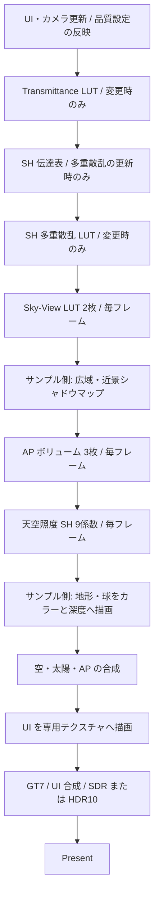

# Atmosphere compact のレンダリングと技術

この文書は、現在のコンパクト版が1フレームを描く順序と、その計算方法を説明する。実装を追う入口は [App::renderFrame](src/app/App.cpp) と [AtmosphereRenderer](src/atmosphere/AtmosphereRenderer.cpp)。ビルド・組み込み手順は [README](README.md)、比較検証の結果は [VALIDATION](VALIDATION.md) にまとめている。

## 1. 全体の考え方

画面の各ピクセルで大気の多重散乱を直接追跡すると計算量が大きい。本実装では、空間・方向に関して滑らかな量を低解像度の LUT（参照テーブル）へ積分しておき、画面解像度ではテーブルの参照と合成を行う。

構成の基本は Hillaire 2020 の Transmittance / Multi-scattering / Sky-View / Aerial Perspective。多重散乱は等方近似から **SH L2 + ground** へ拡張し、方向依存と地表との光の往復を扱う。太陽付近の細い光輪は Mie の位相関数を画面ピクセルで評価して保ち、地形による AP の影も画面ピクセルで求める。

| 対象 | 採用する処理 |
|---|---|
| 大気・エアロゾル | Hillaire2020 の Rayleigh / オゾン係数、C+A+B の Mie 係数と位相関数 |
| 多重散乱 | 局所的な光の場を L2 の SH で表し、地表反射を含む閉じた式で求める |
| 空 | 視点高度・太陽方向に応じた Sky-View LUT を参照 |
| 太陽ディスク | 画面ピクセルで視半径を判定し、透過率を掛けて加算 |
| 空気遠近法（AP） | 視錐台に沿う累積散乱ボリュームと、RGB 平均の透過率 |
| AP の影 | Per Pixel。日陰の区間の単散乱を累積値の差から除く |
| 地表の照明 | 太陽の直達光＋天空照度 SH。サンプルでは Lambert 反射 |
| 表示 | linear Rec.709 の露出済みシーンカラーを GT7 で変換し、SDR / HDR10 へ出力 |

大気側はシャドウマップ・地形・球・表示先ウィンドウを生成しない。これらはサンプル側が用意する。

## 2. 1フレームの処理順序

以下は `App::renderFrame()` の実行順を示す。GPU パスは同じ直接キューのコマンドリストに順番に記録する。



最初の Transmittance・SH 伝達表・多重散乱 LUT は、変更がないフレームでは生成を省略する。`updateLuts()` はこの3パスと Sky-View の生成をまとめて呼び出す。

AP と天空照度は、どちらも前段の大気 LUT を読むが、互いの出力は読まない。現在のサンプルでは図の順に実行している。Per Pixel 方式では AP ボリューム自体に地形の影を焼き込まず、後段の合成がシャドウマップを読む。

地表の描画を AP の生成より後に行えるのは、AP が深度バッファに依存しないため。AP は視錐台内の距離ごとの累積値を用意し、合成時に実際の地表までの距離で参照する。

## 3. 座標・単位・固定データ

### 座標と露出

ワールドは右手系・+Y 上、距離は m。大気の積分だけは惑星中心原点の km を使う。

```text
planetPositionKm = worldPositionM × 0.001 + (0, 6360, 0)
```

惑星半径は6360 km、大気上端は6460 km。ワールド原点は球面上にある。地形はワールドで描き、大気の地表は球として計算するため、両者の幾何は完全には一致しない。

カメラは Reverse-Z、無限遠ファー、深度クリア値0。`invViewProjRot` は `inverse(projection * rotationOnlyView)` で、平行移動を含まない。ピクセルを逆変換してカメラ相対の方向・距離を求めるため、巨大な惑星座標どうしの引き算を避けられる。

太陽方向は「点から太陽へ向かう」方向。太陽照度は大気上端で太陽に垂直な面の照度 `E_sun [lx]`、輝度は `L [cd/m²]`。大気 LUT の散乱量は、原則として太陽照度1 lx あたりの値として保持する。

```text
exposureScale = 1 / (1.2 × 2^EV100)
sceneFb       = luminance × exposureScale
```

シーンカラーは物理輝度そのものではなく、この露出済みの `sceneFb`。空・地表・AP は同じ露出規約で合成する。FP16 への書き込みでは RGB の上限を65000に抑える。

### 媒質と C+A+B

高度 `h [km]` における密度分布は次のとおり。

```text
ρ_R(h)  = exp(−h / 8)
ρ_M(h)  = exp(−h / 1.2)
ρ_O3(h) = max(0, 1 − |h − 25| / 15)

σ_t(h) = σ_R,s × ρ_R(h)
       + (σ_M,s + σ_M,a) × ρ_M(h)
       + σ_O3,a × ρ_O3(h)
```

`σ_s` は散乱、`σ_a` は吸収、`σ_t` は消散係数で、単位は km⁻¹。高度は負にならないようにクランプする。オゾンは吸収だけに寄与する。

Hillaire2020 の Rayleigh・オゾンは、680 / 550 / 440 nm の値を Rec.709 の R / G / B として扱う係数セット。エアロゾルは **C+A+B の係数で上書き**するため、係数セット内に残る旧来の灰色 Mie の値を使うわけではない。

C+A+B は細粒・粗粒を混ぜた光学特性を、同じ指数分布を持つ1成分として扱う。実行時に2成分を別々に積分しない。境界層の平坦な部分と自由大気の背景成分は含まれない。

AOD550 の基準は0.1。設定値に応じて Mie の散乱・吸収係数を同じ比率で変える。

```text
k       = AOD550 / 0.1
σ_M,s   = σ_M,s,preset × k
σ_M,a   = σ_M,a,preset × k
```

粒子の種類、鉛直分布、単散乱アルベド、位相関数の形は変えない。AOD は0.001〜1.0で設定でき、分子散乱やオゾン量を変えるパラメータではない。

固定係数と位相関数の元データは [hillaire_cab.json](data/hillaire_cab.json)。[generate_data.py](tools/generate_data.py) で `FixedData.h` を生成し、実行時はコンパイル済みの配列を使う。Mie の位相関数は2049点の RGB テーブルで、角度配置は `θ = πu²`。太陽に近い前方散乱のピークへサンプルを集めている。

## 4. GPU リソースと各パスの役割

通常の LUT と AP は RGBA16F、SH 伝達表だけは RGBA32F。比較検証ではコンストラクターで LUT / AP を RGBA32F にできる。

| リソース | 既定サイズ | 格納する値 | 主な消費先 |
|---|---|---|---|
| Transmittance | 256×64 | RGB：大気上端までの透過率、A：1 | 散乱積分、地表の直達光、太陽ディスク |
| SH 伝達表 | 17×32 | RGB：高度ごとの伝達行列の成分と地表への伝達量 | SH 多重散乱 LUT の生成 |
| SH 多重散乱アトラス | 192×32 | 32×32 のタイル6枚、RGB：光の場の SH 係数 | Sky-View・AP の積分 |
| Sky-View | 192×108 | RGB：Rayleigh 単散乱＋多重散乱、A：1 | 空の合成、天空照度 |
| Sky-View Mie | 192×108 | RGB：位相関数を除いた Mie 単散乱、A：1 | 空の合成、天空照度 |
| AP Rayleigh / T | 32×32×32 | RGB：累積 Rayleigh 単散乱、A：累積透過率の RGB 平均 | 地表への AP 合成 |
| AP Mie | 32×32×32 | RGB：位相関数を除いた累積 Mie 単散乱、A：1 | 地表への AP 合成 |
| AP multiple | 32×32×32 | RGB：累積多重散乱、A：1 | 地表への AP 合成 |
| Mie 位相関数 | 2049個の float4 | RGB：位相関数 p_M [sr⁻¹] | 単散乱の積分・合成 |
| 天空照度 SH | 9個の float4 | RGB：太陽照度1 lx あたりの余弦畳み込み済み SH | 地形・球の拡散照明 |

散乱輝度の LUT / AP は単位太陽照度あたりで sr⁻¹、位相関数を除いた Mie 積分は無次元。透過率も無次元。SH 多重散乱の係数は、入ってくる散乱光の輝度を単位太陽照度あたりで展開したもの。

このほか、サンプルがシーンカラー、深度、近景・広域のシャドウマップ、UI テクスチャ、スワップチェーンを所有する。

### 透過率と共通の光線積分

透過率は光路に沿う消散係数の積分から求める。

```text
τ = ∫ σ_t(x) dt
T = exp(−τ)
```

[TransmittanceLut.hlsl](shaders/atmosphere/TransmittanceLut.hlsl) は既定500区間の台形則でこれを計算する。LUT の軸は高度に対応する半径と光線の天頂角に対応する量で、地平線付近を細かく表せる非線形の割り付けを使う。生成・参照の両方でサブ UV 補正を行う。

散乱積分では、各点から太陽への透過率をこの LUT から引く。太陽方向の光線が惑星の球に当たる場合は、太陽光を0として惑星の影を表す。

共通処理の [AtmosphereIntegrate.hlsli](shaders/atmosphere/AtmosphereIntegrate.hlsli) は、光線と大気上端・地表の球との交差から積分範囲を決める。AP ではさらにボクセルまでの距離で打ち切る。区間内の媒質と光源が一定とみなせるときの解析積分を使う。

```text
segmentWeight = Δt × (1 − exp(−x)) / x
x             = σ_t × Δt
ΔL            = T_view × source × segmentWeight
```

`x` が小さい場合、`1 − exp(−x)` を直接引くと桁落ちするため、`OneMinusExpOverX()` がテイラー展開で評価する。球との交差でも、`r² − R²` を `(r − R)(r + R)` として求めるなど、地平線付近の浮動小数点精度を保つ計算を使う。

## 5. SH L2 + ground による多重散乱

### 光の方向依存を6係数で持つ

等方近似では、多重散乱を方向によらない RGB 値として持つ。本実装は、ある点に入ってくる散乱光の方向分布を L2、すなわち次数 `l ≤ 2` の球面調和関数で近似する。

局所座標の z 軸は天頂、x 軸は太陽の水平成分。太陽と天頂を含む面に関する鏡映対称性を使い、9係数のうち6係数を保持する。並びは `(l,m) = (0,0), (1,0), (1,1), (2,0), (2,1), (2,2)`。太陽が真上・真下の場合は、方位が定まらない項を抑える。

多重散乱 LUT の軸は高度と太陽天頂角の余弦。6係数を横並びのアトラスに置くため、タイルサイズ N に対して実際のテクスチャサイズは `6N × N` になる。

### 伝達表と係数を2段階で生成する

[MultiScatteringLut.hlsl](shaders/atmosphere/MultiScatteringLut.hlsl) の `CSTransfer` と `CSMain` は別のコンピュートパスとして実行する。

`CSTransfer` は、周囲から来た光がさらに散乱して同じ点へ寄与する割合を、伝達行列 F として求める。球対称の媒質ではこの伝達量は高度で決まり、太陽方向に依存しない。方位角の積分を解析的に済ませ、天頂角の1次元求積を行う。地平線で地表側・空側に分け、各64本、合計128本を積分する。

表の17列は、F の3×3ブロック9個、2×2ブロック4個、1×1ブロック1個、地表への伝達量 G の3個に対応する。1スレッドグループが高度1行を担当する。

`CSMain` は、太陽光が1回散乱した光と、直達光が地表で反射した光を方向積分し、最初の光の場 `c₁` を SH に射影する。方向は太陽を中心とする32環×32方位の格子。鏡映対称性により半分の512方向を計算する。1テクセルを128スレッドが担当し、各スレッドが4方向を積分する。集計には `WaveActiveSum` を使う。

### 地表との往復を閉じる

以後の散乱では、近傍にも同じ光の場があると仮定する。媒質の伝達に地表反射の項を加えた行列を B とすると、光の往復を次の式でまとめる。

```text
B = F + (groundAlbedo / π) × G ⊗ e
c = c₁ + Bc₁ + B²c₁ + … = (I − B)⁻¹ c₁
```

`e` は地表へ入る光の余弦積分に対応する固定ベクトル。行列は SH の方位次数ごとに3×3、2×2、1×1に分けて解く。行列式が小さすぎる場合は、対角成分だけを使う閉じ方へ切り替える。

描画側は係数 `c` を参照し、Rayleigh と Mie の位相関数で方向ごとに畳み込んだ光源項を積分する。Mie の畳み込みには、固定テーブルから事前生成した Legendre モーメント `χ₀, χ₁, χ₂` を使う。

ここで求める6係数は、後述の地表照明用9係数とは別物。局所座標・係数の順序・用途が異なるため、同じバッファとして扱わない。

## 6. 空・太陽・天空照度

### Sky-View LUT

[SkyViewLut.hlsl](shaders/atmosphere/SkyViewLut.hlsl) は、カメラ高度と太陽天頂角に応じた空を毎フレーム生成する。軸は視線の天頂角と、視線・太陽の方位差に対応する。地平線を中心に非線形配置し、明るさが急変する領域へ解像度を割り当てる。

光線の積分は既定30区間、区間端を2次配置して原点側を細かくする。出力を次の2枚に分ける。

```text
Sky-View     = Rayleigh 単散乱 + 多重散乱
Sky-View Mie = ∫ T_view × σ_M,s × T_sun dt
```

空を描くときは、正確な画面方向で Mie の位相関数を掛け直す。

```text
L_sky_per_lux = Sky-View + p_M(dot(viewDir, sunDir)) × Sky-View Mie
```

Mie の鋭い前方散乱を低解像度 LUT に焼き込むと、太陽付近の光輪がぼけたり形が崩れたりする。この分離によって、位相関数のピークを画面解像度で評価できる。

### 太陽ディスク

太陽ディスクは Sky-View LUT に含めず、合成時に解析的に加える。視線と太陽方向の内積が `cos(sunAngularRadiusRad)` 以上ならディスク内と判定する。

```text
Ω_sun          = 2π × (1 − cos(angularRadius))
L_disk_per_lux = T_view_to_top / Ω_sun
```

惑星の球に遮られる方向は描かない。固定照度で視半径を大きくすると、ディスクの面積が増える分、単位面積の輝度は下がる。地形・球による遮蔽は、深度のあるピクセルを地表の合成へ分岐することで表す。

この視半径は描画するディスクのサイズであり、大気への太陽光は点光源として積分する。サイズを変えても光輪との有限角度の畳み込みや、影の半影幅は変わらない。

### 天空照度 SH

[SkyIrradiance.hlsl](shaders/atmosphere/SkyIrradiance.hlsl) は、Sky-View の光を全方向に積分し、ワールド座標の実 SH 9係数へ射影する。Rayleigh＋多重散乱は地平線付近を細かくした128方位×64仰角、Mie は太陽中心の128極角×16方位で求積する。

輝度の SH 係数に、次数ごとの余弦畳み込み係数 `π, 2π/3, π/4` を掛ける。地表の法線ごとにこれを評価すると、面の向きに応じた空からの拡散照度が得られる。負になった照度は0に抑える。

天空照度の生成には太陽ディスクを加えない。太陽の直達光は地表シェーダーが別に計算するため、ここへ含めると二重計上になる。現在の天空照度はカメラ位置で求めた場を全物体に使い、物体ごとの天空遮蔽は含まない。

## 7. 空気遠近法と Per Pixel の影

### 視錐台に沿う累積ボリューム

[AerialPerspective.hlsl](shaders/atmosphere/AerialPerspective.hlsl) は、画面 UV と距離に対応する N³ のボリュームを生成する。各ボクセルはその場所の局所的な明るさではなく、**カメラからその点までに積み重なった散乱と減衰**を持つ。

距離方向の配置は次のとおり。

```text
d(z)  = 128 km × ((z + 0.5) / N)²
steps = max(1, floor((z + 1) × apMaxSteps / N))
```

N を16 / 32 / 64に変えても公称の範囲は128 km。格納位置はボクセル中心なので、最後の中心は128 km より手前になる。既定 N=32 の最後の中心は約124.03 km。ボリューム範囲外はクランプされた値を参照する。

既定の最大積分数64、N=32では、スライスごとの積分数が従来の `(z + 1) × 2` になる。各光線上は等間隔で積分する。ボクセルの終点が惑星の地表より下に入った場合は、地表の少し上へ移して積分方向・距離を補正する。

地表までの距離 d で参照するときは `w = sqrt(d / 128 km)` に対応する逆写像を使う。実装では近距離で参照座標を下限に抑え、内散乱と不透明度にフェードを掛ける。

```text
s    = d / (128 km / N)
fade = s < 0.5 ? saturate(2s) : 1
L    = fade × L_sample
T    = 1 − fade × (1 − T_sample)
```

RGB の透過率は積分中に計算するが、保存するのは `mean(T_rgb)` だけ。同じ係数を地表の R / G / B に掛けるため、遠景の波長別の減衰には近似誤差が残る。太陽方向の Transmittance LUT は引き続き RGB であり、この平均化は AP の地表色への乗算に限られる。

### 影の区間だけ単散乱を除く

AP ボリュームは地形の影を含めずに作る。画面解像度の [SkyFromLut.hlsl](shaders/atmosphere/SkyFromLut.hlsl) が、地表までの視線上に並べた点で太陽の可視性を調べる。探索点は既定32点で、カメラ側へ寄せる2次配置を使う。

日なた・日陰が切り替わる隣接点を見つけたら、既定6回の二分探索で境界を詰める。カメラから距離 t までの累積単散乱を F(t) とすると、区間 [a,b] の寄与は `F(b) − F(a)` で取り出せる。

```text
L_single_shadowed = F(d) − Σ_shadowed_segments (F(b) − F(a))
```

コードは同じ関係を使って、日なたの区間の差分を足し合わせる。Rayleigh と位相関数なし Mie を別々に処理し、Mie の位相関数は最後に画面方向で掛ける。補間によって僅かに負になる単散乱は0にクランプする。多重散乱と透過率はこの差し引きの対象にしない。

影の細かさを低解像度ボリュームへ焼き込まず、画面解像度とシャドウマップで決められる点が利点。一方、探索点の間に収まる細い日陰を見落とすことはあり、探索点数と二分探索回数には品質とコストの交換関係がある。

### サンプルのシャドウマップ

サンプルは広域4096²と近景2048²の2枚を生成する。広域は全物体を囲み、太陽方向または Terrain / Spheres の表示状態が変わったときに描き直す。近景はカメラの視錐台の近距離を囲み、毎フレーム更新する。光源空間の位置をテクセル単位へスナップし、カメラ移動によるちらつきを抑える。

深度は光源に近いほど大きい Reverse-Z。AP は、点が近景の UV・深度範囲の内側にあるときだけ近景を使い、それ以外は広域を使う。影テクスチャの選択はスレッドごとに異なりうるため、Bindless の参照に `NonUniformResourceIndex` を付ける。

AP の判定は比較サンプラーの結果を0.5で二値化する。地表の直接光には別途 PCF とカスケード境界のブレンドを使う。どちらもシャドウマップ範囲外は日なたとして扱う。

Terrain / Spheres を非表示にすると通常描画と影の描画の両方から除外する。ただしシャドウマップの範囲は、安定した非空の領域を保つため全物体の配置から決める。地形の影を描くときは側面にスカートを付け、地形の下から光が漏れるのを抑える。

## 8. 地表・空・AP の合成と表示

### 地表の照明

サンプルの [Mesh.hlsl](shaders/scene/Mesh.hlsl) は、地表の各シェーディング点で太陽方向の透過率を参照する。太陽の直達光と天空照度を足し、材質のアルベドで Lambert 反射を求める。

```text
E_per_lux(n) = T_sun × max(dot(n, sunDir), 0) × surfaceVisibility
             + skyIrradiancePerLux(n)

L_surface  = materialAlbedo / π × E_per_lux(n) × solarRgbLux
surfaceFb = L_surface × exposureScale
```

`Planet ground albedo` は多重散乱の地表反射モデル、`Terrain material albedo` はこの地形材質の値。片方を変えてももう片方は自動変更しない。Terrain を非表示にしても、惑星の球や大気モデルの地表アルベドは残る。

### 深度による分岐

合成パスは深度0を空、それ以外を地表・球のピクセルとみなす。深度から距離を求めるときは、逆行列でカメラ相対の位置を復元し、その長さを使う。単に視線軸方向の深度を距離とするわけではない。

```text
空:
    outputFb = (L_sky_per_lux + L_disk_per_lux)
             × solarRgbLux × exposureScale

地表・球:
    L_ap_per_lux = L_R_shadowed + p_M(cosθ) × L_M_no_phase_shadowed + L_multiple
    outputFb    = surfaceFb × mean(T_rgb)
                + L_ap_per_lux × solarRgbLux × exposureScale
```

露出は地表の描画と大気の加算項にそれぞれ1回だけ適用する。透過率には掛けない。両方の物体を非表示にすると深度が全面0となり、空の合成だけが行われる。

### GT7 と出力形式

表示は [Display.hlsl](shaders/display/Display.hlsl) が担当する。露出済み linear Rec.709 を Rec.2020 へ変換し、GT7 の ICtCp ベースのトーンマッピングを適用する。

SDR は Rec.709 へ戻してクリップ・sRGB エンコードを行い、8bit 量子化の前にディザを加える。HDR10 は GT7 の出力を表示輝度 nit に変換し、Rec.2020 / PQ で10bit出力する。出力先の HDR 状態とピーク輝度への追従はサンプル側の処理。

UI は別のテクスチャへ描く。HDR10 では指定した UI 白輝度で線形空間へ合成し、SDR では ImGui の想定に合わせて sRGB 値で合成する。UI の白はシーンの EV100 によって暗くならない。

## 9. 更新条件・GPU の接続・品質調整

### 変更時に何を作り直すか

| 変更 | Transmittance | SH 伝達表・多重散乱 | Sky-View / AP / 天空照度 |
|---|---|---|---|
| 初回 | 生成 | 生成 | 生成 |
| AOD | 再生成 | 再生成 | 毎フレーム更新 |
| 地表アルベド | 維持 | 再生成 | 毎フレーム更新 |
| Transmittance のサイズ・積分数 | 再生成 | 再生成 | 毎フレーム更新 |
| 多重散乱のサイズ・積分数 | 維持 | 再生成 | 毎フレーム更新 |
| Sky-View / AP のサイズ・積分数 | 維持 | 維持 | 毎フレーム更新 |
| 太陽方向・カメラ | 維持 | 維持 | 毎フレーム更新 |
| 太陽照度・ディスクサイズ・露出 | 維持 | 維持 | 現実装では毎フレーム更新。照度・露出の乗算は後段 |
| Per Pixel の探索数・二分探索数 | 維持 | 維持 | LUT 更新条件は同じ。影の合成時に新しい値を使用 |
| Terrain / Spheres の表示 | 維持 | 維持 | 大気の更新条件は同じ。サンプルの影マップを更新 |

地表材質のアルベド変更は、地表のシェーディングだけに反映する。SH 伝達表に含まれる媒質の伝達量は本来地表アルベドに依存しないが、現在は多重散乱の更新時に表もまとめて再生成している。

### GPU との境界

HLSL SM 6.6 の `ResourceDescriptorHeap[index]` でテクスチャ・構造化バッファを参照する。パス定数はルート CBV に渡し、線形クランプ・ポイント・影比較のサンプラーを使う。C++ の定数バッファ配置は `static_assert` で HLSL の `packoffset` と照合する。

内部リソースは、生成前に UAV、生成後にシェーダー読み取り状態へ遷移する。多重散乱では伝達表を書き終えてから読み取りへ遷移し、係数の生成を実行する。所有する状態遷移は大気側が記録する。

呼び出し側は外部の深度・影マップを読み取り可能な状態にし、合成先を UAV 状態にする。地表色への AP は同じピクセルを読み書きするインプレース合成で、各ピクセルは1スレッドが担当する。

LUT サイズは UI の Apply quality で反映し、`setQuality()` をフレーム記録前に呼ぶ。サイズが変わる場合は GPU 完了を待ち、サイズが異なるリソースだけを再生成する。再生成後は SRV インデックスが変わりうるため、呼び出し側も参照を取り直す。

### 品質とコストの見方

| 調整項目 | 主な効果・コスト |
|---|---|
| Transmittance 積分数 | 地平線付近などの透過率精度。媒質変更時の負荷に影響 |
| 多重散乱積分数・タイルサイズ | 光の場の積分・補間精度。AOD や地表アルベド変更時の負荷に影響 |
| Sky-View のサイズ・積分数 | 空の補間・光路積分の精度。毎フレームの負荷に影響 |
| AP サイズ | 画面方向・距離方向の補間精度。メモリと毎フレームの負荷に影響 |
| AP 最遠スライスの積分数 | 距離に応じた積分精度。毎フレームの負荷に影響 |
| Per Pixel の探索数 | 細い影を見つける能力。地表の画素数に応じた負荷に影響 |
| 二分探索回数 | 見つかった影の境界の精度。見落とした影自体は復元できない |

多重散乱の方向格子や天空照度の求積方向数は固定で、UI の「積分数」は主に光線上の区間数を変える。

この実装が近似しているものには、RGB 3チャンネルでの大気、近傍で同じ光の場を仮定した多重散乱、L2 の方向近似、AP の RGB 平均透過率、低解像度ボリュームの補間がある。空の背景の光芒、雲、局所的なフォグ、物体による天空遮蔽、宇宙視点への対応は含めていない。既存版との一致と、大気モデル自体の物理精度は区別して評価する必要がある。
