# 大気散乱 検証アプリ 設計書

- 作成日: 2026-10-15
- 前提文書: [research.md](research.md)
- 状態: 確定（§12）。Phase 1 から実装

---

## 1. 決定事項

| # | 項目 | 決定 | 理由 |
|---|---|---|---|
| D1 | 単位系 | **物理単位**（SI + 測光量）。光は lx / cd·m⁻²、距離は m（大気内部計算のみ km） | ユーザー指定。Shoga 統合時にライト・露出・IBL と一貫させるため |
| D2 | アプリ形態 | **単独の D3D12 アプリ**（Shoga の RHI/RenderGraph は使わない） | ユーザー指定。大気モジュールだけは Shoga へ移植しやすい境界で切る（§9） |
| D3 | 大気手法 | Hillaire 2020（Transmittance / Multi-scattering / Sky-View / Aerial Perspective の 4 LUT） | research.md §2 |
| D4 | 比較用リファレンス | アプリ内 GPU 総当たりレイマーチ（LUT なし）と GPU パストレーサー + Python による倍精度数値積分 | LUT による誤差と多重散乱近似の誤差を分けて測るため |
| D5 | トーンマップ | **GT7 Tone Mapping**（Polyphony Digital 公開サンプル、MIT。ICtCp UCS・既定パラメータ） | ユーザー指定 |
| D6 | 出力 | **SDR**（8bit sRGB）と **HDR10**（10bit PQ / Rec.2020）。表示先ディスプレイの状態から自動選択し、手動切替も可能 | ユーザー指定 |
| D7 | ディスプレイ輝度変化への追従 | 出力先ディスプレイの変化（移動 / OS の HDR 切替 / 設定変更）を検出し、GT7 カーブのピーク輝度とスワップチェーン形式を再構成する。ピークはユーザーが上書きできる | ユーザー指定。OS 報告値（`MaxLuminance`）は信頼できない場合がある |
| D8 | 露出 | 手動 EV100。`fb = L · 1/(1.2·2^EV100)`（GraphicsTest/HDR テストベッドと同一の規約） | プロジェクト間で数値を比較できるようにするため |
| D9 | 作業色空間 | **linear Rec.709 / linear Rec.2020 を実行時に切替可能**（既定 Rec.709）。散乱係数は色空間ごとに分光データから導出したセットを使う（§2.6） | Rec.709 は Hillaire の係数で参照実装と直接比較するため。Rec.2020 は GT7 の入力色空間と一致し、広色域での空の色を検証するため |
| D10 | 座標系 | 右手系、+Y 上、ワールド単位 m。深度は **Reverse-Z + 無限遠ファープレーン**（D32_FLOAT） | 数十 km の遠景で深度精度を確保するため |
| D11 | シェーダー | HLSL SM 6.6、DXC でビルド時にコンパイル。**Bindless**（`ResourceDescriptorHeap[]`） | Shoga の Bindless 前提と揃えるため |
| D12 | 言語 / ビルド | C++20、CMake + vcpkg マニフェスト、改行 LF | GraphicsTest の既存プロジェクトと揃えるため |
| D13 | 要所のコメント | `// [POINT]` マーカーで「何を・なぜ・単位」を書く（§10） | ユーザー指定 |
| D14 | 太陽照度の既定値 | **ASTM G-173 の大気圏外スペクトルから計算した値（133,121 lx）**。`data/atmosphere_coefficients.json` の `solar_illuminance_lux_from_spectrum` を読み、コードには書かない（2026-10-15 変更、旧既定値は出典未確認の概数 128,000 lx） | (1) 太陽の色（`SpectralFit*` の sunColor）と同じスペクトルから求め、色と明るさの出どころを 1 つにする。(2) V9 で分光リファレンス（スペクトルの絶対値で計算）と輝度を比べるとき、照度の不一致による一律の差（旧値では 4%）が色空間の誤差に混ざらないようにする。(3) 出典を辿れる値にする。128,000 lx は設計時に置いた概数で、出典を確認していなかった |

---

## 2. 単位系

### 2.1 物理量と単位

| 量 | 記号 | 単位 | 備考 |
|---|---|---|---|
| ワールド座標・カメラ位置・オブジェクト寸法 | x | **m** | API・シーン・頂点はすべて m |
| 大気計算内部の距離・高度・惑星半径 | r, h, t | **km** | シェーダー内の大気関数のみ。m→km の変換は 1 箇所（`AtmosphereConstants` 構築時）で行う |
| 散乱・吸収・消散係数 | σs, σa, σt | **km⁻¹** | 例: Rayleigh σs = (5.802, 13.558, 33.1)×10⁻³ km⁻¹ |
| スケールハイト | H | km | Rayleigh 8 km、Mie 1.2 km |
| 光学的厚さ / 透過率 | τ / T | 無次元 | T = exp(-τ) |
| 位相関数 | p | **sr⁻¹** | ∫p dω = 1 |
| 太陽照度（大気上端、太陽方向に垂直な面） | E_sun | **lx**（= lm·m⁻²） | 既定 133,121 lx（ASTM G-173 から計算、D14）。UI で変更可 |
| 輝度（空・地表・画面上の値） | L | **cd·m⁻²**（= nit） | RGB の各値は「Y が輝度になる RGB」（Rec.709 の Y 係数で cd/m²） |
| 単位照度あたり輝度（LUT の格納値） | L/E | **sr⁻¹**（= cd·m⁻²/lx） | §2.3 参照 |
| 地表アルベド | ρ | 無次元 | ランバート: L = ρ/π · E |
| 太陽視半径 | α_sun | rad | 既定 0.004675 rad（参照実装と同値） |
| 露出 | EV100 | EV（ISO 100 基準） | 晴天日中 ≈ 15 |
| GT フレームバッファ値 | fb | 無次元（**1.0 = 100 cd/m² の表示輝度**） | GT7 サンプルの規約（`REFERENCE_LUMINANCE = 100`） |
| ディスプレイ輝度 | — | nit | SDR は GT7 規約でペーパーホワイト 250 nit を想定 |

注: RGB の 3 値は「作業色空間の RGB」。Hillaire の既定係数は波長 680 / 550 / 440 nm でサンプルした値を Rec.709 の RGB として扱う近似で、厳密な分光計算ではない（§2.6）。

### 2.2 変換式（実装のすべての単位変換はこの表のどれかに当たる）

```
x_km        = x_m · 0.001
P_planet_km = x_world_m · 0.001 + (0, R_ground_km + h0_km, 0)      // ワールド原点は惑星表面 +h0 の真上（北極点）
L_sky       = LUT(L/E)[sr⁻¹] · E_sun[lx]                           → cd/m²
L_sun_disk  = E_sun / Ω_sun · T(view→TOA),  Ω_sun = 2π(1 − cos α_sun) ≈ 6.87×10⁻⁵ sr
              → 約 1.94×10⁹ cd/m²（大気上端、E_sun = 133,121 lx）
E_sun       = 683 lm/W × Σ_λ E_e,λ(λ)·ȳ(λ)·Δλ   （λ = 360〜830 nm、Δλ = 1 nm、D14）
              E_e,λ: ASTM G-173 ETR の 10 nm 区間平均 [W·m⁻²·nm⁻¹]（区間内で一定として扱う）、ȳ: CIE 1931 2°
L_ground    = ρ/π · (E_sun · T_sun · max(N·L, 0) + E_sky)           → cd/m²
k_exposure  = 1 / (1.2 · 2^EV100)                                    [1/(cd/m²)]
fb          = L · k_exposure                                         （シーンバッファの格納値、§2.4）
display_nit = GT7(fb) · 100                                          （HDR。SDR は GT7 側で [0,1] に正規化）
```

露出の目安（D8 の規約による）:
- EV100 = 15 では L_sat = 1.2·2¹⁵ ≈ 39,300 cd/m² が fb 1.0（= 100 nit 表示）になる。
- 反射式露出計（K = 12.5）で測った平均輝度 L_avg = 0.125·2^EV100 は fb ≈ 0.104 になる。暗すぎる場合は露出補正（EV バイアス）で調整する。この規約の見直しは §12 Q5。

### 2.3 LUT は「単位照度あたり」で持つ

Sky-View LUT と Aerial Perspective の内散乱は **E_sun = 1 lx として計算**する（格納値の単位 sr⁻¹）。合成時に E_sun と k_exposure を掛ける。

- FP16 LUT の値域に収まる（日中の天空で 10⁻²〜10⁰ 程度。太陽周辺の Mie ピークも 65504 を大きく下回る）。
- LUT が露出にも太陽照度にも依存しないので、露出を変えても LUT の再計算が不要になる。
- 制約: 単一光源（太陽）前提。月などを追加する場合は光源ごとの LUT か、照度込みの格納に変える（範囲外）。

### 2.4 シーンバッファとプリエクスポージャ

- シーンカラー RT（R16G16B16A16_FLOAT）には **露出済みの fb 値** を書く。物理輝度（太陽ディスクは 10⁹ cd/m²）をそのまま書くと FP16 の上限 65504 を超えるため。
- 手動露出なので、プリエクスポージャ = 当該フレームの露出（ディスプレイ段での再スケールは 1.0）。将来自動露出を入れる場合は「前フレームの露出でプリエクスポーズし、ディスプレイ段で `exposure / preExposure` を掛ける」一般形にする。
- 太陽ディスクは露出後も FP16 上限を超えうる（大気上端の値で EV100 < 約 14.6 で超える）。書き込み前に `min(fb, 65000)` で**明示的にクランプ**する（inf/NaN の伝播を防ぐ）。

### 2.5 命名規約（単位をコードで読めるようにする）

| 接尾辞 | 単位 | 例 |
|---|---|---|
| `M` | m | `cameraPosM`, `terrainSizeM` |
| `Km` | km | `bottomRadiusKm`, `viewHeightKm` |
| `PerKm` | km⁻¹ | `rayleighScatteringPerKm` |
| `Lux` | lx | `sunIlluminanceLux` |
| `Nits` | cd/m² | `skyLuminanceNits`, `displayPeakNits` |
| `PerLux` | sr⁻¹（cd/m²/lx） | `skyViewLutPerLux` |
| `Fb` | GT fb（1 = 100 nit） | `sceneColorFb` |
| `Ev100` | EV | `exposureEv100` |
| `Rad` / `Deg` | 角度 | `sunZenithRad`（UI は Deg） |

C++ 側は型エイリアスではなく接尾辞で表す（型を増やさない）。Python・ダンプのメタデータでも同じ名前を使う。

### 2.6 作業色空間の切替（Rec.709 / Rec.2020）

**散乱係数は 3×3 行列では変換できない。** 透過率 `exp(-σ·t)` は σ について非線形で、係数は色ではなく波長ごとの物理量なので、色の変換行列を掛けても正しくならない。色空間ごとに分光データから係数セットを導出する。

係数セット（`reference/derive_coefficients.py` で生成し、`data/atmosphere_coefficients.json` に出力してコミットする）:

| セット名 | 作業色空間 | Rayleigh / オゾン係数 | 太陽の色 | 用途 |
|---|---|---|---|---|
| `Hillaire2020` | Rec.709 | 論文値（680/550/440 nm のサンプル） | 白（D65、Y = 1） | 論文・参照実装との比較（V3/V4） |
| `SpectralFit709` | Rec.709 | 分光フィット（下記） | 大気上端の太陽スペクトル → RGB（Y = 1） | 色空間比較 |
| `SpectralFit2020` | Rec.2020 | 分光フィット（下記） | 同上 | 色空間比較 |

- 分光データ: Rayleigh は `σ(λ) = 1.24062×10⁻⁶ m⁻¹ · (λ/1µm)⁻⁴`、オゾン吸収断面積と大気上端の太陽分光放射照度は Bruneton 2017 実装（BSD-3、出典を明記）の表、等色関数は CIE 1931 2°（colour-science）。Mie は波長に依存しない（灰色）ので全セットで共通値（プリセット `base`）。エアロゾルのプリセット（§5.9、Phase 4.8〜）では、Mie も Mie 理論から分光フィットする。
- 10 nm 表の扱い: 表の値は区間 [λ, λ+10) nm の平均なので、区間内で一定の階段関数として 1 nm 刻みで評価する。Bruneton の実装のように「区間先頭 λ のサンプル」として線形補間すると、スペクトルが実質 5 nm 短波長側にずれる（太陽照度で 0.4%）。
- フィット方法: 作業色空間の各チャンネル c について、太陽スペクトルを光学的距離 d だけ通したときの分光透過光を RGB に射影し、`T_c(d) = exp(-σ_c·d)` が最小二乗（log 空間、d は天頂〜地平線方向の範囲）で一致する σ_c を求める。σ_c は 0 以上に制限する（負の吸収は光の増幅になり物理的に不正）。Rec.709 の B 等色関数は負の部分がオゾンの吸収帯にかかり、制限しないと B のオゾン係数が −2×10⁻⁵ km⁻¹ になる。
- 参考: Rec.2020 の原色はスペクトル軌跡上の単色光（630 / 532 / 467 nm）なので、「原色波長でのサンプル値」がフィット値に近くなる見込み。Rec.709 の原色は単色光ではない。この差を V9 で測る。
- 作業色空間に依存するもの（切替時にすべて更新し、大気 LUT は dirty にする）:

| 対象 | Rec.709 | Rec.2020 |
|---|---|---|
| 大気係数・太陽の色 | 上表のセット | 上表のセット |
| 輝度の重み（Y、nit 表示、AP の平均） | (0.2126, 0.7152, 0.0722) | (0.2627, 0.6780, 0.0593) |
| 作業 → Rec.2020（GT7 入力） | BT.2087 の 3×3 行列 | 単位行列 |
| アルベド | 灰色のみ使うため共通。色付きアルベドを UI で入力する場合は Rec.709 で入力して変換 | |

- SDR 出力時は GT7 の出力（Rec.2020）を Rec.709 にクリップするため、Rec.2020 作業時の高彩度（夕焼け等）は SDR ではクリップされる。これは表示側の制約で、作業色空間の欠陥ではない。
- サイドカー JSON には作業色空間と係数セット名を必ず記録する。

---

## 3. 全体構成

```
Atmosphere/
├─ docs/                     research.md, design.md
├─ CMakeLists.txt / CMakePresets.json / vcpkg.json
├─ src/
│  ├─ main.cpp               起動引数（対話 / バッチ）
│  ├─ app/                   Window（Win32）, App（フレームループ, 入力, カメラ）
│  ├─ gfx/                   D3D12 の薄い層（Shoga へは移植しない）
│  │  ├─ Device              デバイス, キュー, フェンス, フレーム同時実行数 2
│  │  ├─ BindlessHeap        シェーダー可視 CBV/SRV/UAV ヒープ + インデックス割当
│  │  ├─ Resources           Texture / Buffer 生成, アップロード, 状態遷移
│  │  ├─ Shaders             DXIL の読み込み, ルートシグネチャ（Bindless 用 1 つ）, PSO
│  │  ├─ GpuTimer            タイムスタンプクエリ（パス別 ms）
│  │  └─ Readback            RT → CPU（バッチダンプ用）
│  ├─ display/               出力（§7）
│  │  ├─ DisplayMonitor      出力先ディスプレイの検出・変化通知
│  │  ├─ Swapchain           SDR / HDR10 の作成・再作成, ColorSpace, HDR メタデータ
│  │  └─ DisplayPass         GT7 → エンコード → UI 合成
│  ├─ atmosphere/            ★ Shoga へ移植する単位（§9）
│  │  ├─ AtmosphereParams    物理パラメータ（単位付き）, 地球プリセット
│  │  ├─ AtmosphereConstants GPU 定数への変換（m→km 変換はここだけ）
│  │  └─ AtmosphereRenderer  LUT 4 種の生成 + 空/空気遠近法の合成 + リファレンス描画
│  ├─ scene/                 Terrain（手続き生成）, TestObjects（球）, Camera, Sun
│  ├─ render/                SceneRenderer（地形のフォワード描画）, Exposure
│  ├─ ui/                    ImGui（パラメータ, 計測値, 単位表示, ピクセルピッカー）
│  └─ batch/                 シナリオ実行 → ダンプ（§8）
├─ shaders/
│  ├─ common/                Units.hlsli, Bindless.hlsli, ColorSpace.hlsli, Noise.hlsli
│  ├─ atmosphere/            AtmosphereCommon.hlsli（媒質, 交差, LUT パラメタ化）, Phase.hlsli,
│  │                         TransmittanceLut.cs, MultiScatteringLut.cs, SkyViewLut.cs,
│  │                         AerialPerspective.cs, SkyComposite.ps, ReferenceRaymarch.cs, PathTrace.cs
│  ├─ scene/                 Terrain.vs/ps, Object.vs/ps
│  └─ display/               GT7ToneMap.hlsli, PQ.hlsli, SRGB.hlsli, Display.ps, UIComposite
├─ data/                     atmosphere_coefficients.json（Python 生成・コミット）, scenarios/*.json
└─ reference/                Python（numpy, colour-science）: atmosphere_ref.py, derive_coefficients.py,
                             gt7_tone_mapping.py, compare.py, tests/
```

---

## 4. フレームの流れ

```
CPU: 入力・UI → パラメータ更新 → 変更検出（大気パラメータ変更なら LUT dirty）
     DisplayMonitor をポーリング → 変化があればスワップチェーン / GT7 定数を再構成

[Graphics] 0. ShadowMap           … 太陽のシャドウマップ（§5.5）。近景: 毎フレーム、全体: 太陽の向きの変更時
[Compute] 1. TransmittanceLut      … 大気パラメータ変更時のみ
[Compute] 2. MultiScatteringLut    … 大気パラメータ変更時のみ（1 に依存）
[Compute] 3. SkyViewLut            … 毎フレーム（カメラ高度・太陽方向に依存）
[Compute] 4. AerialPerspective     … 毎フレーム（カメラ・太陽に依存）。単散乱に全体のシャドウマップを掛ける
[Graphics] 5. Scene                … 地形・球を SceneColor(fb) / Depth に描画
                                      太陽光は「シェーディング点での透過率」で減衰（per-pixel）× シャドウマップ
[Graphics] 6. SkyComposite         … 深度 = 0（Reverse-Z の無限遠）: Sky-View LUT + 太陽ディスク
                                      それ以外: color·T_ap + inscatter_ap
[Graphics] 7. Display              … fb → Rec.2020 → GT7 → (PQ | sRGB+ディザ) → バックバッファ
[Graphics] 8. UI                   … ImGui を UI テクスチャへ → Display 内で合成
```

リファレンスモード（UI で切替）では 1–4 と 6 の代わりに:
- **Raymarch**: ピクセルごとに LUT を使わず多数ステップで積分（同じ多重散乱近似。LUT 化による誤差だけを見る）
- **PathTrace**: デルタトラッキングで多重散乱を厳密に計算し、フレーム間で累積（近似そのものの誤差を見る）

さらに差分表示（相対誤差のヒートマップ / EV 差）で A/B 比較する。

---

## 5. 大気モジュール詳細

### 5.1 パラメータ（`AtmosphereParams`、既定値 = 地球）

| パラメータ | 既定値 | 単位 |
|---|---|---|
| bottomRadiusKm / topRadiusKm | 6360 / 6460 | km |
| rayleighScatteringPerKm | (5.802, 13.558, 33.1)×10⁻³ | km⁻¹ |
| rayleighScaleHeightKm | 8.0 | km |
| mieScatteringPerKm / mieAbsorptionPerKm | 3.996×10⁻³ / 0.444×10⁻³ | km⁻¹ |
| mieScaleHeightKm / miePhaseG | 1.2 / 0.8 | km / — |
| ozoneAbsorptionPerKm | (0.650, 1.881, 0.085)×10⁻³ | km⁻¹ |
| ozoneCenterKm / ozoneHalfWidthKm | 25 / 15 | km |
| groundAlbedo | 0.3 | — |
| sunIlluminanceLux / sunAngularRadiusRad | 133,121（JSON から読む、D14）/ 0.004675 | lx / rad |
| sunZenithDeg / sunAzimuthDeg | UI | deg |
| originAltitudeM (h0) | 0 | m |

Mie 吸収は参照実装の値（消散 4.44、散乱 3.996）を正とする（research.md §3.1）。

### 5.2 LUT 仕様

| LUT | 形式 | 既定サイズ | 格納値（単位） | パラメタ化 | 更新 |
|---|---|---|---|---|---|
| Transmittance | RGBA16F（RGB 使用） | 256×64 | T（無次元） | Bruneton 2017: u = 地平線までの距離比、v = 高度（地平線付近に集中） | 大気変更時 |
| MultiScattering | RGBA16F | 32×32 | Ψ_ms（sr⁻¹、単位照度あたり） | u = cos(太陽天頂角)、v = 高度 | 大気変更時 |
| SkyView | RGBA16F | 192×108 | L/E（sr⁻¹）: Rayleigh の単散乱 + 多重散乱（Mie の単散乱は含まない） | u = 太陽との相対方位、v = 緯度（`sqrt` で地平線に集中） | 毎フレーム |
| SkyViewMie | RGBA16F | 192×108 | ∫ T_view·σs_M·T_sun dt（無次元）: Mie の単散乱から位相関数を除いたもの。描画時にピクセルごとの p_M(θ) [sr⁻¹] を掛ける | SkyView と同じ | 毎フレーム |
| AerialPerspective | RGBA16F 3D | 32×32×32 | RGB = Rayleigh の単散乱 + 多重散乱の内散乱 L/E（sr⁻¹）、A = 透過率の RGB 平均 | 画面 UV × 深度（2 次配置、最大 128 km。参照実装と同じ、§12 Q10） | 毎フレーム |
| AerialPerspectiveMie | RGBA16F 3D | 32×32×32 | Mie の単散乱から位相関数を除いた内散乱（無次元）。描画時にピクセルごとの p_M(θ) を掛ける（§12 Q9） | AerialPerspective と同じ | 毎フレーム |
| AerialPerspectiveTransmittance | RGBA16F 3D | 32×32×32 | RGB = カメラからの透過率（無次元）。§5.7 の方式 2 で使う | AerialPerspective と同じ | 毎フレーム |

- ステップ数（論文 PC 値）: Transmittance 40、MultiScattering 20（64 方向）、SkyView 30、AP 30。UI で変更でき、誤差-コスト曲線を測る。Transmittance は Phase 2 の検証結果により既定 500（§14）。MultiScattering はエアロゾルのプリセット（§5.9）の検証結果により既定 40 区間・2 次配置（2026-10-18、§12 Q8、§14 Phase 4.8）。
- 視線方向の積分（MultiScattering・SkyView・リファレンスのレイマーチで共通、`AtmosphereIntegrate.hlsli`）は、区間内を Hillaire の解析積分 S·dt·(1 − e^(−x))/x（x = σt·dt）で足す。(1 − e^(−x))/x は x < 10⁻² でテイラー展開にする（Phase 3 の検証で導入、§14）。
- 光線上のサンプル配置（区間端、`IntegrationSettings::uniformSteps`）。区間数は固定、サンプルは区間の中点:

  | パス | 配置 | 理由 |
  |---|---|---|
  | Sky-View LUT・リファレンスのレイマーチ | 2 次 t_k = (k/N)²（カメラ側を細かく） | 等間隔では地表付近の Mie を過小評価し、太陽の周りの光輪が暗くなった（V3、§14） |
  | Multi-scattering LUT | 2 次配置・40 区間（既定、`AtmosphereQuality::multiScatteringUniformSteps = false`・`multiScatteringSteps = 40`、UI で切替可） | 今の大気の 20 区間では等間隔のほうが誤差が小さかった（2.7% vs 4.9%、§14 Phase 3）が、AOD 0.1 のプリセットでは等間隔 20 区間の Ψ_ms が最大 24〜34% ずれ、空の見た目で ΔE_ITP 0.5〜4.7 になった。40 区間・2 次配置なら AOD 0.1 で ΔE ≤ 0.05、今の大気でも最大 1.3%（§14 Phase 4.8）。§12 Q8 で決定（2026-10-18 に更新） |

  - 変えているのは光線上のサンプル配置だけで、LUT のマッピング（テクセル ↔ 高度・方向）は変えていない。
  - 参照実装（sebh/UnrealEngineSkyAtmosphere、`RenderSkyRayMarching.hlsl`）も、2 次配置は `VariableSampleCount = true` のパス（Sky-View LUT と画面のレイマーチ）だけで、Multi-scattering LUT（20 区間）と空気遠近法は等間隔。違いは 2 点: 参照実装は 2 次配置のパスで区間数も光線の長さで変える（`lerp(RayMarchMinMaxSPP.x, .y, saturate(tMax·0.01))`）が、本実装は固定。区間内のサンプル位置は参照実装が `SampleSegmentT = 0.3`、本実装は 0.5（中点）。
- サブテクセル UV 補正（`fromUnitToSubUvs`）を全 LUT に適用する（端のテクセル中心をパラメータ端に合わせる）。
- 空気遠近法のボリューム（参照実装 `RenderCameraVolumePS` に合わせる、§12 Q10）: スライス z の中心の距離は ((z + 0.5)/32)² × 32 × 4 km（カメラ側を細かく、最大 128 km）。引くときは w = √(距離/4 km/32)。各ボクセルはカメラから毎回積分し直し、区間数は (z + 1) × 2 の等間隔。ボクセルの点が地表の下なら地表の上に移す。128 km を超える距離は最終スライスにクランプする。

### 5.3 合成時の要点

- 太陽ディスクは Sky-View LUT に含めず解析的に描画する（`cosθ > cos α_sun`）。周縁減光はしない。
- 空気遠近法の最初のスライス手前（スライス座標 < 0.5）は、内散乱と不透明度に 2 × スライス座標を掛けてフェードする（参照実装と同じ。スライス境界の段差防止）。
- 空気遠近法の合成: color' = color × T_eff + (AP.rgb + p_M(θ)·APMie.rgb + APMs.rgb) × E_sun（ボリュームの分け方は §5.6）。T_eff = 1 − フェード × (1 − T)。**T はボリュームに積分した RGB の透過率**（`AerialPerspectiveTransmittance`、§5.7 の方式 2、2026-10-17 から既定）。論文・参照実装の RGB 平均（`AerialPerspective` の A、方式 0）は遠景の色が R で暗く B で明るくずれる（V3c で 5〜20 km の平均 R −6%・B +7%、高度 3 km から見下ろすと B で 13%）ので、比較用に残す。
- 地表の太陽光は `T(シェーディング点 → 太陽)` を Transmittance LUT から per-pixel で引く（カメラ位置 1 回ではなく。地形の高低差で色が変わることを確認するため）。惑星の影（太陽が地平線下）も同じ LUT 引きで 0 になる。地形・球の影はシャドウマップで掛ける（Phase 4.5、§5.5）。
- 天空からの拡散照度 E_sky（地形の環境光）は、カメラ位置での空の輝度（Sky-View LUT + p_M·Mie LUT）を L2 球面調和（9 係数）に射影し、余弦の畳み込み（Ramamoorthi & Hanrahan 2001）で照度にする。カメラ位置で 1 回だけ計算し、全シェーディング点で使う（高度による違いは無視）。
  - [POINT] 輝度を 2 つの項に分け、それぞれに合った方向の格子で求積する（1 スレッドグループ、合計 10,240 方向）。
    - Rayleigh + 多重散乱: 方位 128 × 仰角 64。仰角は地平線（俯角 acos(R/r)）を中心に 2 次で刻む（e = e_h ± (π/2 ∓ e_h)·s²）。空は地平線のすぐ上が最も明るく、その下で急に暗くなるので、仰角を等間隔（2.8°）にすると壁面の照度が最大 7% ずれる（§14 Phase 4）。
    - Mie の単散乱 p_M(θ)·Mie LUT: 太陽を極にした極座標 128 × 16。θ = π·u²（u は等間隔の中点）で太陽の近くを細かく刻み、正確な p_M を掛ける。g = 0.99（ピーク幅 0.88°）でも ∫p_M dω = 1 との差は 10⁻⁴。
    - p_M を l ≤ 2 の Legendre 展開に置き換えて正距円筒の格子で積分する案は、Mie LUT の値が方向で大きく変わる（地平線で明るい）ため、壁面の照度で最大 20% ずれた（§14 Phase 4）。採らない。
- ワールドは平面（惑星の接平面）として扱い、大気の計算だけ惑星座標に移す（§2.2 の平行移動のみ）。地形の点は惑星の曲率の分だけ高度が上がる（20 km 先で +31 m）。検証範囲では無視する。
- カメラ高度は大気上端未満に制限する（宇宙視点は範囲外、§11）。

### 5.4 リファレンス

| 種類 | 何を検証するか | 実装 |
|---|---|---|
| Python 数値積分（倍精度） | 透過率・単散乱の正解値 | `reference/atmosphere_ref.py`。GPU と同じ式・パラメータ。格子点の値を JSON で出力 |
| GPU Raymarch | LUT 化（解像度・パラメタ化・補間）の誤差 | 多重散乱近似は LUT と同一、ステップ数 256 以上 |
| GPU PathTrace | 多重散乱近似（等方仮定）の誤差 | デルタトラッキング + 比率トラッキング、次数 N 指定、フレーム累積 |

---

### 5.5 太陽の影（シャドウマップ、Phase 4.5）

背景: §14 Phase 4 の調査。太陽が稜線より低いとき、地形の面と、地形の手前の空気が日なたとして計算され、太陽の光輪が地形を貫通して見えた。

- 方式: 参照実装（sebh/UnrealEngineSkyAtmosphere）の `SHADOWMAP_ENABLED` と同じ。不透明物（地形・テスト球）の影を、地表の直接光と、空気の単散乱（Rayleigh・Mie）に掛ける。多重散乱の項には掛けない。そのため、影の中の空気はやや明るめになる（参照実装と同じ近似）。
- 2 段のカスケード（§12 Q13）:

  | カスケード | 範囲 | 解像度 | 1 テクセル | 更新 |
  |---|---|---|---|---|
  | 0（近景） | 視錐台の 0〜500 m を囲む球（光源から見た正方形） | 2048² | 約 0.6 m（画角 60°・16:9 で半径 640 m の球。半径 2 m の球の影が出る） | 毎フレーム。カメラに追従し、テクセル単位でスナップしてちらつきを防ぐ |
  | 1（全体） | 地形全体（40 × 40 km、標高 0〜3 km）とテスト球を囲む、光源から見た長方形（縦横別の倍率） | 4096² | 横 約 10〜14 m（太陽の方位による）、縦は太陽が低いほど細かい（天頂角 45° で 7.6 m、80° で 2.6 m、88° で 1.2 m） | 太陽の向きが変わったとき |

  - 正射影。近景の奥行きの範囲は、光源の側へ地形全体まで伸ばす（範囲外の山の影も落とすため）。
  - 深度は光源に近いほど大きい（Reverse、クリア値 0 = 遮蔽物なし）。比較サンプラーは GREATER_EQUAL（受け手の深度 ≥ 遮蔽物の深度で日なた）。
  - [POINT] **地形のスカート**: シャドウマップにだけ、地形の四辺から真下（−500 m）へ垂らす壁を描く。地形は端の開いた高さマップなので、太陽が低いと光源側の端で地表より低い所から入る光線がどの面にも当たらず、地形の下（山の中）の点が日なたになる。空気遠近法のボクセルの光線は、地形より奥のスライスでは山の中を通るので、その光が奥行き方向の補間で手前の地形のピクセルに漏れた（§14 Phase 4.5）。スカートで地面を中身の詰まった地盤として扱う。画面の描画には使わない。
- 地表: 近景の範囲の内側なら近景、外なら全体を引く。近景の端の帯（幅の 10%）で 2 つを混ぜて境目を隠す。比較サンプラー（線形補間で 2×2 の PCF）を 3×3 回。傾斜スケールのデプスバイアス（−1.5）+ 法線オフセット（1 テクセル）。法線オフセットの長さはテクセルの小さい方の辺に合わせる。全体のカスケードは縦横の大きさが違い（太陽が低いと横 10 m・縦 1〜3 m）、大きい方に合わせると受け手を影の外まで押し出して光が漏れた（§14 Phase 4.5）。
- 空気遠近法: 点が近景のカスケードの範囲（u, v, 深度とも内側）なら近景、外なら全体を引く（§5.6 の比較から。当初は全体だけ）。積分の各ステップで 1 回の比較（方式 0。§5.6）。シャドウマップの外と、最大標高（3 km）より上の点は日なた。点の位置はカメラ相対 [m]（光線のパラメータ t から）で求める。惑星座標 [km] から戻すと float の精度が約 0.5 m に落ちるため。
- 比較用のレイマーチ（SkyRaymarch の地形ピクセル）も同じ影を掛ける（V3f でボリュームと比べるため）。
- 空気遠近法の Mie ボリュームの A チャンネルに、視線上の点で太陽が見える割合の平均を書く（検証用。合成では使わない）。
- [POINT] **空のピクセル（地形のない方向）の光芒は扱わない**（§12 Q14、§11）。空は Sky-View LUT のまま影なしで描くので、稜線より上の空は、視線の手前側で山の影に入る空気の分だけ明るめになる。正しく出すには、空のピクセルでも影ありの積分（画面のレイマーチ、または空気遠近法のボリュームの範囲での補正）が必要。どれだけ明るくなるかは量っていない（§14 Phase 4 の調査）。
- 地形による空からの照度の遮蔽（AO）は扱わない。影の中の地形は、SH の空からの照度（§5.3）だけで照らされる。
- モジュールの境界（§9）: `AtmosphereRenderer` はシャドウマップを持たず、`ShadowInput`（SRV、カメラ相対 → シャドウ空間の行列、有効フラグ）を受け取るだけにする。シャドウマップの描画は `render/ShadowRenderer`。

### 5.6 空気遠近法の影の方式（比較用、Phase 4.5 の追加）

背景: 太陽が低く、カメラが地表近くにあると、球や山の影がボリュームの格子（画角 60° で 1 ボクセル ~1.9°）の大きさのブロックとして見える（2026-10-16 のユーザーの確認）。他の実装の対処の調査は research.md §10。そこで挙げた型のうち 1 と 5 を実装し、今の方式と切り替えて比べる（§12 Q16）。

| 方式 | 影を入れる場所 | 内容 |
|---|---|---|
| 0: ボリューム（点） | 空気遠近法のボリュームの積分 | 各ステップでシャドウマップを 1 回引く（Phase 4.5 の方式） |
| 1: ボリューム（ぼかし） | 同上 | 各ステップで、ボクセルの横幅に合わせた円盤の範囲を 12 点の PCF で平均する（低域通過フィルター。AC4 が ESM の縮小 + ぼかしでしているのと同じ目的）。円盤の半径 = カメラからの距離 × ボクセルの半角（隣のボクセルの中心方向との角度の半分）× 倍率（UI、既定 1）。点の並びは黄金角の螺旋（Vogel）で、ステップごとに回す |
| 5: ピクセルごと（影の区間を差し引く） | 合成パス（ピクセルごと） | ボリュームは影なしで作る。ピクセルの視線上の N 点（既定 32、2 次配置）でシャドウマップを引き、影の有無が切り替わる所を二分探索（既定 6 回）で詰める。影の区間 [a, b] の単散乱を、ボリュームの累積値の差 F(b) − F(a) で差し引く（research.md §10、Bruneton 2017 の shadow_length を任意の形の影に広げたもの） |

- [POINT] 方式 5 のため、空気遠近法のボリュームの中身を分ける: `AerialPerspective`（RGB = Rayleigh の単散乱 [sr⁻¹]、A = 平均透過率）、`AerialPerspectiveMie`（RGB = Mie の単散乱、位相関数なし）、`AerialPerspectiveMs`（RGB = 多重散乱 [sr⁻¹]、新設）。単散乱だけが影の対象。方式 0 / 1 の合成は 3 つの和で、結果は分ける前と同じ。
- 方式 5 の F(t) は、合成と同じ引き方（画面 UV、w = √(t / 4 km / 32)、スライス 0 の手前のフェード）でボリュームを引いた値。影の有無は 0.5 で二値化する。区間の端の位置の誤差は二分探索で 視線上の点の間隔 / 2⁶。N 点の間に収まる細い影（点と点の間で影に入って出る）は見落とす。
- 方式 1 は、近い所（ボクセルが小さい）では方式 0 とほぼ同じ、遠い所ほどぼける。
- 比較の基準は、深度までのレイマーチ（2048 区間、各点で影を 1 回）。全方式と基準で、近景・全体のカスケードの選び方を揃える。
- 空のピクセルはどの方式でも影なし（§12 Q14）。

### 5.7 空気遠近法の RGB 透過率（2026-10-17、Phase 4.6）

結論（§14 Phase 4.6）: 方式 1（Transmittance LUT の比）は地平線付近で V3h の基準を満たさなかった（カメラの地平線に最大 3% の段差、地平線のすぐ上で最大 2.3%）。代わりの方式 2（ボリュームに RGB の透過率）はすべての基準を満たした（最大 0.6%）。**既定を方式 2 にした**（2026-10-17、§12 Q17）。方式 0 / 1 は比較用に残す。以下の「方式」「式」「懸念」「検証の計画」は、設計時（方式 1 を既定の候補としていたとき）の記述。

背景: V3c（§14 Phase 4）で、地形の空気遠近法の誤差の大部分は、透過率を RGB の平均にする近似だった（相対 RMSE R/B で 2.5〜4.6%。平均の相対誤差は奥行き 5〜20 km で R −6%、B +7%）。ボリュームそのものの誤差は 0.6% 以下。GT7 は減衰を内散乱と別の LUT に持っている（research.md §11、改善案 G）。

- 方式: 合成パスで、**カメラ → 地形の点の RGB 透過率を Transmittance LUT の比**で求める（Bruneton 2017 の `GetTransmittance` と同じ式。コードは移植せず式から書く）。ボリュームは増やさない。
- 変えるもの: `SkyFromLut.hlsl` の地形のピクセルで `ApplyAerialPerspective` に渡す透過率だけ。内散乱（ボリューム、方式 0 / 1 / 5 の影）は変えない。透過率は影に依存しないので、影の方式と独立に切り替えられる。
- 切替: `gApTransmittanceMode`（定数バッファの空きに追加し、C++ の `static_assert(offsetof)` で照合）。
  | 値 | 内容 |
  |---|---|
  | 0: ボリュームの RGB 平均 | Phase 4.5 までの方式（論文・参照実装と同じ）。比較用に残す（V3f・V3g はレイマーチの RGB 平均と揃えるためこれを明示） |
  | 1: LUT の比 | 下記。V3h で地平線付近の基準を満たさなかった（比較用に残す） |
  | 2: ボリュームの RGB（**既定**） | 空気遠近法のボリュームに RGB の透過率をもう 1 枚持つ（`AerialPerspectiveTransmittance`、RGBA16F 32³、256 KB）。内散乱と同じ引き方・フェード（不透明度 1 − T に掛ける）。V3h の基準をすべて満たした |

#### 式

カメラ（半径 r、視線の天頂角の余弦 μ）から視線方向に距離 d [km] の点の半径と天頂角の余弦（余弦定理）:

```
r_d = √(d² + 2·r·μ·d + r²)
μ_d = (r·μ + d) / r_d
```

```
光線が地表の球に当たらないとき:  T(カメラ → 点) = T_top(r, μ)     / T_top(r_d, μ_d)
光線が地表の球に当たるとき:      T(カメラ → 点) = T_top(r_d, −μ_d) / T_top(r, −μ)
```

T_top(r, μ) は Transmittance LUT（半径 r から μ の方向に大気上端までの透過率）。

- [POINT] 光学的厚さは区間について足し算なので、τ(カメラ → 上端) = τ(カメラ → 点) + τ(点 → 上端)。透過率では比になる。地表に当たる光線は、大気上端までの経路が LUT の定義域の外（地面で止まる）なので、向きを逆にして（点 → カメラ → 上端）同じ関係を使う。
- 判定はカメラの光線で 1 回（`RayIntersectsGround(r, μ)`）。点の側の光線は同じ直線の続き（または逆向き）なので、判定を分けると境目で式が食い違う。
- r はカメラ・点とも `bottomRadiusKm + kSurfaceOffsetKm` 以上にクランプする（`SampleSkyViewLuts` と同じ）。地形は惑星の接平面の上にあるので点が球の下に入ることはないが、float の誤差で入る場合に備える。
- 比が 1 を超えたら 1 にする（d が小さいと、2 回の LUT 引きの補間誤差で 1 をわずかに超えうる）。分母は 0 にならないが、念のため下限を置く。
- スライス 0 の手前のフェード（§5.3）は透過率には掛けない。フェードはボリュームの最初のスライスの手前を補うためのもので、比の式は d → 0 で正しく 1 に近づく。内散乱のフェードはそのまま。
- 点の位置は、ボリュームとレイマーチと同じく「惑星座標のカメラ + d × 視線」。平面のワールドを球の大気に置く近似（§5.3）は 3 つで揃っている。

```hlsl
// [POINT] カメラから視線方向に距離 distanceKm の点までの透過率（RGB）。Transmittance LUT 2 回の比。
float3 TransmittanceToPoint(AtmosphereParameters a, Texture2D<float4> lut, SamplerState s,
                            float r, float mu, float distanceKm, float2 lutSize)
{
    const float minR = a.bottomRadiusKm + kSurfaceOffsetKm;
    r = max(r, minR);
    const float d = distanceKm;
    const float rd = clamp(sqrt(d * d + 2.0 * r * mu * d + r * r), minR, a.topRadiusKm);
    const float mud = clamp((r * mu + d) / rd, -1.0, 1.0);
    float3 numerator;
    float3 denominator;
    if (RayIntersectsGround(a, r, mu)) {
        numerator = SampleTransmittanceLut(a, lut, s, rd, -mud, lutSize);
        denominator = SampleTransmittanceLut(a, lut, s, r, -mu, lutSize);
    } else {
        numerator = SampleTransmittanceLut(a, lut, s, r, mu, lutSize);
        denominator = SampleTransmittanceLut(a, lut, s, rd, mud, lutSize);
    }
    return min(numerator / max(denominator, 1e-30), 1.0);
}
```

#### 懸念（V3h で測る）

1. **地平線付近の比の誤差**: 地平線方向の T_top は非常に小さい（概算: 地表 2 m・水平で B 5.2×10⁻⁵、仰角 0.5° で 3.0×10⁻⁴、高度 300 m・水平で B 8.2×10⁻⁵。Hillaire2020 の係数、数値積分）。log T がテクセルの間で大きく変わるので、双線形補間の相対誤差が大きくなりやすく、比では分子と分母の誤差が打ち消し合うとは限らない。Bruneton 2017 の実装でも、地平線付近の誤差が知られている（research.md §4.3）。
2. **分岐の境目**: カメラの地平線（地表 300 m で俯角 0.56°）を境に式が切り替わる。境目の両側で値が連続でなければ、画面に横線が出る。V3c のカメラ（地表 300 m、俯角 2°、画角 60°）では境目が地形の上に入る。
3. **FP16 の LUT**: 実用の LUT は RGBA16F（§5.2）。B の地平線の値 5.2×10⁻⁵ は FP16 の正規数の最小値 6.1×10⁻⁵ を下回る（非正規数。刻みは 6×10⁻⁸ なので相対 0.1% 程度）。数値検証のバッチは RGBA32F の LUT で動くので（`AtmosphereRenderer` の `lutFormat`）、FP16 の影響は別に測る。
4. **コスト**: 地形のピクセルごとにテクスチャ 2 回と sqrt 1 回。合成は 1080p で 0.035 ms（§14 Phase 4）なので小さいはず。V8 で測る。

懸念 1・2 で比の誤差が大きい場合の代わり: ボリュームに RGB の透過率を持つ（RGBA16F 32³ をもう 1 枚、256 KB。内散乱と同じ奥行きの補間）。UE の有色透過率のオプションと同じ。→ V3h で方式 1 が地平線付近の基準を外れたので、方式 2 として実装して比べた（§14 Phase 4.6）。

**方式 1 が地平線付近で崩れる理由**（§14 Phase 4.6 の測定から）: 地平線のすぐ上（光線が地表の球に当たらない側）では、比の分子 T_top(カメラ) が地表すれすれを通る光線になり、光学的厚さが大きい（地表 300 m・水平で B の τ ≈ 9.4）。区間の τ（数 km で 0.1〜0.5）を、大きな τ どうしの差として求めることになり、LUT の補間の誤差（τ の 0.1% でも 0.01）がそのまま透過率の相対誤差になる。地平線のすぐ下（当たる側）は逆向きの式で、分子も分母も上向きの光線なので誤差が小さい。この非対称が、カメラの地平線での段差になる。ボリューム（方式 2）は区間の τ を直接積分するので、この問題がない。

#### 検証の計画（V3h、V3c の再実行）

透過率は太陽の向きに依存せず、カメラと視線だけで決まる。そこで、透過率そのものを測る V3h（カメラを変える）と、最終の輝度を測る V3c の再実行（太陽を変える、今の 4 ケース）に分ける。

1. **透過率の書き出し**: フラグ `SKY_FLAG_WRITE_AP_TRANSMITTANCE` を足し、`ApplyAerialPerspective` が合成の代わりに透過率（RGB）を書くようにする。`SkyFromLut`（方式 0 / 1）と `SkyRaymarch`（RGB / 平均）の両方で使えるので、内散乱の誤差と混ざらずに透過率だけを比べられる。
2. **V3h のカメラ**（`Phase4Tests` に追加。太陽は昼の前方で固定、透過率には効かない）:

   | カメラ | 位置・向き | 見るもの |
   |---|---|---|
   | C1 | V3c と同じ（地表 300 m、俯角 2°、画角 60°） | 分岐の境目（俯角 0.56°）が地形の上に入る。奥行き 1〜20 km |
   | C2 | 地表 2 m、ピッチ 0°（ヨー 0、山の方向） | 地平線すれすれの長い光線。B の T_top が FP16 の正規数を下回る |
   | C3 | 高度 3,000 m、俯角 15° | すべて地表の球に当たる側の式（逆向き）。斜めの長い光線 |

   - それぞれ 4 枚: 方式 0（ボリュームの RGB 平均）、方式 1（LUT の比）、深度までのレイマーチの RGB（2048 区間、基準）、同じレイマーチの RGB 平均（方式 0 との差がボリュームの誤差だけであることの確認）。
   - LUT の形式は RGBA32F（数値の検証）と RGBA16F（実用）の 2 通り。C1・C2 で両方、C3 は RGBA32F だけ。
3. **Python（`validate_phase4.py` に V3h を追加）**:
   - 地形のピクセルで、方式 0 / 1 の透過率と基準の相対誤差（RGB 別）: RMSE、最大、平均の偏り。今の V3c と同じ奥行きの区分（< 1 km、1〜5、5〜20、> 20 km）に加え、**カメラの地平線からの仰角**の区分（±0.25° 以内、0.25〜1°、1° 超を上下別）。ピクセルの仰角はサイドカーのカメラ（ピッチ・画角）から求め、地平線の俯角は acos(R / (R + h))。
   - 分岐の境目の連続性: 画面の中央の列で、透過率の仰角方向の 1D プロファイル（方式 1 と基準）を図にする。境目をまたぐ隣の行どうしの差を、境目の外の隣の行どうしの差の分布と比べる（段差があれば外れ値になる）。
   - 誤差の画像（`docs/images/phase4_6_ap_transmittance.png`）: 行 = カメラ、列 = 方式 0 / 方式 1 の符号付きの相対誤差（B、±5% で飽和）と 1D プロファイル。
4. **V3c の再実行**: 今の 4 ケースに、方式 1 の合成（`volume_lut_t`）を足す。「ボリュームの誤差」「RGB 平均の近似の誤差」「合計」に、「方式 1 の合計」（方式 1 vs レイマーチ RGB）を加える。
5. **V8**: 合成の時間（方式 0 / 1、1080p / 4K、Release）。§14 Phase 4.5 の注意のとおり、対話モードのアプリを閉じて測る。
6. **判定と決定**: 下の基準（案）を満たせば、方式 1 を既定にして §5.3 の合成の記述（「透過率は RGB の平均」）を改める。満たさなければ、どの区分で外れたかを §14 に記録し、ボリュームに RGB の透過率を持つ代わりの案と比べる。

基準（案、未決定 → §12 Q17）:
- V3h（RGBA32F、方式 1 vs 基準）: 透過率の相対 RMSE < 0.5%（RGB 各、カメラごと）、最大 < 2%。地平線 ±0.25° の区分と RGBA16F は記録のみ。分岐の境目に段差がないこと（上の外れ値の判定）。
- V3c の再実行: 方式 1 の合計の相対 RMSE < 1%（RGB 各、4 ケース）。今の合計は 0.48〜4.5%（§14 Phase 4）。

予想（未検証）: RGBA32F では、比の誤差は Transmittance LUT の誤差（500 区間で 0.09%、§14 Phase 2）と双線形補間の誤差の 2 倍程度で、合計はボリュームの誤差（0.6% 以下）の水準まで下がる。地平線の帯と FP16 では悪くなる。

#### 移植（§9）

- 既定の方式 2 は、空気遠近法のボリュームが 4 枚になる（RGBA16F 32³ × 4 = 1 MB）。半透明（ForwardTranslucent）でも同じボリュームを画面 UV と距離で引けば RGB の透過率が得られる。ただし半透明で RGB の透過率を背景に掛けるには、デュアルソースブレンド（または背景を読む合成）が要る（research.md §3.3）。不透明は合成パスで掛けるので不要。
- 方式 1 の式は Transmittance LUT だけに依存するので、ボリュームの範囲（128 km）の外や、ボリュームを持たない経路では使える。地平線付近の誤差（§14 Phase 4.6）に注意する。

### 5.8 現実的なエアロゾルでの多重散乱の近似の検証（2026-10-17、Phase 4.7）

結論（§14 Phase 4.7）: **Hillaire 2020 の多重散乱の近似は、AOD 0.1 の大気では V4b の基準を満たさなかった。** 近似とパストレースの差は ΔE_ITP（ノイズを差し引いた RMS）で 5.6〜14（目標の大気 C+A+B+D、地球の影を除く）、低い太陽・夕方では R の多重散乱を 4 割前後少なく見積もる。今の薄い大気（AOD ≈ 0.005）では同じ指標で 0.9〜2.6。§12 Q18 の取り決めにより、A〜D を GPU に入れる前に改善案 H（多重散乱の近似の改善）を検討する。以下は計画時の記述（判定の指標は §14 のとおり一部変えた）。

背景: research.md §12 の実験で、AOD を現実的にする（C）と見た目が大きく変わり、続いて Mie の位相関数（A）・波長依存（B）・鉛直分布（D）が効くと分かった。ただし、実験はどの変種でも Hillaire 2020 の多重散乱の近似（2 次以降を等方とみなす）を使っている。V4（§14 Phase 3）では、今の薄い大気（AOD ≈ 0.005）でも、近似が R の多重散乱を昼 −18%、夕方 −37% 少なく見積もった。AOD 0.1・二峰性・前方散乱の強い大気でこの誤差がどこまで増えるかを、GPU の LUT に A〜D を入れる前に測る。近似が崩れるなら、改善案 H（多重散乱の近似の改善）を先にやる必要がある。

**何と何を比べるか**

| 側 | 実装 | 理由 |
|---|---|---|
| 近似 | `reference/aerosol_experiment.py`（Python）の描画。Hillaire 2020 の Ψ_ms（GPU と同じ 64 方向・等方）をその大気で作り直したもの | A〜D はまだ GPU の LUT にない。この描画は、今の大気で `atmosphere_ref.py` と単散乱 0.05%・Ψ_ms 0.15% で一致済み（research.md §12.1） |
| 真値 | GPU のパストレーサー（`PathTrace.hlsl`）に「表の媒質」を足したもの | Python のパストレースは遅すぎる（V4 の条件は 8,192 方向 × チャンネルあたり 65,536 経路） |

GPU の LUT 側は変えない。A〜D を GPU に入れた後で、同じ真値を使って GPU の LUT 描画も比べる（そのときの V4b の再実行）。

**パストレーサーの拡張（表の媒質）**

- 今の解析式の媒質（`SampleMedium`、Cornette-Shanks）はそのまま残し、フラグで「表の媒質」に切り替える。Phase 3 の V4 の結果は変わらない。
- 媒質は Python が書き出す 1 つのバッファ（`StructuredBuffer<float>`、Bindless）。定数バッファは SRV のインデックス 1 つだけ（空いている `c19.z` を使う）。中身:
  - Rayleigh・オゾン: 今と同じ係数と分布（解析式）。
  - Mie の成分（最大 2）: σs・σa（RGB、海面 = 分布の値 1 のところ）、鉛直分布の表（高度 0〜100 km、低高度を細かく刻んだ 256 点、線形補間）、位相関数の表（RGB、θ = π·u² で 2,049 点）と、方向をサンプリングするための累積分布。
  - 書き出しは `aerosol_experiment.py` の変種の定義から作る（同じ数値を両方が使う）。
- デルタトラッキングの上限 σ̄: 各成分の分布の最大値（どの変種も 1）× 係数の和。今の `MajorantPerKm` と同じ考え方。
- 散乱方向のサンプリング: σs の比で成分（Rayleigh / Mie 1 / Mie 2）を選び、その成分の位相関数の表から方向を選ぶ。表の区間（θ の刻み）を累積分布で選び、区間の中では cosθ を一様に選ぶ（区間内の pdf は一定）。重み = 混ぜた位相関数 / 混ぜた pdf（Rayleigh は今と同じ一様分布）。表の補間と pdf がわずかに違っても、重みで補正されるので偏りは出ない。
- 太陽への NEE は、混ぜた位相関数を表から引く（今の Cornette-Shanks の代わり）。
- RGB の各チャンネルを独立に追跡するのは今と同じ（係数と位相関数がチャンネルごとに違う）。

**大気とシナリオ**

| 大気（research.md §12 の変種） | 目的 |
|---|---|
| C（AOD 0.1、灰色、Cornette-Shanks、指数） | 量だけを増やしたときの近似の誤差 |
| C+A+B（二峰性の位相関数と係数、指数） | 位相関数・波長依存を加えたときの増分 |
| C+A+B+D（すべて） | 目標の大気 |

- シナリオ: V4 と同じ 4 つ（地表 0.2 km の昼 45° / 夕方 89° / 地球の影 96°、高度 10 km の昼 45°）に、低い太陽（0.2 km、80°）と高度 3 km（80°、§12 で D が最も効いた条件）を加えた 6 つ。全天 128×64（`EquirectDirection`）。地表アルベドは V4 と同じ 0（論文の RMSE 測定と同条件）。
- 太陽の周り ±6° の 64×64 も、低い太陽と夕方で追加する（coarse-mode の前方散乱が多重散乱で太陽の周りを広げる効果は、等方近似では出ない。その大きさを見る）。
- パストレースの設定: 散乱は最大 32 回、チャンネルあたり 65,536 経路（V4 と同じ）。AOD 0.1 では衝突が増えるので、1 つのシナリオで最大 64 回と比べて打ち切りの影響を確かめる。散乱 1 回のパストレース（16,384 経路）も作る。

**手順**

1. **媒質の書き出し**: `aerosol_experiment.py` に、変種を媒質のバッファ（バイナリ + JSON のメタデータ）として書き出す機能を足す。描画を `EquirectDirection` と同じ方向の格子・地表アルベド 0 でも行えるようにする。
2. **パストレーサーの拡張**（上記）と、バッチの検証 `pathtrace_aerosol`（媒質のファイルを読み、6 シナリオ × 3 大気で、散乱 1 回と 32 回を書き出す）。
3. **V4b-1（媒質の実装の確認）**: 散乱 1 回のパストレース vs Python の単散乱（同じ大気）。差がパストレースのノイズで説明できること（V4a と同じ基準）。これで、GPU が Python と同じ媒質を見ていることを確かめる。
4. **V4b-2（近似の誤差）**: Python の近似 vs パストレース（散乱 32 回）。V4 と同じ指標（ノイズを差し引いた単位照度あたりの絶対 RMSE、相対 RMSE、偏り、多重散乱成分の比）に加え、見た目の指標として GT7 SDR・自動露出での ΔE_ITP（§12 と同じ条件）。パストレースのノイズ自身の ΔE_ITP（偶数・奇数フレームの差）も出す。
5. **判定**: 下の基準（案）で、A〜D を GPU に入れる前に H が要るかを決める。結果は §14 に記録する。

**基準（案、§12 Q18）**

- V4b-1: V4a と同じ（相対 RMSE < 1.5 × ノイズ + 10⁻³、|偏り| < 4 × 標準誤差 + 10⁻³）。満たさなければ、パストレーサーの媒質の実装を直してから先へ進む。
- V4b-2: 近似とパストレースの ΔE_ITP の平均が、§12 で測った案ごとの見た目の差の 1/3 未満なら、近似のまま A〜D を進める。目安として **ΔE_ITP の平均 < 3**（正面・反対とも、地球の影を除く 5 シナリオ）、かつ多重散乱成分の比が 0.7〜1.3（RGB 各）。これを外れたら、A〜D の前に H を検討する。V4 の基準（絶対 RMSE < 10⁻²）も記録する。

**見込み（未検証）**: 多重散乱の割合は AOD とともに増えるので、近似の誤差（特に R と夕方）は今より大きくなるはず。位相関数の前方散乱が強いほど等方の仮定から外れる（論文 §6）ので、C より C+A+B の方が悪くなると予想する。

### 5.9 エアロゾルのプリセット（A〜D）の実装（2026-10-18、計画、Phase 4.8 / 4.9）

目的: research.md §12 の改善案 C（量）・A（Mie 理論の位相関数）・B（Mie の波長依存）・D（鉛直分布）を GPU の描画に入れ、プリセットで切り替えられるようにする。多重散乱の近似（Hillaire 2020、等方）は変えない（§12 Q19）。

**前提と既知の限界（§14 Phase 4.7）**
- 多重散乱の近似は、AOD 0.1 の大気でパストレースから外れる。地面を照らす画面では、低い太陽・夕方で空が 1〜2 割暗く、青が足りない（ΔE_sys 12〜17）。太陽側と反対側の多重散乱の差も出ない。
- これは既知の限界として記録する。GPU 実装の合否は「GPU の描画が Python の近似（同じ大気・同じ近似）と一致すること」で取る。パストレースとの差は記録だけにする（§12 Q20）。
- 粒子と鉛直分布は仮定の代表値（research.md §12.1）で、実測の空とは比べていない（改善案 F）。

**決めたこと（§12 Q19〜Q24）**
- 鉛直分布は境界層の解析式にする（表は持たない）。
- 色空間ごとの係数（`SpectralFit709` / `SpectralFit2020`）は、分光フィットに Mie を加えて作る。
- 既定は今の大気のまま（`Hillaire2020` の係数セット + プリセット `base`）。V1〜V9 の結果は変わらない。

**プリセット**

research.md §12 の変種を、そのままプリセットにする（同じ定義・同じ数値から作る）。

| プリセット | Mie の成分 | 内容 |
|---|---|---|
| `base`（既定） | 1 | 今の大気（AOD550 ≈ 0.005、灰色、Cornette-Shanks g = 0.8、指数 H = 1.2 km）。UI のスライダー（係数・g・スケールハイト）で編集できるのはこのプリセットだけ |
| `C` | 1 | 量だけ AOD550 = 0.1（ほかは `base` と同じ） |
| `C+A` / `C+B` / `C+A+B` | 1 | fine + coarse を 1 成分に混ぜたもの（σs で重みを付けた位相関数、research.md §12.1） |
| `C+D` / `C+A+B+D` | 2 | fine（境界層 1.5 km）と coarse（1.0 km）を別の成分に |

- `C+D` と `C+A+B+D` は Phase 4.9（2 成分）で入れる。それまでは選べない。
- プリセットは係数セット（作業色空間）ごとに持つ。B の係数と、A の位相関数の RGB は色空間で変わるため。

**媒質のモデル（GPU、`AtmosphereParameters`）**
- Mie を最大 2 成分にする。成分ごとに σs（RGB）、σa（RGB）、鉛直分布、位相関数を持つ。
- **鉛直分布（解析式）**: ρ(h) = exp(−max(h − h_top, 0) / H)。h_top = 0 なら今の指数（H = 1.2 km）と同じ式になるので、`base` の結果は変わらない。D は fine が h_top = 1.5 km・H = 0.3 km、coarse が 1.0 km・0.3 km（research.md §12 の `boundary_layer_profile` と同じ）。
- **位相関数**: 成分ごとに、Cornette-Shanks（g）か表かを選ぶ。A を含まないプリセット（`base`・`C`・`C+B`・`C+D`）は Cornette-Shanks の解析式のまま（表にすると補間の誤差で `base` の結果が変わるため）。表は RGB の 1D テクスチャ（RGBA32F、θ = π·u²、2,049 点、u で線形補間。パストレーサーの表の媒質・Python の `PhaseTable` と同じ）。
- `SampleMedium` は Mie の成分ごとの σs を返すように変える（多重散乱・Transmittance は和だけを使う）。
- `AtmosphereGpu` は成分 2 つ分の行を足す（C++ と HLSL で static_assert で照合する）。

**描画の変更**

| 場所 | Phase 4.8（1 成分） | Phase 4.9（2 成分） |
|---|---|---|
| Transmittance LUT・Multi-scattering LUT | 係数と鉛直分布が変わるだけ（等方なので位相関数は使わない） | 成分の和 |
| Sky-View LUT | Mie LUT は今と同じ（位相関数を除いた積分） | Mie LUT を成分ごとに 2 枚（鉛直分布が違うと、視線上で位相関数の混ざり方が変わるので 1 枚にまとめられない） |
| 空気遠近法のボリューム | Mie のボリュームは今と同じ | Mie のボリュームを成分ごとに 2 枚。影の方式 5（§5.6）の累積値も成分ごと |
| 空と空気遠近法の合成（`SkyFromLut.hlsl`） | `CornetteShanksPhase` を「成分の位相関数」（解析式 / 表）に替える | 成分ごとに位相関数 × Mie LUT を足す |
| 空からの照度（SH、`SkyIrradiance.hlsl`） | 太陽中心の Mie の格子で、成分の位相関数を掛ける | 成分ごとに求積 |
| 画面のレイマーチ（リファレンス、`SkyRaymarch.hlsl`）・`AtmosphereIntegrate.hlsli` | 成分の位相関数をそのまま掛ける | 成分ごとの和 |
| パストレーサー | 今の表の媒質（§5.8）をそのまま使う（Python が同じプリセットから書き出す） | 同じ |

- 太陽ディスクは今のまま（点光源の近似、ディスクとの畳み込みはしない）。太陽の周りは V3b と同じ方法で記録する（§12 Q21）。coarse-mode のピークの幅（p(3°) が p(0°) の約 1/3、research.md §12.2）は太陽の視半径（0.27°）より十分広いので、ディスクの外では点光源の近似で足りる見込み。
- 毎フレームの増分（Phase 4.9）: Sky-View の Mie LUT 1 枚（30 区間の積分は共有、書き込み先が増えるだけ）、空気遠近法の Mie ボリューム 1 枚（RGBA16F 32³ = 256 KB）、合成でテクスチャを 2 回多く引く。V8 で測る。

**係数と位相関数の導出（`reference/derive_coefficients.py`）**
- エアロゾルの仮定（粒径分布・屈折率・AOD・fine の割合・鉛直分布）は、新しいモジュール `reference/aerosol_models.py` に移し、`aerosol_experiment.py` と `derive_coefficients.py` の両方がそこから読む（同じ数値の出どころを 1 つにする）。
- 出力: `data/atmosphere_coefficients.json` の各係数セットに、プリセットの配列を加える（成分ごとに σs・σa・h_top・H・位相関数の種類と g、または表 2,049 × RGB）。アプリは JSON を読むだけで、係数を手書きしない（§2.6 と同じ方針）。
- `Hillaire2020` のセット: 680 / 550 / 440 nm の Mie 理論の値をそのまま R / G / B にする（research.md §12 の実験と同じ規約。Python の近似と直接比べられる）。
- `SpectralFit709` / `SpectralFit2020` のセット（分光フィット、§12 Q22）:
  - Mie 理論で σt(λ)・σs(λ)・p(θ, λ) を 360〜830 nm で計算する（粒径分布で平均。Mie は波長になめらかなので 10 nm 刻みで計算し、1 nm に線形補間する）。
  - **消散 σt_c**: Rayleigh・オゾンと同じフィット（太陽スペクトルを光学的距離 d だけ通した透過光の RGB が、exp(−σt_c·d) と log 空間の最小二乗で一致する σt_c）。fine と coarse で波長依存が違うので、成分ごとに別にフィットする。d の範囲は AOD 0.1 の光学的厚さに合わせて決め直す（今の範囲は Rayleigh 向け）。
  - **散乱 σs_c**: σt_c × 単散乱アルベド ω_c。ω_c = ∫ w_c σs dλ / ∫ w_c σt dλ（w_c(λ) = 太陽スペクトル × チャンネル c の感度。負の値は 0 にする。§2.6 と同じ理由）。
  - **位相関数 p_c(θ)**: p_c = ∫ w_c σs p dλ / ∫ w_c σs dλ（散乱光の色で重みを付けた平均）。∫p_c dω = 1 は自動で満たす。
  - 光学的に薄い極限での平均なので、厚い大気の分光計算とは一致しない。差は V9 で測る。
  - `base` プリセットの Mie（灰色）は今と同じ値（全セット共通）。

**検証（§8.2 の V3i〜V3k、V4b・V8・V9 の追加。基準は §12 Q20）**

| ID | 比較 | 基準 |
|---|---|---|
| 回帰 | `base` プリセットの V1〜V9 の再実行 | Phase 4.7 までの値と一致（ダンプの最大相対差 < 10⁻⁶） |
| V3i | 媒質と単散乱: プリセットごとに Transmittance LUT と単散乱のレイマーチ（GPU）vs Python 倍精度（`atmosphere_ref.py` に解析式の鉛直分布と表の位相関数を足す） | V1・V2 と同じ（相対誤差 < 1×10⁻³） |
| V3j | Multi-scattering LUT（GPU）vs Python の Ψ_ms（同じ設定） | 最大相対誤差 < 1%（`base` での実績は 0.15%）。記録も |
| V3k | 描画: LUT 経由の描画 vs 画面のレイマーチ（V3 と同じ）と、GPU のレイマーチ vs Python の近似の描画（research.md §12 の画面、GT7 SDR） | GPU のレイマーチ vs Python の ΔE_ITP の平均 < 0.5、LUT 経由は記録（V3 と同じ扱い） |
| V3b | 太陽の周り（±6°）。`C+A+B` / `C+A+B+D` の低い太陽・夕方 | 記録（光輪のピーク・広がり） |
| V4b | GPU の LUT 描画 vs Phase 4.7 のパストレースのダンプ（C / C+A+B / C+A+B+D、同じ媒質） | 記録のみ（既知の限界）。Python の近似の結果（§14 Phase 4.7）と同程度であることを確かめる |
| V9 | 分光リファレンスに Mie の波長依存を入れ、`SpectralFit709` / `2020` のプリセットの透過率 + 単散乱を比べる | 記録（今の V9 と同じ扱い） |
| V8 | 2 成分での毎フレームの GPU 時間の増分 | 記録 |

**進め方（§12 Q24）**
1. Phase 4.8: `aerosol_models.py` と `derive_coefficients.py` の拡張、JSON の形式、`AtmosphereParams` のプリセット、媒質の一般化（解析式の鉛直分布・位相関数の表）、1 成分のプリセット（`C`・`C+A`・`C+B`・`C+A+B`）、UI の切り替え。回帰、V3i〜V3k、V3b、V4b（C・C+A+B）、V9。
2. Phase 4.9: 2 成分（Sky-View の Mie LUT・空気遠近法の Mie ボリューム・SH・影の方式 5 を成分ごとに）、プリセット `C+D`・`C+A+B+D`。V3i〜V3k、V3b、V4b（C+A+B+D）、V8。

**実装の記録（Phase 4.8、2026-10-18）**
- `AtmosphereParameters`（HLSL）/ `AtmosphereGpu`（C++）を 6 行から 9 行にした。1 つ目の成分に h_top と位相関数の表の SRV、2 つ目の成分の行（Phase 4.9 用、今は 0）を足し、後ろの cbuffer の位置をすべて 3 行ずらした（`SkyPassConstants`・Multi-scattering / Transmittance LUT・`MeshConstants`）。
- 位相関数の表は `StructuredBuffer<float4>`（2,049 点、RGB）。`MiePhaseTables` が起動時に全プリセットの表を一度だけ GPU に上げ、作り直さない。表のプリセットを表なしで適用しようとすると例外にする（黙って Cornette-Shanks に戻らないように）。
- `MiePhase()`（`AtmosphereIntegrate.hlsli`）が、表なら u = √(θ/π) で線形補間、なければ Cornette-Shanks を返す（RGB）。空・空気遠近法の合成、SH の求積、レイマーチ、パストレーサー（解析式の媒質）のすべてで使う。パストレーサーは表のとき、平均の余弦 g の Henyey-Greenstein で方向を選び、表との比で重みを付ける。
- プリセットは `data/atmosphere_coefficients.json` の各係数セットに入る（7 つ。`derive_coefficients.py` が `aerosol_models.py` の定義から作る）。UI の「Aerosol preset」で選ぶ。2 成分のプリセットは Phase 4.9 まで選べない。`base` 以外ではスライダーの Mie g を無効にした。
- Multi-scattering LUT の既定を 40 区間・2 次配置に変えた（§12 Q8 の更新）。AOD 0.1 で等間隔 20 区間が足りなかったため（§14 Phase 4.8）。

## 6. シーン

- 地形: 40 km × 40 km の格子（512² 区間、約 78 m 間隔）。fBm で最大標高 約 3,000 m。原点の周り（半径 2 km）は標高 0 m の平地にして、半径 2〜8 km でなめらかに山へつなぐ（カメラの初期位置）。アルベドは定数（既定 0.18）。法線は高さの中心差分から計算。頂点は構造化バッファから頂点シェーダーで読む（Bindless、入力レイアウトなし）。
- テスト球: アルベド 0.18 / 0.8 の球（半径 2 m）をカメラ近傍に、距離の違う大きな球（半径 200 m・500 m、距離 2 km・10 km）を遠くに置く（露出・トーンマップ・空気遠近法の確認用。アルベド既知）。
- シェーディング: ランバート。輝度 L = ρ/π × (E_sun·sunColor·T_sun(点)·max(N·L, 0) + E_sky(N))、E_sky は §5.3 の球面調和。露出して fb でシーンカラーに書き、空気遠近法は合成パスで掛ける。
- パストレースのモードでは地形・球を描かない（パストレーサーは地形を扱わない、§12 Q11）。
- カメラ: フライカメラ（m/s 単位の移動速度）。UI に高度（m）、EV100、太陽天頂角を常時表示。
- 影: Phase 4.5 で太陽のシャドウマップ（2 段のカスケード）を入れる（§5.5）。地形のセルフシャドウ、球の影、地形のピクセルの空気遠近法の単散乱の遮蔽。空のピクセルの光芒は範囲外（§11）。

---

## 7. 表示パイプライン（SDR / HDR、GT7）

### 7.1 ディスプレイ処理の流れ

```
SceneColor (fb, linear 作業色空間)
  │ × (exposure / preExposure)            … 手動露出では 1.0
  ▼
作業色空間 → linear Rec.2020（3×3 行列。Rec.2020 作業時は単位行列）
  ▼
GT7 Tone Mapping（mode = SDR | HDR(peakNits)）
  ├─ SDR: 出力 [0,1]（1.0 = SDR 白 = ペーパーホワイト 250 nit 想定）
  │        → Rec.2020 → Rec.709 → 負値・1 超を clamp → sRGB OETF
  │        → ブルーノイズディザ（±0.5 LSB）→ R8G8B8A8_UNORM
  └─ HDR: 出力 fb（[0, peakNits/100]）→ ×100 = nit
           → PQ（ST 2084, nit/10000）→ R10G10B10A2_UNORM（Rec.2020）
  ▼
UI 合成（ImGui は R8G8B8A8 の UI テクスチャに描き、ここで合成）
  - SDR: sRGB 空間でアルファ合成
  - HDR: UI を linear 化 × uiWhiteNits（既定 200 nit）→ Rec.2020 → シーンの nit と線形合成 → PQ
```

### 7.2 GT7 Tone Mapping の実装方針

- 正本: Polyphony Digital の公開サンプル（SIGGRAPH 2025 PBS Course、MIT ライセンス）。HLSL は GraphicsTest/HDR/testbed の `tonemap.hlsli`（`toneMapGT7`）から移植し、ライセンス表記を付ける。
- パラメータ（サンプル既定値）: alpha 0.25、midPoint 0.538、linearSection 0.444、toeStrength 1.280、blendRatio 0.6、fadeStart 0.98、fadeEnd 1.16、UCS = ICtCp。
- モード:
  - SDR: target = 250 nit（`GRAN_TURISMO_SDR_PAPER_WHITE`）、出力に 1/2.5 を掛けて [0,1] にする。
  - HDR: target = ディスプレイのピーク輝度（nit）。**下限 250**（サンプルの注記: カーブパラメータが 250 nit 前提で決められているため）、上限 10,000。
- カーブ定数（kA, kB, kC, k）と target の UCS 輝度（`framebufferLuminanceTargetUcs`）は、**ピーク輝度が変わったときだけ CPU で再計算**して定数バッファで渡す（ピクセルごとに `rgbToICtCp(target)` を計算しない）。
- 正しさの検証は、GraphicsTest/LUTGenGT7 の `gt7_tone_mapping.py`（元の C++ と照合済み）と格子点で比較して行う（§8）。

### 7.3 ディスプレイの検出と変化への追従（D7）

検出のきっかけ:
1. `WM_MOVE` / `WM_SIZE` / `WM_DISPLAYCHANGE` → `IDXGISwapChain::GetContainingOutput` で出力先が変わったか
2. 毎フレーム `IDXGIFactory::IsCurrent()` が false → ファクトリを作り直して再列挙（OS の HDR 切替・ディスプレイ構成変更で false になる）

状態の取得（`IDXGIOutput6::GetDesc1`）:
- `ColorSpace == DXGI_COLOR_SPACE_RGB_FULL_G2084_NONE_P2020` → OS の HDR が有効
- `MaxLuminance` / `MaxFullFrameLuminance` / `MinLuminance`（nit）

再構成ルール:

| 変化 | 処理 |
|---|---|
| OS HDR 有効 ↔ 無効 | 自動モードなら出力モードを切替（スワップチェーンの形式と ColorSpace を作り直す） |
| ピーク輝度の変化 | GT7 の target を更新（スワップチェーンの再作成は不要） |
| 出力先ディスプレイの変化 | 上記 2 つを両方評価 |

- ユーザー上書き: UI で「出力モード（Auto / SDR / HDR10）」と「ピーク輝度（Auto = OS 報告値 / 手動 nit）」を選べる。ゲーム機の HDR キャリブレーション（HGIG）に相当する手動値を優先できるようにする。
- HDR10 メタデータ（`SetHDRMetaData`）: MaxMasteringLuminance = 使用中のピーク、MaxCLL = ピーク。GT7 の出力はピークを超えないため。
- SDR 出力時は ColorSpace を `RGB_FULL_G22_NONE_P709` にする。OS HDR 有効で SDR を強制した場合の明るさは Windows の「SDR コンテンツの明るさ」に従う（アプリでは制御しない）。

---

## 8. 検証計画とバッチモード

### 8.1 バッチモード

```
atmosphere.exe --batch scenarios/noon.json --out dumps/noon/
```
- シナリオ JSON: カメラ（位置 m、向き）、太陽角（deg）、大気パラメータ、露出、描画モード（LUT / Raymarch / PathTrace(spp)）、出力モード。
- ダンプ: float32 オフスクリーン RT から読み戻し、EXR + サイドカー JSON（GraphicsTest/HDR と同じスキーマ思想）。サイドカーには**格納値の単位**（`sr^-1 (per lux)` / `cd/m2` / `fb (1=100cd/m2)` / `nits`）と色空間を必ず書く。
- 比較は Python（`reference/compare.py`）で行い、C++ 側にテストフレームワークは持たない。

### 8.2 合格基準

| ID | 比較 | 基準 |
|---|---|---|
| V1 | Transmittance LUT（GPU）vs Python 倍精度 | 格子点で相対誤差 < 1×10⁻³ |
| V2 | 単散乱 Raymarch（GPU）vs Python | 代表方向で相対誤差 < 1×10⁻³ |
| V3 | LUT 描画 vs GPU Raymarch（同じ近似） | RGB 別 RMSE を記録。地平線付近の 1D プロファイルを保存 |
| V3b | 太陽の周りの光輪（画角 6°）: LUT 描画 vs GPU Raymarch。g = 0.8 と、g = 0.99 で太陽天頂角 34〜36°（0.25° 刻み） | ピーク値の比 0.95〜1.05、光輪の広がり（標準偏差）の比 0.95〜1.05、中心のずれ < 0.05°（2026-10-16 追加、§14 の調査） |
| V3c | 地形の空気遠近法: ボリューム経由の合成 vs ピクセルごとの深度までのレイマーチ（同じ Transmittance / Multi-scattering LUT）。地形を写した固定カメラで、昼・夕方、g = 0.8 / 0.99 | 内散乱と最終の輝度の相対 RMSE を記録（地形のピクセルのみ）。透過率を RGB 平均にする近似の誤差は、レイマーチ側で RGB / 平均の両方を出して分けて記録する |
| V3d | 空からの拡散照度: 球面調和（L2）による照度 vs 空の輝度（LUT 描画、2048×1024 方向）の余弦重み求積 | 法線 6 方向（±X, ±Y, ±Z）で相対誤差を記録。実装の誤差（GPU の SH vs 同じ画像を Python で L2 に射影）と L2 の打ち切りの誤差に分ける |
| V3e | 地表の影: GPU の地表の日照率（シャドウマップ、PCF）vs Python の高さマップのレイキャスト（地形のみ）。太陽天頂角 45° / 80° / 88° | 影か日なたかの一致率（影の境界から 1 テクセル以内を除く）と、不一致の分布を記録（合否なし、§12 Q15） |
| V3f | 空気遠近法の影: ① 影ありのボリューム vs 影ありの深度までのレイマーチ ② 影で減った量（レイマーチの影なし − 影あり）vs Python で求めた影に入る単散乱 ③ ボクセルごとの、視線上の点で太陽が見える割合（GPU vs Python） | 相対 RMSE と差を記録。夕方の確認画像。影をオフにした V3c が Phase 4 と変わらないことも確かめる |
| V3g | 空気遠近法の影の方式（§5.6 の 0 / 1 / 5）vs 深度までのレイマーチ（影あり）。地表 1 m のカメラ（2026-10-16 のユーザーの画面の条件）、低い太陽・夕方 | 相対 RMSE・最大誤差・影の境界付近の誤差を記録。確認画像。GPU 時間（V8 に追加） |
| V3h | 空気遠近法の RGB 透過率（§5.7）: 方式 0（ボリュームの RGB 平均）/ 方式 1（Transmittance LUT の比）/ 方式 2（ボリュームの RGB）vs 深度までのレイマーチの RGB。カメラ C1〜C3、LUT は RGBA32F / RGBA16F | §12 Q17: RGBA32F・地平線 ±0.25° の外で相対 RMSE < 0.5%・最大 < 2%、分岐の境目に段差なし。方式 2 の採用後は、合否は既定の方式 2 だけで取り、方式 1 は基準を満たすかを記録する（`meets_q17_criteria`）。地平線 ±0.25° と RGBA16F は記録のみ。V3c を方式 1 / 2 で再実行し、合計の相対 RMSE < 1% |
| V3i | エアロゾルのプリセット（§5.9）: Transmittance LUT と単散乱のレイマーチ（GPU）vs Python 倍精度 | §12 Q20: V1・V2 と同じ（相対誤差 < 1×10⁻³）。`base` は Phase 4.7 までのダンプと一致（最大相対差 < 10⁻⁶） |
| V3j | エアロゾルのプリセット: Multi-scattering LUT（GPU）vs Python の Ψ_ms（同じ設定） | 最大相対誤差 < 1% |
| V3k | エアロゾルのプリセット: LUT 経由の描画 vs 画面のレイマーチ、GPU のレイマーチ vs Python の近似の描画（research.md §12 の画面、GT7 SDR） | GPU のレイマーチ vs Python の ΔE_ITP の平均 < 0.5。LUT 経由は記録（V3 と同じ）。V3b（太陽の周り）・V4b（GPU の LUT 描画 vs Phase 4.7 のパストレース）・V9（Mie の波長依存を入れた分光リファレンス）も記録 |
| V4 | LUT 描画 vs PathTrace | 論文と同じシナリオ（昼・夕方・地球の影）で RGB 別 RMSE が論文と同程度（10⁻³ オーダー、単位照度あたりで正規化）。実装上の判定: 単位照度あたりの絶対 RMSE（パストレースのノイズを差し引いた値）< 1×10⁻²（昼・夕方・高度 10 km。地球の影は記録のみ）。相対 RMSE と多重散乱成分の比も記録する。前提として V4a（散乱 1 回のパストレース vs 単散乱）で差がノイズで説明できることを確認する |
| V4b | 現実的なエアロゾル（research.md §12 の C / C+A+B / C+A+B+D）での多重散乱の近似（Python の描画）vs 表の媒質のパストレース（§5.8）。V4 の 4 シナリオ + 低い太陽 + 高度 3 km | 案（§12 Q18）: V4b-1（散乱 1 回 vs Python の単散乱）は V4a と同じ。V4b-2 は ΔE_ITP の平均 < 3（GT7 SDR・自動露出、地球の影を除く）かつ多重散乱成分の比 0.7〜1.3。外れたら A〜D の前に改善案 H を検討 |
| V5 | GT7 HLSL vs `gt7_tone_mapping.py` | SDR / HDR 450・1000・2000 の格子点（33³）で知覚色差 ΔE_ITP（BT.2124）< 0.5。チャンネル別の絶対誤差は参考値（下記注） |
| V6 | PQ エンコード vs Python | 10bit コード差 ≤ 1 LSB |
| V7 | ディスプレイ変化 | OS HDR 切替・ウィンドウの別ディスプレイへの移動・ピーク手動変更で、再起動なしに正しいモード/ピークへ追従（目視 + ログ） |
| V8 | 性能 | パス別 GPU 時間（1080p / 4K）。論文値（GTX 1080 で LUT 合計 約 0.17 ms）と比較。Phase 4.5 でシャドウマップの描画と、空気遠近法の時間の増分を加える |
| V9 | 作業色空間（§2.6）: 各係数セットの GPU 描画（透過率 + 単散乱）vs Python 分光リファレンス（5 nm 刻み → XYZ → 作業色空間） | 色差 ΔE_ITP と輝度の相対誤差を、昼・夕方・地平線で記録。合否ではなく比較データとして残す |

注: AMD RDNA3 では FP16 への書き込みが切り捨て丸めになる（GraphicsTest/HDR の実測）。数値比較用のダンプは必ず float32 の RT から読み戻す。

注（V5 の基準を ΔE_ITP にした理由、2026-10-15 実測）: 当初の基準「チャンネル別 abs < 1×10⁻³ fb」では HDR が不合格（最大 1.0×10⁻² fb @ HDR2000）になった。原因は、高彩度色で ICtCp → RGB の逆変換をするときに、ほぼ 0 のチャンネルで桁落ちが起きること。float32 と float64 の Python 参照どうしでも PQ 10bit で最大 70 コード（0.01 nit 程度）ずれており、GPU 固有の誤りではない。画素全体の知覚色差では、GPU vs float64 参照が最大 0.064、float32 参照 vs float64 参照が最大 0.072 で同程度だった。

---

## 9. Shoga への移植境界

`src/atmosphere/` と `shaders/atmosphere/` だけを移植対象にする。依存は以下に限る。

| 大気モジュールが要求するもの | 検証アプリ | Shoga での対応先 |
|---|---|---|
| コンピュート / グラフィックスのディスパッチ, リソース生成 | `gfx/`（薄い D3D12 ラッパー） | RHI のコマンド IR |
| パス間の依存と状態遷移 | 手書き（§4 の固定順） | RenderGraph のパス宣言 |
| Bindless インデックス | `BindlessHeap` | Shoga の Bindless ヒープ |
| 太陽の方向・照度 | `scene/Sun` | `ExtractedDirectionalLight`（照度 lx の追加が必要） |
| 深度・シーンカラー | アプリの RT | SceneTextures |
| 太陽のシャドウマップ（`ShadowInput`、§5.5） | `render/ShadowRenderer`（2 段のカスケード） | `ShadowDepth` パス / CSM。空気遠近法には遠くまで覆うカスケード（または大気用の広域シャドウマップ）が要る。ディレクショナルライトのシャドウマップの実装状況は未確認（research.md §1） |
| 露出 | `render/Exposure` | ViewPipeline の Exposure（物理単位化が必要） |

`AtmosphereRenderer` の公開 API 案（最小）:
```cpp
// [POINT] 大気モジュールの入出力はすべて単位付きの名前にする（2.5 の命名規約）。
struct AtmosphereFrameInput {
    glm::vec3 cameraPosM;          // ワールド座標 [m]
    glm::mat4 viewProj;            // Reverse-Z
    glm::vec3 sunDirectionWs;      // 太陽「へ向かう」方向（正規化）
    float     sunIlluminanceLux;   // 大気上端での照度 [lx]
    float     exposureScale;       // 1/(1.2·2^EV100) [1/(cd/m²)]
    uint32_t  depthSrvIndex;       // Bindless
};
class AtmosphereRenderer {
public:
    void setParams(const AtmosphereParams&);           // 変更検出 → LUT dirty
    void updateLuts(GpuContext&, const AtmosphereFrameInput&);   // §4 の 1–4
    void composite(GpuContext&, const AtmosphereFrameInput&, uint32_t sceneColorUav); // §4 の 6
    AtmosphereLutIndices lutIndices() const;           // 地形シェーダーが透過率 LUT を引くため
};
```

---

## 10. コメント規約（要所のポイント）

- マーカー `// [POINT]` を付け、「何をしているか / なぜそうするか / 単位」を書く。言語は日本語（理解目的。§12 Q3）。
- 必ず `[POINT]` を書く箇所:
  1. 単位変換（m→km、L/E × E_sun、露出、fb↔nit、nit→PQ）
  2. LUT パラメタ化（Transmittance の地平線距離写像、Sky-View の非線形緯度、サブテクセル UV 補正）
  3. 多重散乱近似（L₂ と f_ms の積分、`1/(1−f_ms)`、等方仮定の限界）
  4. 数値的な注意（レイ-球交差の桁落ち、地表オフセット、FP16 クランプ、NaN 対策）
  5. Reverse-Z と無限遠の扱い（空ピクセルの判定 depth == 0）
  6. GT7（SDR 補正 1/2.5、ピーク下限 250、カーブ定数の CPU 事前計算）
  7. ディスプレイ変化の検出と再構成
  8. cbuffer の `packoffset` と C++ 側 `static_assert(offsetof)`（GraphicsTest/HDR の教訓）
- 例:

```hlsl
// [POINT] Sky-View LUT は「太陽照度 1 lx あたりの輝度」[sr^-1] を格納している。
//         ここで E_sun [lx] を掛けて cd/m^2 にし、さらに露出 [1/(cd/m^2)] を掛けて
//         GT フレームバッファ値 (1.0 = 100 cd/m^2) にする。
//         LUT を照度・露出から独立させることで、露出変更で LUT を作り直さずに済み、
//         FP16 の値域 (max 65504) にも収まる。
float3 skyFb = SampleSkyViewLut(uv) * (gSunIlluminanceLux * gExposureScale);
```

---

## 11. 範囲外（今回はやらない）

宇宙視点（大気上端より上）、夜空・月・星、雲、ハイトフォグ / ボリュメトリックフォグ、空のピクセルのボリュームシャドウ（光芒。地形のピクセルの空気遠近法の影は Phase 4.5 で扱う、§5.5）、地形による空からの照度の遮蔽（AO）、自動露出、ホワイトバランス、ブルーム / グレア、スペクトルレンダリング、モバイル品質検証。

---

## 12. 確認済み事項（2026-10-15 回答）

| # | 内容 | 回答 |
|---|---|---|
| Q1 | 外部ライブラリ | 使用可。C++: imgui（dx12 + win32）、tinyexr、glm、nlohmann-json（シナリオ・サイドカー JSON）を vcpkg で使う。DXC は Windows SDK 同梱版（1.8、SM 6.6 対応）を使い、無い場合は vcpkg の directx-dxc に切り替える。d3d12.h は Windows SDK のものを使う（directx-headers は不要になった）。Python: numpy、colour-science、OpenEXR（`reference/.venv`） |
| Q2 | GT7 の HLSL | GraphicsTest/HDR からコピーして移植（出典・MIT 表記を付ける）。Python 参照は GraphicsTest/LUTGenGT7 の `gt7_tone_mapping.py` をコピー |
| Q3 | `[POINT]` コメントの言語 | 日本語 |
| Q4 | 進め方 | Phase 1 から順に、フェーズごとに検証してから次へ進む |
| Q5 | 露出の規約 | D8 のとおり（`1/(1.2·2^EV100)`） |
| Q6 | git | `git init` する（コミットは指示があるまでしない） |
| Q7 | 作業色空間 | Rec.2020 への切替に対応する（§2.6） |
| Q8 | Multi-scattering LUT の光線上のサンプル配置の既定を、2 次配置から等間隔に切り替えるか（§5.2、§14 Phase 3。既定 20 区間で最大誤差 4.9% → 2.7%） | 切り替える（2026-10-15）。`AtmosphereQuality::multiScatteringUniformSteps = true`。V4 は測り直し済み（§14）。→ **2026-10-18 に更新: 既定を 40 区間・2 次配置にする**（AOD 0.1 のプリセットで等間隔 20 区間が足りなかった。§14 Phase 4.8。V3・V4 などは測り直した） |
| Q9 | 空気遠近法のボリュームでも Mie の位相関数を分けるか。Hillaire 2020（論文・参照実装 `RenderCameraVolumePS`）は焼き込み、Bruneton 2017（`GetSkyRadianceToPoint`）は空・空気遠近法とも分けて描画時に掛ける | 分ける（2026-10-16）。Sky-View LUT と扱いを揃え、g が大きくても太陽方向の遠景が崩れないようにする |
| Q10 | 空気遠近法のボリュームの深度方向の配置。論文の記述は「32 スライスで 32 km」、参照実装は 2 次配置・4 km/スライス相当で最大 128 km | 参照実装に合わせる（2026-10-16） |
| Q11 | 地形ありの検証をどこまで行うか | V3 型のみ（空気遠近法のボリューム vs 深度までのレイマーチ、V3c）。パストレースとの比較（V4）は空だけ（Phase 3 で完了）（2026-10-16） |
| Q12 | 太陽のシャドウマップをロードマップに入れるか（§14 Phase 4 の調査: 太陽が稜線より低いと光輪が地形を貫通して見える） | Phase 4.5 として入れる。地形のセルフシャドウ + 空気遠近法の単散乱の遮蔽（2026-10-16） |
| Q13 | シャドウマップの範囲 | 2 段のカスケード（近景 + 地形全体）（2026-10-16） |
| Q14 | 空のピクセルの光芒 | 対象外。文書に明記する（§5.5、§11）（2026-10-16） |
| Q15 | V3e（地表の影 vs Python のレイキャスト）の判定 | 記録のみ（2026-10-16） |
| Q16 | 空気遠近法の影のブロック状の見た目の対処（research.md §10 の型 1〜5） | 1（ボクセルの大きさに合わせたぼかし）と 5（ピクセルごとに影の区間を差し引く）を両方実装し、切り替えて比べる（2026-10-16、§5.6） |
| Q17 | 空気遠近法の RGB 透過率（§5.7）の V3h の基準と、満たしたときに方式 1 を既定にするか | 基準案のとおり。満たしたら方式 1 を既定にする（2026-10-17）。→ 方式 1 は満たさなかった。基準をすべて満たした方式 2（ボリュームの RGB）を既定にする（2026-10-17） |
| Q18 | V4b（§5.8）の基準と、比べる大気・シナリオ | §5.8 の案のとおり（2026-10-17）。→ V4b-2 は不合格。A〜D の前に改善案 H を検討する。→ H は案 1 を試したが効果が足りず、保留にした（Q19、research.md §11.4） |
| Q19 | 多重散乱の近似をどうするか（H を保留して A〜D を進めるか） | 多重散乱は今の近似（Hillaire 2020、等方）のまま、A〜D をプリセットで切り替えられるように実装する。近似の誤差は既知の限界として記録する（2026-10-18、§5.9）。H の案 2（オフラインで焼く補正）は採らない（D3 と合わない） |
| Q20 | §5.9 の合否の基準（GPU vs Python の近似で取り、パストレースとの差は記録のみ） | 案（§5.9 の検証の表）のとおり（2026-10-18） |
| Q21 | coarse-mode の鋭い前方散乱と太陽ディスクの関係（畳み込むか） | 畳み込まない。点光源のまま、V3b の方法で太陽の周りを記録する（2026-10-18） |
| Q22 | 分光フィットでの Mie の単散乱アルベドと位相関数の RGB の定義 | 太陽スペクトル × チャンネルの感度で重みを付けた平均（§5.9）（2026-10-18） |
| Q23 | 鉛直分布の持ち方、色空間ごとの Mie の係数、既定のプリセット | 鉛直分布は境界層の解析式（表は持たない）。`SpectralFit709` / `2020` は分光フィットに Mie を加える。既定は今の大気（`Hillaire2020` + `base`）（2026-10-18） |
| Q24 | 実装の段階 | Phase 4.8 で 1 成分のプリセット、Phase 4.9 で 2 成分（D）（2026-10-18） |

---

## 13. 実装フェーズ

| Phase | 内容 | 完了条件 |
|---|---|---|
| 1 | CMake/vcpkg、Device、Bindless、Swapchain（SDR/HDR10）、DisplayMonitor、GT7 + PQ/sRGB、ImGui、テスト画像（輝度ランプ） | V5, V6, V7（2026-10-15: 実装済み。V5・V6 合格、V7 は OS の HDR 切替を含む手動確認待ち） |
| 2 | 大気パラメータ・単位系、係数セット導出（§2.6）、Transmittance LUT、GPU Raymarch リファレンス（単散乱）、Python リファレンス、バッチダンプ | V1, V2（2026-10-15: 実装済み・合格。結果は §14） |
| 3 | MultiScattering / Sky-View LUT、太陽ディスク、PathTrace、作業色空間の切替 | V3, V4（空のみ）, V9（2026-10-15: 実装済み・合格。結果は §14） |
| 4 | 地形・テスト球、AP ボリューム（Mie 分離、§12 Q9・Q10）、地表の透過率減衰、天空拡散照度（SH）、GPU 時間計測 | V3c, V3d, V8（地形ありの V4 は行わない、§12 Q11）（2026-10-16: 実装済み。結果は §14） |
| 4.5 | 太陽のシャドウマップ（2 段のカスケード）、地形・球の影、空気遠近法の単散乱の遮蔽（§5.5、§12 Q12〜Q15）。空気遠近法の影の方式の比較（§5.6、§12 Q16） | V3e, V3f, V3c の再実行（影なし）, V8 の追加（2026-10-16: 実装済み。結果は §14）。V3g |
| 4.6 | 空気遠近法の RGB 透過率（Transmittance LUT の比 / ボリュームの RGB、§5.7）。透過率の書き出し、V3h のカメラ、V3c の再実行 | V3h, V3c（方式 1 / 2）, V8 の追加（2026-10-17: 実装済み。方式 1 は不合格、方式 2 は合格で既定にした。結果は §14） |
| 4.7 | 現実的なエアロゾルでの多重散乱の近似の検証（§5.8）。パストレーサーの表の媒質、媒質の書き出し、Python の近似との比較 | V4b-1, V4b-2（2026-10-17: 実装済み。V4b-1 合格、V4b-2 不合格。結果は §14）。見た目の比較（地表アルベド 0.3 の画面、2026-10-18、記録のみ） |
| 4.8 | エアロゾルのプリセット（1 成分、§5.9）: `aerosol_models.py`、`derive_coefficients.py` への Mie の分光フィットの追加、JSON のプリセット、媒質の一般化（解析式の鉛直分布・位相関数の表）、UI の切り替え | 回帰（`base`）, V3i, V3j, V3k, V3b, V4b, V9（2026-10-18: 実装済み。V3i は既知の限界として不合格を記録、ほかは合格。Multi-scattering LUT の既定を 40 区間・2 次配置に変更（§12 Q8）。結果は §14） |
| 4.9 | エアロゾルのプリセット（2 成分、D）: Sky-View の Mie LUT・空気遠近法の Mie ボリューム・SH・影の方式 5 を成分ごとに | V3i, V3j, V3k, V3b, V4b, V8（計画） |
| 5 | Shoga 移植設計のレビュー（§9 の境界の見直し） | 設計レビュー |

---

## 14. 検証結果の記録

### Phase 1（2026-10-15、AMD Radeon RX 7800 XT）
| 項目 | 結果 |
|---|---|
| V5 GT7（33³ 格子、SDR / HDR450 / 1000 / 2000） | ΔE_ITP 最大 0.095（基準 < 0.5） |
| V6 PQ 10bit | コード差 最大 1 |
| 色空間行列 vs colour-science | 最大 1.1×10⁻⁶ |
| V7 ディスプレイ変化への追従 | ユーザーによる手動確認で合格 |

### Phase 2（2026-10-15）
| 項目 | 結果 |
|---|---|
| V1 Transmittance LUT（500 区間、float32）vs 倍精度 | 相対誤差 最大 8.6×10⁻⁴（基準 < 1×10⁻³） |
| V1 LUT パラメタ化（UV → r, mu → UV の往復） | 最大 7.7×10⁻³ テクセル（基準 < 1×10⁻²） |
| V2 単散乱（入れ子レイマーチ、6 条件 × 512 方向）vs 倍精度 | 相対誤差 最大 9.1×10⁻⁴（基準 < 1×10⁻³） |
| リファレンス自身の収束（区間数を倍にした差） | < 2×10⁻¹¹ |

分かったこと:
- **Transmittance LUT の積分区間数**: 論文の PC 設定（40 区間）では LUT 自体の誤差が最大 1.8%（地表・地平線方向）。それを使った空の単散乱は、太陽天頂角 85° で最大 1.4% ずれる。500 区間では LUT の誤差 0.09%、空の誤差 0.28%（残りは双線形補間）。LUT は媒質パラメータの変更時しか作り直さないので、**既定を 500 区間に変更**した（§5.2 の 40 は論文値として残す）。
- **係数セットのフィット残差**（§2.6）: Rayleigh の B チャンネルは単一指数で表しにくい（log 透過率の RMS が Rec.709 で 0.51、Rec.2020 で 0.14）。長い光路で短波長が先に減衰し、チャンネルの実効係数が距離とともに下がる「スペクトルの硬化」のため。V9 で影響を測る。
- **オゾンの係数**: 分光フィットした R チャンネルのオゾン吸収（Rec.709 で 2.63×10⁻³ km⁻¹）は、Hillaire の値（680 nm のサンプル、0.65×10⁻³）の約 4 倍。オゾンの Chappuis 帯（約 600 nm）が R チャンネルにかかるため。
- **太陽照度**（D14 で既定値に採用）: ASTM G-173 のスペクトルから求めた大気圏外の照度は 133,121 lx。当初は 10 nm 表を区間先頭のサンプルとして補間して 132,538 lx と算出していたが、区間平均として扱うよう直した（§2.6）。旧既定値 128,000 lx（出典未確認の概数）より 4.0% 高い。
- **数値リファレンスの作り方**: オゾンのテント分布の折れ目（高度 10 / 25 / 40 km）で求積区間を分けないと、Gauss-Legendre 求積でも 3×10⁻⁵ 程度しか収束しない。
- **絶対値の目安**: 単散乱のみ、E_sun = 133,121 lx、地表 0.2 km、太陽天頂角 30° で、天頂付近 約 1,340 cd/m²、地平線付近 約 4,570 cd/m²（照度に比例。128,000 lx での値は約 1,300 / 4,400 cd/m²）。多重散乱は Phase 3 で加える。
- **係数セットの再生成（D14 に伴う変更）**: 10 nm 表の扱いと非負制約の変更で `SpectralFit709` / `SpectralFit2020` の値が変わった。Rayleigh 係数は 1% 未満、太陽の色は 2% 未満、オゾン係数は最大 7%（Rec.709 の B は非負制約で 0）。`Hillaire2020` は論文値なので変わらない。Phase 2 の V1 / V2 は `Hillaire2020` と単位照度あたりの量で検証しているので、結果に影響しない。

### Phase 3（2026-10-15）

シナリオ: 地表 0.2 km で太陽天頂角 45°（昼）/ 89°（夕方）/ 96°（地球の影）、高度 10 km で 45°。全球 128×64 方向、係数セット `Hillaire2020`、地表アルベド 0（論文の RMSE 測定と同条件）。パストレースは散乱最大 32 回、チャンネルあたり 65,536 サンプル。

| 項目 | 結果 |
|---|---|
| Multi-scattering LUT（256 区間・LUT なし・等間隔）vs 倍精度の同じ式 | 相対誤差 最大 9.6×10⁻⁴（基準 < 1×10⁻³。2 次配置のときは 7.6×10⁻⁴）。実用設定（20 区間・等間隔・Transmittance LUT）は最大 2.7%・平均 0.22%（2 次配置のときは最大 4.9%・平均 0.31%） |
| V3 Sky-View LUT 描画 vs レイマーチ（相対 RMSE R/G/B） | 昼 0.58 / 0.33 / 0.18%、夕方 0.32 / 0.11 / 0.29%、地球の影 2.6 / 0.87 / 0.58%、高度 10 km 0.26 / 0.16 / 0.07%（最大誤差 2.1%）。Mie の位相関数を LUT の外で掛ける変更（2026-10-16）の後の値。変更前の昼は 0.62 / 0.35 / 0.18%・最大 1.6% |
| V3b 太陽の周りの光輪（g = 0.8 / 0.99） | ピーク値の比 0.988（g = 0.8）、0.985（g = 0.99、太陽天頂角 34〜36° のすべてで同じ）。広がりの比 1.000、中心のずれ 0.000〜0.007°（変更前は g = 0.99 でピーク値の比 0.06〜0.97） |
| V4a パストレース（散乱 1 回）vs 単散乱 | 4 シナリオとも差がノイズと同程度（パストレーサーの正しさを確認） |
| V4 LUT 描画 vs パストレース（単位照度あたりの絶対 RMSE R/G/B） | 昼 (0.30, 0.59, 1.1)×10⁻³、夕方 (0.33, 0.19, 0.12)×10⁻³、高度 10 km (0.19, 0.43, 0.68)×10⁻³（基準 < 1×10⁻²、論文 (0.94, 1.74, 5.07)×10⁻³ と同オーダー） |
| V4 相対 RMSE（R/G/B、記録） | 昼 5.8 / 6.0 / 5.3%、夕方 11.5 / 8.6 / 4.6%、地球の影 15.4 / 9.2 / 8.6%、高度 10 km 3.5 / 3.8 / 2.8% |
| V4 多重散乱成分の比（近似 / パストレース、R/G/B） | 昼 0.82 / 0.89 / 0.95、夕方 0.63 / 0.83 / 0.97、地球の影 0.62 / 0.87 / 0.97、高度 10 km 0.89 / 0.93 / 0.98 |

V4 は Multi-scattering LUT を等間隔に切り替えた後（§12 Q8）の値。切替前（2 次配置）との差は相対 RMSE で 0.5 ポイント以内で、パストレースのノイズの補正の揺らぎと同程度。LUT の誤差（最大 2.7%）より、多重散乱の近似そのものの誤差（R で −18%）のほうがずっと大きいので、V4 はほとんど変わらない。

V9（透過率 + 単散乱、地表 0.2 km、全球 16×8 方向、分光リファレンス 5 nm 刻み）:

| 係数セット | 太陽天頂角 30° ΔE_ITP 平均 / 最大 | 60° | 85° | 輝度の誤差（平均、30 / 60 / 85°） |
|---|---|---|---|---|
| `Hillaire2020`（Rec.709） | 8.5 / 9.3 | 7.5 / 8.5 | 2.6 / 10.7 | −2.2% / −2.5% / −0.7% |
| `SpectralFit709`（Rec.709） | 4.9 / 5.9 | 3.8 / 5.1 | 9.0 / 14.9 | +4.4% / +3.3% / −1.4% |
| `SpectralFit2020`（Rec.2020） | 3.2 / 3.9 | 2.5 / 3.5 | 1.4 / 2.3 | −2.1% / −1.9% / +0.6% |

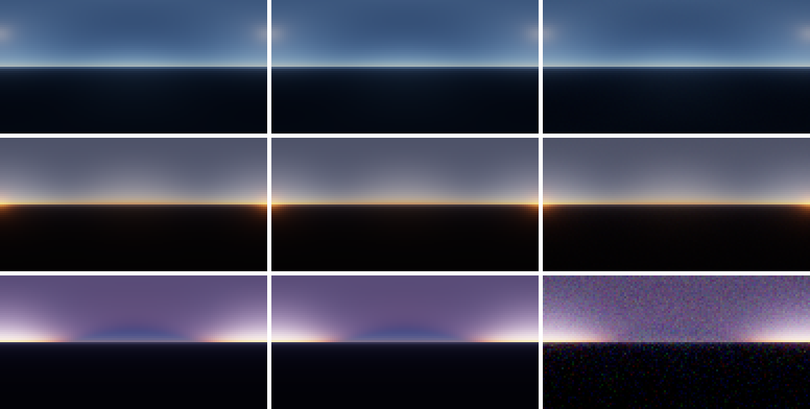

確認画像（行: 昼・夕方・地球の影、列: LUT 描画・レイマーチ・パストレース。全天の正距円筒、シナリオごとに自動露出 + 簡易トーンマップ。GT7 ではない）

分かったこと:
- **多重散乱の近似の誤差**: 単散乱の成分はパストレースと 0.1% 以内で一致し、差はすべて多重散乱の成分から来る。近似は多重散乱を小さく見積もり、R ほど大きい（昼 −18%、夕方 −37%）。R の多重散乱は前方散乱の強い Mie（g = 0.8）が主で、「2 次以降を等方とみなす」仮定が最も外れる。論文 §6 の限界（g が大きいほど不正確）と一致し、実装の不具合ではない。全体の輝度では昼 −2%、夕方 −4% の偏り、地平線付近（±10°）で最大 −5〜−11%。
- **視線の積分のステップ配置（Sky-View LUT）**: 等間隔の 30 区間では、地表付近で太陽の周りの光輪が 10〜19% 暗くなった（V3、昼の R の相対 RMSE 8.5%）。地表付近の Mie はスケールハイト 1.2 km で急減し、最初の区間（~5 km）の中点では密度を過小評価するため。光線上のサンプル配置を 2 次配置にして 0.62% に下がった（§5.2）。当初これを「参照実装と同じ」と書いたが不正確だった。参照実装が 2 次配置を使うのは Sky-View LUT と画面のレイマーチ（区間数も可変）だけで、Multi-scattering LUT と空気遠近法は等間隔（§5.2）。本実装は 2 次配置を Multi-scattering LUT にも広げていた。
- **Multi-scattering LUT のステップ配置（2 次配置 vs 等間隔）**: 倍精度リファレンス（上表と同じ 8×8 テクセル）との相対誤差。太陽方向は Transmittance LUT（500 区間）、地表アルベド 0.3。「平均」は LUT 最大値の 10⁻³ 以上のテクセルだけで取ったもの。

  | 区間数 | 配置 | 最大 | 平均 | μs > 0.2 の最大 | \|μs\| ≤ 0.2 の最大 | 平均の偏り R/G/B |
  |---|---|---|---|---|---|---|
  | 10 | 2 次 | 31% | 1.28% | 3.7% | 31% | −1.4 / −1.4 / −0.8% |
  | 10 | 等間隔 | 12% | 0.87% | 3.0% | 12% | −0.9 / −0.7 / −0.3% |
  | 20 | 2 次（切替前の既定） | 4.9% | 0.43% | 1.3% | 4.9% | −0.54 / −0.37 / −0.30% |
  | 20 | 等間隔（現在の既定） | 2.7% | 0.29% | 1.2% | 2.7% | −0.35 / −0.27 / −0.09% |
  | 40 | 2 次 | 1.3% | 0.15% | 0.55% | 1.3% | −0.20 / −0.14 / −0.10% |
  | 40 | 等間隔 | 0.76% | 0.08% | 0.35% | 0.76% | −0.10 / −0.06 / −0.02% |

  どの区間数でも等間隔のほうが誤差が小さい。**2 次配置を Multi-scattering LUT にまで広げたのは誤りだった。** どちらの配置でも、最大誤差は明暗境界の付近（|μs| ≤ 0.2）で出る。理由は推測で、未検証: Multi-scattering LUT は全高度の点から全方向（下向きを含む）に積分する。高い所から下を向いた光線では濃い空気が光線の遠い側（地表付近）にあり、2 次配置ではそこが粗くなる。一方、Sky-View LUT は地表付近のカメラから上を見る光線が中心なので、2 次配置が効いた。この結果から Multi-scattering LUT の既定を等間隔に切り替えた（§12 Q8、§5.2）。
- **解析積分の桁落ち**: 参照実装の (S − S·T)/σt は、ステップが細かく σt·dt が 10⁻⁵ 程度になると float32 で桁落ちし、GPU の exp の近似誤差と合わさって空の輝度が一律 1% ずれた（V2 の回帰で発見）。テイラー展開に切り替えて解消（§5.2）。
- **float32 の惑星座標**: 地表付近（半径 6360 km）の精度は ~0.5 m。パストレースの衝突点が地表の下に入り、次の光線が惑星の内部を通って NaN になった。高度を 0 以上にクランプし、衝突点を地表の 1 m 上に戻して解消。
- **パストレースの分散**: 光学的厚さが小さく大半の経路が衝突せずに抜けるので、2048 サンプルではピクセルあたり 5〜13% のノイズがあった。65,536 サンプルで 1〜2% にし、RMSE からノイズ分を差し引いて評価した。
- **作業色空間（V9）**: `SpectralFit2020` が全条件で最も分光計算に近い（ΔE_ITP 平均 1.4〜3.2）。Rec.2020 の原色が単色光なので、RGB の 3 チャンネルが波長の 3 点に近いため。`SpectralFit709` は太陽が低いとき（85°）に悪化する（平均 9.0）。Rec.709 の等色関数の負の部分のため、B の Rayleigh 係数を単一指数で表しにくい（フィット残差が大きい、Phase 2）。`Hillaire2020` は太陽が高いときに色がずれる（平均 7.5〜8.5）。うち約半分は太陽の色を白（D65）としていることによる。同じ GPU の結果で太陽の色だけ分光スペクトル由来（`SpectralFit709` の sunColor）に替えると、平均 8.5 → 4.7（30°）、7.5 → 4.0（60°）に下がる。残りは 680 / 550 / 440 nm のサンプル値による係数の差。
- **RGB では表せない分光の効果**: 最良の `SpectralFit2020` でも ΔE_ITP は 1.4〜3.9 残る（弁別閾 1 より大きい）。

### 調査: Mie の g が大きいとき、LUT 描画で太陽の周りの光輪が崩れる（2026-10-16）

条件: LUT 描画、太陽天頂角 35°、Mie g = 0.99。比較のため、太陽に向けた画角 6°・256 px のカメラで LUT 描画とレイマーチ（2048 区間、同じ LUT）を描いた（バッチ検証 `sun_closeup`。現在は `validate_phase3.py` の V3b として常に実行する）。以下の測定値と画像は対策前のもの。対策と結果は節の最後。

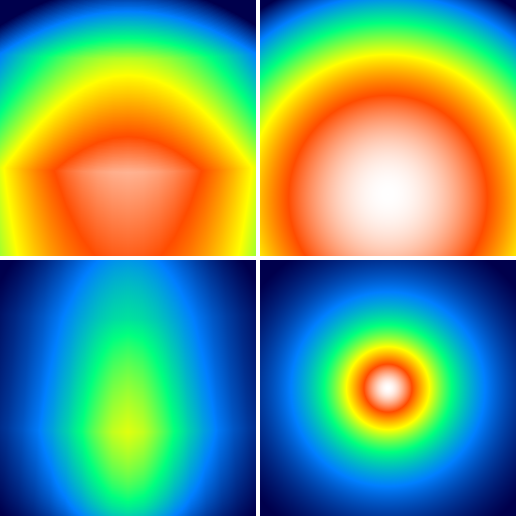

上段 g = 0.8、下段 g = 0.99。左が LUT 描画、右がレイマーチ。対数の擬似カラー、幅 6°。

測定値:

| 量 | 値 |
|---|---|
| Cornette-Shanks の前方ピークの半値全幅 | g = 0.8: 19.4°、g = 0.99: **0.88°**（ピーク値 1594 sr⁻¹） |
| 太陽（天頂角 35°）の位置での Sky-View LUT の 1 テクセル | 縦（天頂角方向）**2.62°**、横（方位方向）0.60°（空の上では × sin 35° = 0.34°） |
| 天頂角ごとの縦の 1 テクセル | 5°: 3.26°、20°: 2.96°、35°: 2.62°、60°: 1.94°、80°: 1.14°、89°: 0.42° |
| g = 0.99 のピーク値（LUT / レイマーチ）、太陽天頂角 34.0〜36.0° を 0.25° 刻み | 0.30, 0.15, 0.08, **0.06**, 0.11, 0.20, 0.39, 0.71, **0.97**。太陽がテクセル行の中心付近（行の端数 0.99）なら 0.97、行の中間（0.51）なら 0.06 |
| g = 0.99 の光輪の広がり（標準偏差、水平 × 鉛直） | レイマーチ 0.72° × 0.72°、LUT 0.6〜0.85° × **1.07〜1.46°** |
| g = 0.99 の光輪の中心のずれ（鉛直） | ±0.03〜0.55° |
| g = 0.8 | ピーク値 1.10 倍、広がりはほぼ一致（1.36 × 1.06° vs 1.33 × 1.06°）。対数で見ると、ピーク付近にテクセル境界の段差と折れ線状の面が出る |

原因:
1. **Sky-View LUT の縦方向の解像度が、ピークの幅より 3 倍粗い。** g = 0.99 のピークの半値全幅 0.88° を表すには、テクセルが 0.44° 以下である必要がある（ナイキスト）。しかし太陽の位置では縦 2.62° しかない。横（0.34°）はほぼ足りているので、縦方向だけがつぶれて光輪が縦長になる。
2. **縦の解像度は地平線に集中させているので、太陽が高いほど粗くなる。** 緯度の 2 次の非線形化（§5.2 の Sky-View LUT、Hillaire 2020 §5.3）は地平線付近の細部のためのもので、天頂角 35° の太陽はテクセルが粗い領域にある。LUT の縦軸は天頂角なので、太陽の位置に合わせて細かくすることもできない（横軸だけが太陽との方位差）。
3. **LUT は各テクセルの中心方向の値を点サンプルしているだけで、テクセル内の平均ではない。** そのため細いピークはエイリアシングを起こす。ピーク値は、太陽がテクセル行の中心からどれだけずれているかで 6〜97% と大きく変わり、太陽を動かすとピークが明滅する。
4. **双線形補間で、粗い行のあいだを直線で結ぶ。** その結果、ピークが縦に引き伸ばされ（鉛直方向の広がり 0.72° → 最大 1.46°）、中心もずれる。ピークから 1° 以内では、場所によって最大約 4.8 倍（相対誤差 +384%）の過大評価にもなる。
5. **前提の範囲外:** 論文は「現実的な g では太陽の周りの光輪は十分滑らか」を前提にしている（§5.1）。g = 0.8 では前提が成り立つ（ピーク幅 19°）が、g = 0.99 は成り立たない。

検討した対策:
- **Mie の位相関数を LUT から外し、ピクセルごとに掛ける（採用、2026-10-16 実装）。** 太陽は平行光なので、ある視線の上では散乱角 θ が一定で、単散乱の Mie は p_M(θ) × ∫ T_view·σs_M·T_sun dt に正確に分解できる。∫ 側は方向に対して滑らかなので、LUT にはこちらを入れ、p_M(θ) は描画時に正確な角度で掛ける。Bruneton 2008 / 2017 が単散乱の Mie を位相関数なしで別に持つのと同じ考え方。Rayleigh と多重散乱（等方）は今の LUT のままでよい。
- Sky-View LUT の解像度を上げる（不採用）。根本的な解決にはならない（g = 0.99 には縦 6 倍以上が必要）。
- g が大きいときは、太陽の周辺だけピクセルごとのレイマーチに切り替える（不採用）。コストがピクセル数に比例する。

実装（§5.2 の LUT 表）:
- Sky-View LUT を 2 枚にした。`SkyViewLut`（Rayleigh の単散乱 + 多重散乱 [sr⁻¹]）と `SkyViewMieLut`（Mie の単散乱から位相関数を除いた ∫ T_view·σs_M·T_sun dt [無次元]、RGB）。
- `SkyFromLut.hlsl` で L = SkyViewLut + p_M(θ)·SkyViewMieLut。θ はピクセルの視線と太陽方向の正確な角度。
- 積分は `IntegrationSettings::separateMiePhase` で切り替える（Sky-View LUT だけ true。Multi-scattering LUT とリファレンスのレイマーチは false のまま）。
- Mie を輝度だけ（A チャンネル）にする近似は採らなかった。Hillaire 2020 §6 が、Bruneton の色なし Mie では夕焼けの Mie の色が再現できないと指摘しているため。
- 代償: RGBA16F 192×108 のテクスチャ 1 枚（約 166 KB）、Sky-View LUT 生成時の UAV 書き込み 1 つ、描画時のテクスチャ読み 1 回と位相関数の評価 1 回（ピクセルごと）。

結果（V3b、対策後）:

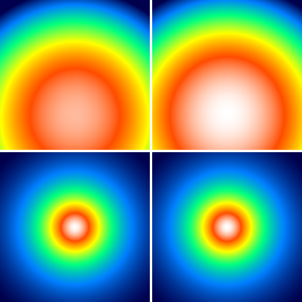

上段 g = 0.8、下段 g = 0.99。左が LUT 描画、右がレイマーチ（対策前の図と同じ配置・色範囲の決め方）。

- g = 0.99: ピーク値の比は太陽天頂角 34〜36° のすべてで 0.985（対策前 0.06〜0.97）。光輪の広がりの比 1.000、中心のずれ 0.000°。太陽を動かしたときの明滅はなくなった。
- g = 0.8: ピーク値の比 0.988（対策前 1.10）、広がりの比 1.00。
- 残る 1.2〜1.5% の差は、太陽の位置によらず一定。Sky-View LUT の 30 区間の積分の誤差と考えているが、未確認。
- V3（昼）は太陽付近の誤差が減って、最大誤差 1.6% → 1.2%。V4 は変化なし（g = 0.8 では光輪がもともと滑らかなため）。

### Phase 4（2026-10-16、AMD Radeon RX 7800 XT）

条件: 係数セット `Hillaire2020`（既定）、カメラ 地表 300 m・俯角 2°・画角 60°、640×360。太陽は天頂角 45°（昼、前方 = 方位 −90° / 後方 = 90°）と 88°（夕方、前方）。g = 0.8、昼の前方だけ g = 0.99 も。値はすべて単位照度あたり。

V3c 地形の空気遠近法（地形・球のピクセル 146,296 個、相対 RMSE R/G/B）:

| ケース | ボリュームの誤差（ボリューム vs レイマーチ、透過率は RGB 平均） | 透過率の RGB 平均の近似（RGB 平均 vs RGB） | 合計 |
|---|---|---|---|
| 昼・前方 g = 0.8 | 0.09 / 0.11 / 0.11%（最大 1.0%） | 2.5 / 0.77 / 3.1% | 2.5 / 0.71 / 3.1% |
| 昼・前方 g = 0.99 | 0.09 / 0.11 / 0.11%（最大 1.0%） | 2.5 / 0.78 / 3.1% | 2.5 / 0.71 / 3.2% |
| 昼・後方 | 0.06 / 0.21 / 0.52%（最大 1.3%） | 3.9 / 1.2 / 4.6% | 3.9 / 1.2 / 4.5% |
| 夕方・前方 | 0.60 / 0.35 / 0.26%（最大 1.5%） | 1.1 / 0.57 / 3.6% | 0.98 / 0.48 / 3.6% |

透過率の RGB 平均の近似の誤差（平均の相対誤差 R/G/B、昼・後方）は奥行きとともに増える: 1 km 未満 −0.9 / −0.3 / +1.2%、1〜5 km −3.0 / −0.9 / +3.4%、5〜20 km −6.1 / −1.8 / +6.7%。

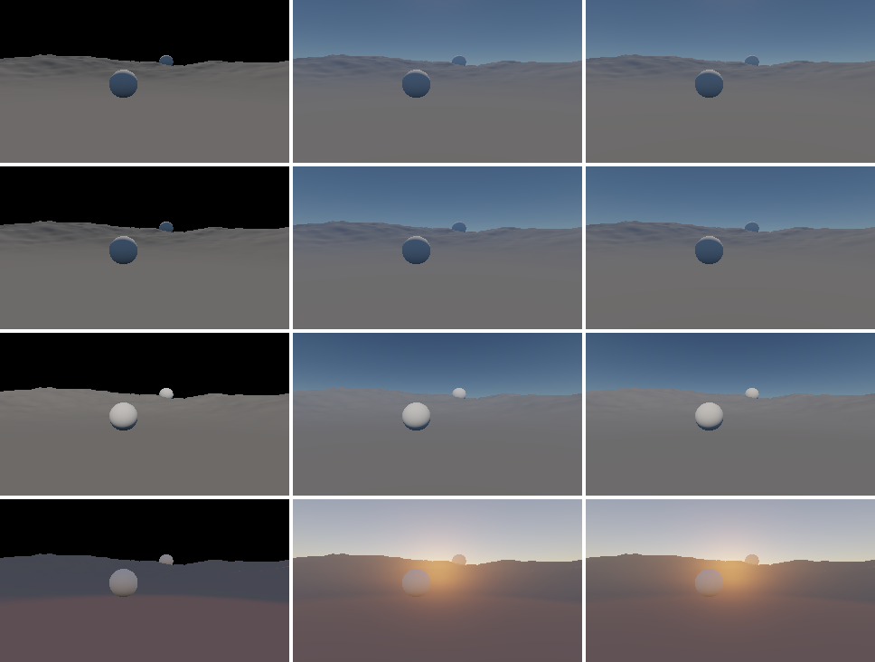

確認画像（行: 昼・前方 g = 0.8、昼・前方 g = 0.99、昼・後方、夕方・前方。列: 地形のみ（空気遠近法なし）、ボリューム経由の合成、深度までのレイマーチ（透過率 RGB）。ケースごとに自動露出 + 簡易トーンマップ。GT7 ではない）

V3d 空からの照度（地表 0.2 km、相対誤差 R/G/B）:

| 太陽天頂角 / g | 実装の誤差（GPU の SH vs Python で同じ画像を L2 に射影）最大 | L2 の打ち切り: +Y | ±X | −Y |
|---|---|---|---|---|
| 30° / 0.8 | 0.78%（−Y）、ほかの法線 0.35% 以内 | +8.6 / +5.9 / +3.0% | +1.1〜1.4% | +267 / +182 / +85% |
| 80° / 0.8 | 1.4%（−Y）、ほかの法線 0.93% 以内 | +13.8 / +7.6 / +2.3% | +2.9〜5.2% | +434 / +278 / +103% |
| 30° / 0.99 | 0.78%（−Y）、ほかの法線 0.35% 以内 | +8.5 / +5.9 / +3.0% | +0.9〜1.1% | +272 / +183 / +85% |
| 80° / 0.99 | 0.75%（−Y）、ほかの法線 0.30% 以内 | +11.2 / +6.8 / +2.2% | +3.3〜5.9% | +450 / +279 / +102% |

V8 GPU 時間（Release、各 100 フレームの中央値 [ms]。Transmittance / Multi-scattering LUT は測定のため毎フレーム作り直した。各区間の先頭で直前のシェーダーの完了を待つので、パス間の重なりはない）:

| パス | 1920×1080 | 3840×2160 | 実行頻度 |
|---|---|---|---|
| Transmittance LUT（500 区間） | 0.042 | 0.041 | 媒質の変更時 |
| （参考）Transmittance LUT（40 区間、論文の PC 設定） | 0.006 | 0.005 | — |
| Multi-scattering LUT（20 区間） | 0.027 | 0.026 | 媒質の変更時 |
| Sky-View LUT（30 区間、2 枚） | 0.026 | 0.025 | 毎フレーム |
| 空気遠近法のボリューム（32³ × 2） | 0.043 | 0.042 | 毎フレーム |
| 空からの照度（SH） | 0.024 | 0.024 | 毎フレーム |
| 空 + 空気遠近法の合成 | 0.035 | 0.149 | 毎フレーム |
| **大気の毎フレームの合計**（上の 4 つ） | **0.128** | **0.240** | |
| （作例）シーンのクリア / 地形・球の描画 / 深度と色の状態遷移 | 0.009 / 0.087 / 0.002 | 0.033 / 0.162 / 0.001 | 毎フレーム |
| GT7 + PQ（表示） | 0.075 | 0.290 | 毎フレーム |

論文（GTX 1080、720p）は LUT 合計 約 0.17 ms、画面への描画 約 0.14 ms、合計 約 0.31 ms。GPU が違うので直接は比べられないが、同じ桁に収まっている。

分かったこと:
- **空気遠近法のボリュームの誤差は小さい**（相対 RMSE 0.6% 以下、最大 1.5%）。32 スライスの離散化と奥行きの補間で失うものはほとんどない。誤差は近距離（1 km 未満）で大きい（昼・後方の B で平均 0.9%）。原因は調べていない。
- **誤差の大部分は、透過率を RGB 平均にする近似**（論文・参照実装と同じ、§5.3）。R と B で逆向きに、奥行きとともに増え、5〜20 km で ±6% になる。遠景の地形の色が R 側で暗く、B 側で明るくなる（青みが増す）。g と太陽の向きにはほとんど依存しない（透過率だけの問題なので）。改善するなら、透過率を RGB で持つ（ボリュームを 1 枚増やすか、デュアルソースブレンドで乗算する）必要がある。今回は記録のみ（V3c）。
- **空からの照度の SH: 最初の実装は p_M を Legendre 展開（l ≤ 2）に置き換えていた**（設計時の案）。V3d で、壁面（±X）の照度が R で最大 20% ずれた。Mie LUT の値（位相関数なし）は地平線付近で大きく、展開した p̃_M は太陽から遠い方向にも重みを広げるので、「Mie LUT が滑らかなら誤差は小さい」という前提が成り立たなかった。太陽中心の極座標（θ = π·u²）で正確な p_M を求積する方式に替えて、太陽の向きに依存する誤差は消えた。
- **地平線の帯のサンプリング**: その後も、すべての法線で一律に −4 / −2.5 / −1.4%（R/G/B）の差が残った。原因は仰角の等間隔 64 分割（2.8°）。地平線のすぐ上の明るい帯を取りこぼしていた。Python で同じ画像を間引いて確かめた（+X: 等間隔 64 行 −6.6%、256 行 +2.7%、地平線中心の 2 次配置 64 行 +0.6%）。2 次配置にして、実装の誤差は ±X / ±Z / +Y で 0.93% 以内、−Y で 1.4% 以内になった。
- **L2 の打ち切りの誤差は手法の限界**: 上向き（+Y）の照度を R で 8.5〜14% 過大評価する。地平線の明るい帯と、その下の暗い領域の段差を 9 係数で表せず、リンギングが出るため。下向き（−Y）は真の照度がほぼ 0（+Y の 2〜4%）なので相対誤差が数百 % になるが、絶対値では R で +Y の照度の 7〜12% にあたる。実際の地形では下向きの面には地面の反射光が入る（本実装では扱わない）。改善するなら、窓関数でリンギングを抑える、または地平線の帯を別に持つなどがある。今回は記録のみ（V3d）。
- **GPU 時間の測り方**: タイムスタンプは直前のパスの完了を待たずに書かれることがある。区間の先頭にバリアがないと、直前のパスの残りが次の区間に入った（40 区間の Transmittance LUT が 0.44 ms と出た）。区間の先頭で対象リソースなしの UAV バリアを入れて直した（`GpuTimer::begin`）。

### 調査: 太陽が地平線近くのとき、Mie の光輪が地形を貫通して見える（2026-10-16）

条件: V3c の夕方・前方（太陽天頂角 88° = 仰角 2°、カメラ正面、g = 0.8）。太陽は山の稜線の向こうにあるのに、稜線の手前の地形に太陽中心の光輪が乗り、空の光輪とつながって見える（下図の左）。解析は `reference/analyze_ap_terrain_shadow.py`（地形の高さ関数を移植した `reference/terrain_ref.py` で、視線上の空気の点ごとに太陽方向の遮蔽を調べる。320×180 ピクセル × 視線上 64 点、単散乱のみ）。

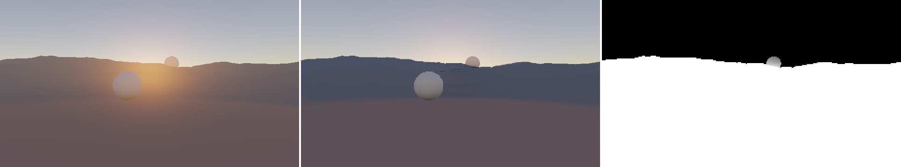

左: 今の合成。中: 地形の影に入る空気の単散乱を差し引いたもの（地形の面の直接光はそのまま）。右: 視線上の点のうち地形の影に入る割合（白 = 1）。

測定値:

| 量 | 値 |
|---|---|
| カメラから太陽の方位に見える稜線の仰角 | 6.1°（7.7 km 先、標高 1,121 m）。方位 ±15° で 4.4〜7.2°。太陽（仰角 2°）はカメラから見て稜線の下 = 山に沈んでいる |
| 太陽方向の遮蔽（試験点） | カメラ（300 m）と高度 1 km は影、3 km と 6 km は日なた |
| 地形のピクセルの視線上で地形の影に入る点の割合 | 平均 99.99%（太陽の方位 ±15° では 100%） |
| 地形の手前の空気の単散乱（Rayleigh + Mie）のうち影に入る割合 | R/G/B 99.97 / 99.97 / 99.96%（太陽の方位 ±15° では 100%） |
| 太陽の方位 ±15° の地形のピクセルで、今の輝度に占める割合（R/G/B） | 空気の単散乱 76 / 54 / 9%、地形の面（空気遠近法なし）24 / 42 / 78% |

結論:
- **実装は設計どおりに動いている。** 光輪は稜線の向こうから漏れているのではなく、カメラと地形のあいだの空気（0〜8 km）の内散乱。空気遠近法は深度までしか積分しておらず（V3c でボリュームと深度までのレイマーチが 1.5% 以内で一致）、空の光輪と同じ位相関数で太陽方向を中心にするので、稜線をまたいでつながって見える。
- **物理的には正しくない。** この条件では、地形の手前の空気はすべて山の影に入っていて、太陽からの単散乱は 0 になるはず。今の光輪（地形のピクセルの R の 76%）は、ほぼ全部が地形による遮蔽（ボリュームシャドウ）を入れていないことによるもの。地形の面に当たる直接光も、セルフシャドウがあれば 0 になる（残るのは空からの照度と多重散乱の分）。
- **これは設計時に範囲外にした項目**（§11 のボリュームシャドウ・地形のセルフシャドウ）。この調査を受けて Phase 4.5 で対応する（§5.5、§12 Q12）。論文の参照実装（sebh/UnrealEngineSkyAtmosphere）も同じで、不透明物の影は `SHADOWMAP_ENABLED`（既定 0）で切り替える任意の機能。有効にすると、空気の点ごとにシャドウマップを引き、単散乱の項だけに掛ける（多重散乱の項には掛けない）。
- 太陽の仰角が 10° 以上（天頂角 80° / 70° / 45°）では、上の試験点（カメラ、高度 1 / 3 / 6 km）はすべて日なたになる。太陽が稜線より低いときに大きく効く現象。仰角 10° 以上でも、尾根の裏側の谷などには影が残るはず（量っていない）。
- 稜線より上の空も、視線の手前側（稜線の高さより下）の空気は影に入るので、本来は少し暗くなる（光芒）。今回は量っていない。

### Phase 4.5（2026-10-16、AMD Radeon RX 7800 XT）

条件: Phase 4 と同じカメラ（地表 300 m、俯角 2°、画角 60°、640×360）。地表 2 m・俯角 10° のカメラ（近くの球の影、近景のカスケード）も加えた。係数セット `Hillaire2020`、g = 0.8。カスケードは近景 2048²（1 テクセル 0.62 m）、全体 4096²。

V3e 地表の影（GPU の太陽の見える割合を 0.5 で二値化 vs Python のレイキャスト。N·L > 0.05 の地形・球のピクセル、2 ピクセル間隔）:

| ケース | 全体のカスケードの 1 テクセル（横 × 縦） | 一致率 | 影の境界（±1 テクセル）を除いた一致率 | 不一致（境界を除く）|
|---|---|---|---|---|
| 太陽天頂角 45°、カメラ 300 m | 9.9 × 7.6 m | 99.71% | 100.00% | なし |
| 80°、カメラ 300 m | 9.9 × 2.6 m | 99.73% | 99.99% | GPU だけ日なた 4 ピクセル（1〜5 km） |
| 88°、カメラ 300 m | 9.9 × 1.2 m | 100.00%（太陽の側を向く面は 1 ピクセルだけ。地形はすべて山の影） | 100.00% | なし |
| 60°（太陽は +X）、カメラ 2 m | 近景 0.62 m | 98.63% | 99.98% | GPU だけ日なた 10 ピクセル（100 m 以内） |

GPU だけ影（シャドウアクネ）はどのケースも 0。

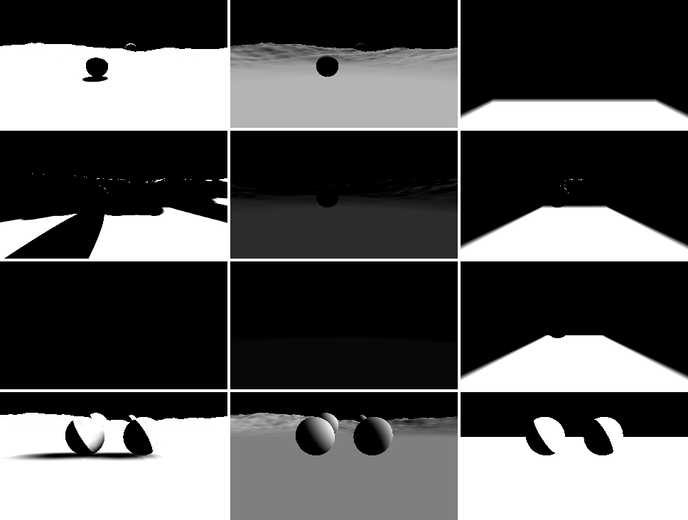

行: 45° / 80° / 88° / 60°（地表 2 m）。列: 太陽の見える割合、N·L、近景のカスケードの重み（白 = 近景）。

V3f 空気遠近法の影（地形・球の面の影はすべて有り。空気遠近法の単散乱の影だけを切り替える）:

| ケース | ① ボリューム vs レイマーチ（影あり、相対 RMSE R/G/B） | ② 影で減った量 GPU / Python（R/G/B） | 影で減った量が影なしの画素に占める割合（R/G/B） | ③ ボクセルの太陽の見える割合 GPU / Python（平均、差の平均 / 最大） |
|---|---|---|---|---|
| 昼・前方（45°） | 0.24 / 0.39 / 0.61% | 0.994 / 0.994 / 0.995 | 0.0%（影に入る空気がほぼない） | 0.7721 / 0.7728（0.0009 / 0.10） |
| 低い太陽・前方（80°） | 3.6 / 3.0 / 2.1% | 1.000 / 1.000 / 1.000 | 9.6 / 9.0 / 6.8% | 0.6938 / 0.6938（0.0007 / 0.11） |
| 夕方・前方（88°） | 3.9 / 1.4 / 0.30% | 1.000 / 1.001 / 1.003 | 66 / 40 / 5.8% | 0.1712 / 0.1713（0.0003 / 0.10） |

影をオフにした V3c（Phase 4 の 4 ケース）は Phase 4 の値と同じ（ボリュームの誤差 最大 0.60%）。

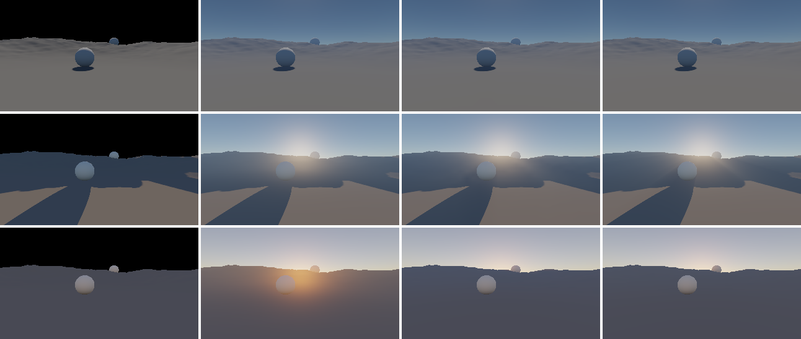

行: 昼・前方 / 低い太陽・前方 / 夕方・前方。列: 地形のみ、ボリューム経由の合成（空気遠近法の影なし）、ボリューム経由の合成（影あり）、深度までのレイマーチ（影あり、透過率 RGB）。夕方の行で、地形に乗っていた太陽の光輪が消えている。

V8 GPU 時間（Release、中央値 [ms]）:

| パス | 1920×1080 | 3840×2160 | 実行頻度 |
|---|---|---|---|
| シャドウマップ 全体（4096²、地形 52 万三角形 + スカート + 球） | 0.314 | 0.316 | 太陽の向きの変更時 |
| シャドウマップ 近景（2048²） | 0.041 | 0.041 | 毎フレーム |
| 空気遠近法のボリューム 影なし / 影あり | 0.043 / 0.078 | 0.043 / 0.080 | 毎フレーム |
| 地形・球の描画 影なし / 影あり（3×3 の PCF、2 段） | 0.074 / 0.106 | 0.159 / 0.251 | 毎フレーム |

影による毎フレームの増分は 1080p で 0.108 ms（近景 0.041 + 空気遠近法 0.035 + 地表 0.032）、4K で 0.170 ms。

分かったこと:
- **地形の端が開いていると、山の中が日なたになる**: 最初の実装では、夕方のボリューム vs レイマーチが R で 20.9% ずれ、ボリューム経由の合成に光輪が少し残った（影で消えるべき単散乱の 4% が残る）。ボクセルごとの太陽の見える割合を書き出して Python と比べると、カメラから 3.7 km より奥のスライスで GPU だけが日なた（スライス 12 で 75% 対 0.2%）。シャドウマップを書き出して調べると、山の中の点の光線は光源側の端（z = −20 km）で地表より低い所から入るので、どの面にも当たらず（深度 0）、またはカメラ側の斜面の裏で止まっていた。地形は高さマップで底も側面もないため。空気遠近法のボクセルの光線は、地形より奥のスライスで山の中を通るので、その光が奥行き方向の補間で手前の地形のピクセルに漏れた（ピクセルごとのレイマーチは地形で止まるので漏れない）。シャドウマップにだけ地形の四辺のスカート（−500 m まで）を描いて解消（§5.5）。夕方の ① は 20.9% → 3.9%、③ の差は平均 0.0003 になった。傾斜スケールのデプスバイアスは原因ではなかった（0 にしても変わらない）。
- **残る ① の誤差（低い太陽で 2〜4%）は、空気遠近法のボリュームの画面方向の解像度**: 誤差は光芒（山の影の縞）の境界に沿って ±4〜12% 出る。ボリュームは 32×32 で、影の境界を追えない（§5.5 の懸念どおり）。Python で同じ配置のボリュームを作ると、影の漏れは単散乱の 0.2% にとどまる（ピクセルの光線 0.44%、ボリューム 0.63%）。
- **法線オフセットはテクセルの小さい方の辺に合わせる**: 全体のカスケードは縦横の大きさが違う（低い太陽で横 9.9 m・縦 2.6 m）。大きい方（9.9 m）に合わせると、受け手を影の外まで押し出して、80° のケースで 1〜5 km に光漏れが 150 ピクセル出た（境界を除いた一致率 99.46%）。小さい方にして 4 ピクセル（99.99%）。アクネは増えなかった。
- **影の中の空気**: 多重散乱の項には影を掛けない（参照実装と同じ近似、§5.5）。夕方の地形のピクセルでは、影で減った単散乱が影なしの画素の 66%（R）を占めていた。残りは多重散乱と、空からの照度で照らされた地形の面。

### Phase 4.5 の追加: 空気遠近法の影の方式の比較（2026-10-16、§5.6）

条件: 640×360。地表 1 m のカメラ（ヨー 14.8°、ピッチ 6.9°、太陽天頂角 82.78°・方位 −76°、g = 0.83。ユーザーの画面の条件）、低い太陽（80°）・夕方（88°）の正面（カメラ 300 m）。基準は深度までのレイマーチ（2048 区間、各点で影を 1 回、透過率は RGB 平均でボリュームと揃える）。「影が効く画素」は、影なしのレイマーチより 2% 以上暗い画素。方式 1 の倍率 1、方式 5 は 32 点 + 二分探索 6 回。

V3g（相対 RMSE R/G/B）:

| ケース | 方式 0: ボリューム（点） | 方式 1: ボリューム（ぼかし） | 方式 5: ピクセルごと |
|---|---|---|---|
| 地表 1 m・全体 | 6.8 / 4.7 / 2.1% | 6.1 / 4.2 / 2.0% | 0.33 / 0.25 / 0.15% |
| 地表 1 m・影が効く画素（23,062） | 19.6 / 10.7 / 3.9%（最大 39%） | 17.4 / 9.7 / 3.7%（最大 51%） | 0.93 / 0.57 / 0.28%（最大 4.4%） |
| 低い太陽・全体 | 3.7 / 3.1 / 2.1% | 3.6 / 3.0 / 2.1% | 0.60 / 0.48 / 0.33% |
| 夕方・全体 | 3.9 / 1.4 / 0.30% | 6.7 / 2.2 / 0.35% | 0.59 / 0.23 / 0.25% |

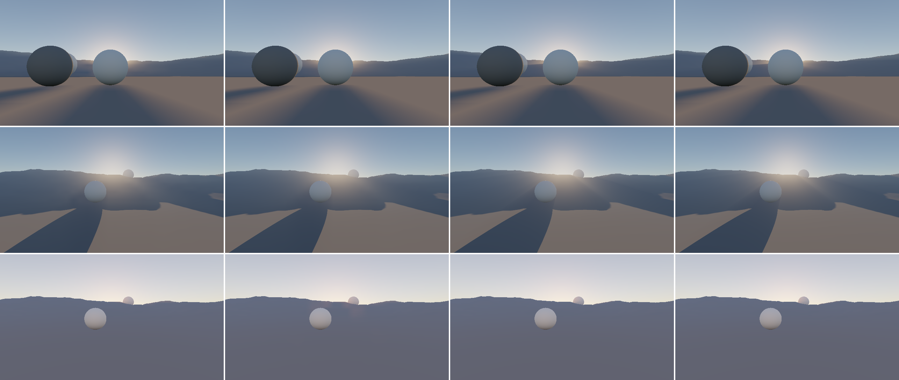

行: 地表 1 m / 低い太陽 / 夕方。列: 方式 0、1、5、基準のレイマーチ。

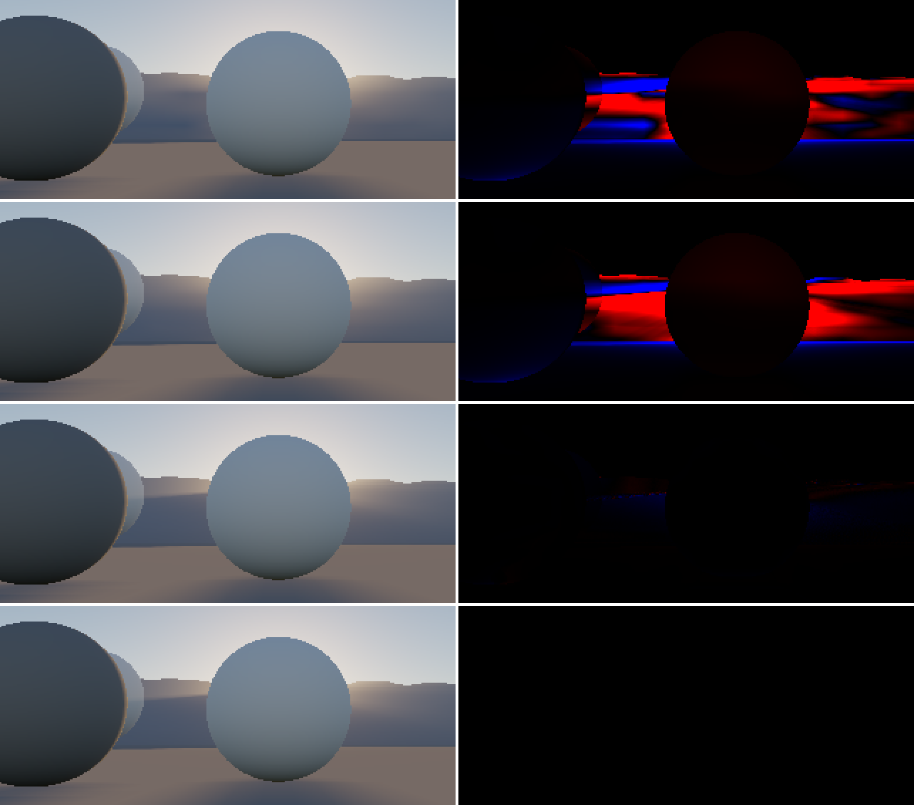

地表 1 m のケースの拡大（左）と、基準との相対誤差（右。赤 = 明るすぎ、青 = 暗すぎ、10% で飽和）。行: 方式 0、1、5、基準。

V8 GPU 時間（Release、中央値 [ms]、1920×1080 / 3840×2160。Phase 4 の perf のカメラ・太陽天頂角 45°）:

| パス | 1080p | 4K |
|---|---|---|
| 空気遠近法のボリューム 影なし（方式 5 が使う） | 0.043 | 0.044 |
| 空気遠近法のボリューム 方式 0 | 0.099 | 0.099 |
| 空気遠近法のボリューム 方式 1 | 0.586 | 0.590 |
| 合成（方式 0 / 1） | 0.038 | 0.166 |
| 合成（方式 5） | 0.284 | 1.127 |

注意: この計測は、対話モードのアプリ（Debug）が同じ GPU で動いている間に取った。全体のシャドウマップが前回の 0.314 ms から 0.671 ms（最大 6 ms）に増えるなど、値がぶれている。方式どうしの大小の目安としてだけ使い、アプリを閉じて測り直す。

分かったこと:
- **方式 5 は基準とほぼ一致**（影が効く画素で 1% 未満）。影の形が、画面とシャドウマップの解像度で出る。ボリューム（32×32×32）が担うのは影なしの累積 F だけで、その補間の誤差は小さい。
- **方式 1 は誤差の形をなめらかにするだけで、大きさは減らない**（地表 1 m で 19.6 → 17.4%）。ぼかしでブロックの段差は消えるが、ボクセルの横幅より細い影は平均されて薄まる。夕方では、稜線の影の境界をまたいで日なたの空気が混ざり、方式 0 より悪い（R 3.9 → 6.7%）。コストも 12 点の PCF で、ボリュームが 6 倍（0.099 → 0.586 ms）。
- **方式 0 の誤差はボリュームの格子そのもの**: 地表 1 m では、遠くの地形の帯に ±10% を超える誤差がブロック状に出る（拡大の 1 行目）。
- **方式 5 のコストは合成のピクセル数に比例する**（1080p で +0.25 ms、4K で +0.96 ms。値は上の注意のとおり目安）。視線上の点の数を減らすか、半分の解像度で求めて引き伸ばす（境界を保つ補間）余地がある。今回は試していない。
- **ディスクリプタのインデックスがスレッドごとに違うときは NonUniformResourceIndex が要る**: 空気遠近法でも近景のカスケードを使うようにしたところ、ボクセルの判定（V3f ③）が平均 0.0003 → 0.0065、最大 0.81 ずれた。近景のシャドウマップを書き出して Python で引くと判定は正しく、シェーダーの読み方の問題だった。点ごとに近景 / 全体を選ぶので、同じウェーブの中でインデックスがそろわない。そのまま `ResourceDescriptorHeap[]` で読むと、GPU が 1 つのスレッドのインデックスでウェーブ全体を読んでいた（D3D12 では未定義動作）。`NonUniformResourceIndex` で包んで解消（`common/Shadow.hlsli`）。Shoga の Bindless でも、インデックスがスレッドごとに変わる所では同じ注意が要る。
- 近景のカスケードを空気遠近法でも使うようにした後の V3f: ① 低い太陽 3.62 → 3.67%（R）、ほかは同じ。③ の差は平均 0.0003〜0.0009 で、変わらない。

### Phase 4.6（2026-10-17、AMD Radeon RX 7800 XT）

空気遠近法の RGB 透過率（§5.7）。640×360、係数セット `Hillaire2020`。基準は深度までのレイマーチ（2048 区間）の RGB の透過率。V3h のカメラ: C1 = 地表 300 m・俯角 2°（V3c と同じ）、C2 = 地表 2 m・ピッチ 0°、C3 = 高度 3,000 m・俯角 15°（画角はすべて 60°）。

V3h 透過率（地形のピクセル、相対 RMSE R/G/B と最大。「帯」= カメラの地平線 ±0.25°）:

| カメラ / LUT | 方式 0（RGB 平均） | 方式 1（LUT の比）帯の外 | 方式 1 帯 | 方式 1 段差 | 方式 2（ボリュームの RGB）帯の外 | 方式 2 帯 | 方式 2 段差 |
|---|---|---|---|---|---|---|---|
| C1 RGBA32F | 3.19 / 1.04 / 4.77% | 0.024 / 0.044 / 0.118%（最大 0.87%） | 最大 2.5% | **あり** | 0.030 / 0.057 / 0.137%（最大 0.29%） | 最大 0.1% | なし |
| C1 RGBA16F | 3.21 / 1.06 / 4.75% | 0.030 / 0.048 / 0.119%（最大 0.85%） | 最大 2.4% | あり | 0.036 / 0.060 / 0.136%（最大 0.29%） | 最大 0.1% | なし |
| C2 RGBA32F | 2.24 / 0.73 / 3.39% | 0.020 / 0.043 / 0.150%（**最大 2.34%**） | 最大 1.1% | なし | 0.005 / 0.010 / 0.018%（最大 0.09%） | 最大 0.1% | なし |
| C2 RGBA16F | 2.25 / 0.74 / 3.38% | 0.021 / 0.043 / 0.149%（最大 2.37%） | 最大 1.1% | なし | 0.015 / 0.021 / 0.028%（最大 0.13%） | 最大 0.1% | なし |
| C3 RGBA32F | 7.47 / 2.31 / 12.81% | 0.007 / 0.015 / 0.034%（最大 0.17%） | 最大 1.5% | **あり** | 0.056 / 0.089 / 0.171%（最大 0.57%） | 最大 0.01% | なし |

判定（§12 Q17、RGBA32F）: 方式 1 は C1・C3 で段差、C2 で最大 2.34% により不合格。方式 2 は全カメラで合格。

段差の判定: 縦に隣り合う地形のピクセルの相対誤差の差（RGB の最大）を、カメラの地平線をまたぐ組と、それ以外の組で比べた。方式 1 は C1 で境目の中央値 1.8%（最大 3.1%）、それ以外の 99 パーセンタイル 0.32%。方式 2 は境目 0.01%、それ以外 0.02%。

V3c の再実行（4 ケース、合計の相対 RMSE R/G/B。方式 0 の合計は Phase 4 と同じ値）:

| ケース | 方式 0（今の既定） | 方式 1 | 方式 2 |
|---|---|---|---|
| 昼・前方 g = 0.8 | 2.47 / 0.71 / 3.13% | 0.05 / 0.10 / 0.18% | 0.05 / 0.10 / 0.13% |
| 昼・前方 g = 0.99 | 2.49 / 0.71 / 3.15% | 0.05 / 0.10 / 0.18% | 0.05 / 0.10 / 0.14% |
| 昼・後方 | 3.87 / 1.19 / 4.54% | 0.12 / 0.27 / 0.61% | 0.10 / 0.22 / 0.49% |
| 夕方・前方 | 0.98 / 0.48 / 3.64% | 0.61 / 0.37 / 0.35% | 0.61 / 0.35 / 0.22% |

どちらも基準（< 1%）を満たす。残りはボリュームの内散乱の誤差（Phase 4 の「ボリュームの誤差」）とほぼ同じ。V3c のカメラ（C1）では地平線付近の地形のピクセルが少ないので、方式 1 の地平線の誤差は合計にほとんど出ない。

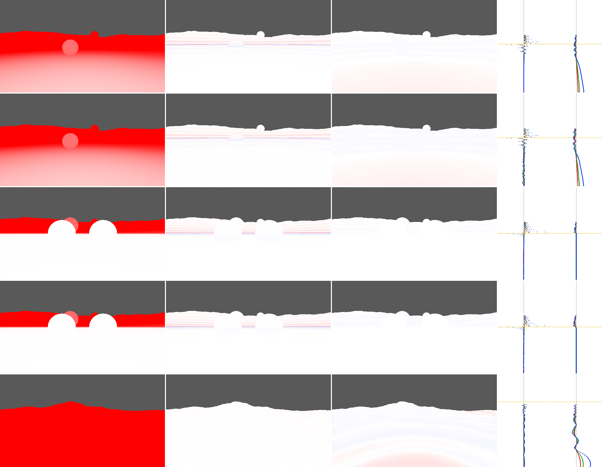

行: C1 RGBA32F / C1 RGBA16F / C2 RGBA32F / C2 RGBA16F / C3 RGBA32F。列: 方式 0・1・2 の符号付きの相対誤差（B、赤 = 透過率が大きすぎ、±5% で飽和）、中央の列の方式 1・2 の相対誤差の縦のプロファイル（R/G/B、±1%、黄の線 = カメラの地平線）。

V8（Release、中央値 [ms]、1080p / 4K）: 合成 方式 0 0.042 / 0.171、方式 1 0.052 / 0.197、方式 2 0.047 / 0.178。空気遠近法のボリューム（4 枚目の書き込みを含む）0.046 / 0.046（Phase 4.5 の 0.043〜0.045 から変化なし相当）。

分かったこと:
- **方式 1 は地平線付近で崩れる**（理由は §5.7）。カメラの地平線のすぐ上で、地平線に沿った細い線と、その上の横縞（LUT のテクセルの行）として出る。帯の外の RMSE は 0.15% 以下と小さいが、最大誤差と段差が基準を外れる。RGBA16F でもほぼ同じで、FP16 の格納（懸念 3）は主因ではない。
- **方式 2 は全条件で 0.6% 以内**。誤差はボリュームの奥行きの補間で、近距離（1 km 未満）で B が +0.19%（C1）、C3 の 1〜5 km で B が +0.10% の偏り。地平線の帯でも 0.1% 以下で、段差は出ない。
- **方式 0 の誤差（RGB 平均）は C3（高度 3 km から見下ろす長い光線）で B 12.8% に達する**。高い視点ほど RGB の透過率の差が大きく、方式 0 の近似が効かない。
- Phase 4.5 の比較（V3f・V3g）はレイマーチの RGB 平均と揃えるため、方式 0 を明示した。再実行して §14 Phase 4.5 と同じ値を確認した。


### Phase 4.7（2026-10-17、AMD Radeon RX 7800 XT）

現実的なエアロゾルでの多重散乱の近似（§5.8）。大気は research.md §12 の C（AOD 0.1、Cornette-Shanks、指数）/ C+A+B（二峰性の Mie）/ C+A+B+D（+ 境界層）。比較はすべて同じ表の媒質（Python と GPU で同じ数値・同じ補間）。全天 128×64、地表アルベド 0。パストレースは散乱最大 32 回、チャンネルあたり 65,536 経路（3 大気 × 6 シナリオで約 12 分、Release）。

V4b-1（散乱 1 回のパストレース vs Python の単散乱）: 18 件すべて合格。高度帯ごとの偏りは最大 0.3%（夕方 1〜4%、地球の影を除く）。GPU の表の媒質は Python と同じ媒質を見ている。
- 判定の変更: 計画では V4a と同じ基準（全画素の RMSE とノイズの比）だったが、C+A+B+D の低い太陽で 1 件外れた（R の RMSE 6.9%、ノイズ 3.6%）。高度帯ごとに見ると偏りは 0.3% 以内で、外れの原因は地面向きの短い光線（衝突が少なく、画素ごとの誤差が ±30% になる裾の重いノイズ）だった。そこで、高度帯ごとの偏り（|偏り| < 3 × 標準誤差 + 0.5%）で判定し、V4a の基準は記録に残した。地球の影は単散乱がほぼ 0 で帯ごとの相対的な偏りに意味がないので、V4a の基準で判定した。

V4b-2（Python の近似 vs パストレース）。ΔE_ITP は GT7 SDR・自動露出（パストレースの上半球の中央値）、太陽側 / 反対側の半球の、パストレースのノイズを差し引いた RMS（ΔE_sys）。括弧内は地平線より上だけ（記録）。

| 大気 | 昼 | 低い太陽 | 夕方 | 高度 10 km | 高度 3 km |
|---|---|---|---|---|---|
| C | 13.9 / 14.6（3.8 / 7.4） | 13.1 / 13.8（6.5 / 6.9） | 23.2 / 22.4（9.7 / 7.2） | 10.1 / 8.8（4.0 / 5.3） | 10.5 / 11.3（1.7 / 1.9） |
| C+A+B | 8.1 / 8.3（2.8 / 3.3） | 8.3 / 9.1（5.3 / 5.5） | 14.6 / 14.7（7.2 / 5.1） | 5.6 / 5.6（3.2 / 4.2） | 5.8 / 6.9（1.5 / 1.7） |
| C+A+B+D | 7.2 / 7.2（3.1 / 3.2） | 7.9 / 8.3（5.6 / 5.8） | 13.6 / 13.7（7.0 / 5.1） | 5.6 / 5.6（3.2 / 4.2） | 5.7 / 7.1（1.3 / 1.4） |
| 参考: 今の大気（Phase 3 の V4、レイマーチ vs パストレース） | 1.3 / 1.3 | — | 2.5 / 2.6（89°） | 0.9 / 0.9 | — |

多重散乱成分の比（近似 / パストレース、R / G / B）と、パストレースでの多重散乱の割合:

| 大気 | 昼 | 低い太陽 | 夕方 | 高度 10 km | 高度 3 km |
|---|---|---|---|---|---|
| C | 0.99 / 0.96 / 0.94 | 0.41 / 0.54 / 0.73 | 0.46 / 0.68 / 0.86 | 1.76 / 1.42 / 1.20 | 0.56 / 0.73 / 0.91 |
| C+A+B+D | 0.85 / 0.88 / 0.89 | 0.56 / 0.65 / 0.74 | 0.60 / 0.78 / 0.86 | 1.22 / 1.22 / 1.18 | 0.73 / 0.82 / 0.93 |
| C+A+B+D の多重散乱の割合 | 16 / 23 / 36% | 20 / 29 / 46% | 26 / 35 / 51% | 18 / 24 / 36% | 20 / 27 / 39% |

判定（§12 Q18）: 地球の影を除く 15 件すべてで不合格（ΔE_sys ≥ 3。低い太陽・夕方・高度 10 km は多重散乱成分の比も 0.7〜1.3 の外）。

太陽の周り ±6°（近似 / パストレースの平均輝度、角度の帯ごと）: 低い太陽では C+A+B+D で 0.98（0〜1°）〜0.92（4〜6°）、夕方では 0.82〜0.79、C の夕方では 0.67〜0.75。前方散乱の強い粒子の多重散乱が太陽の周りを明るくする効果を、等方の近似は出せない。

散乱回数の打ち切り: C+A+B+D の低い太陽で、最大 32 回と 64 回の差は 0.00%（32 回で十分）。

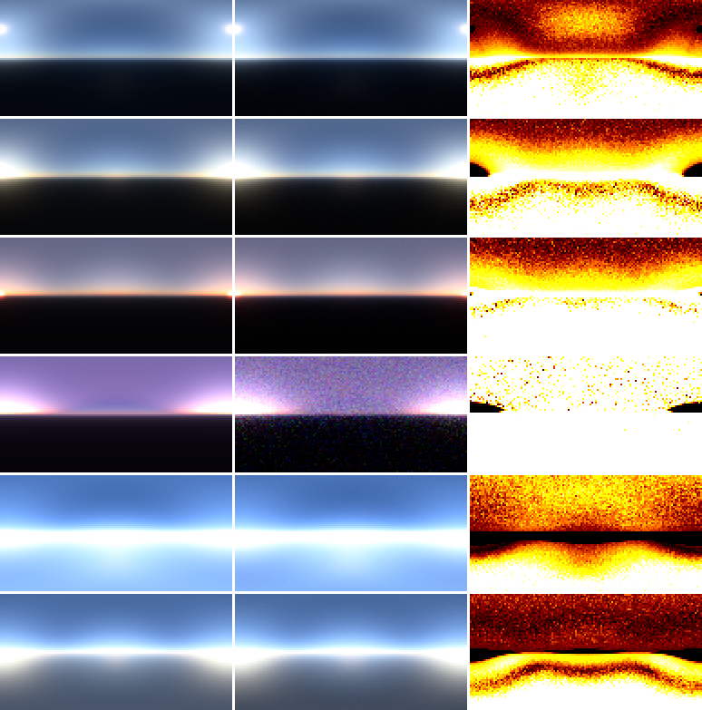

行: 昼 / 低い太陽 / 夕方 / 地球の影 / 高度 10 km / 高度 3 km。列: 近似、パストレース（GT7 SDR、露出は行ごとにパストレースの上半球の中央値）、ΔE_ITP（黒 = 0、黄 = 3、白 = 10 以上）。C、C+A+B の図は `images/v4b_C.png`、`images/v4b_C_A_B.png`。

分かったこと:
- **AOD を現実的にすると、多重散乱の近似は見た目で分かるほど外れる。** 今の薄い大気では ΔE_sys 0.9〜2.6 だったのが、AOD 0.1 で 5.6〜23 になる。多重散乱の割合が今の大気より増え（目標の大気で R 16〜26%、B 36〜51%）、等方の仮定の誤差がそのまま見えるようになる。
- **誤差の向きは条件で逆になる。** 地表付近で太陽が低いと、近似は R の多重散乱を 4 割前後少なく見積もる（今の大気の V4 の夕方 −37% と同じ向きで、より大きい）。高度 10 km では逆に 2 割多く見積もる。
- **誤差が最も大きいのは地平線と、地平線より下の方向**（地表アルベド 0 なので、黒い地面に向かう視線の内散乱だけが写る所）。地平線より上だけでは ΔE_sys 1.3〜7.0（目標の大気）で、高度 3 km は 1.3〜1.4 と小さい。実際の描画では地面は照らされているので、地平線より下の誤差は地面の明るさに埋もれる（量っていない）。
- **Cornette-Shanks（C）の方が二峰性の Mie（C+A+B）より近似の誤差が大きい**（昼で 13.9 → 8.1）。二峰性の Mie は横・後方への散乱が強く（research.md §12.2）、多重散乱が等方に近くなるためと考えている（未検証）。鉛直分布（D）の影響は小さい。
- research.md §12 の案ごとの見た目の差（地平線より上も含む画面全体で A 12〜18、B 5〜10）と比べると、近似の誤差は B の効果と同じくらいで、A の効果より小さい。A〜D を入れること自体の価値はあるが、正しさの保証には多重散乱の近似の改善が要る。

**見た目の比較（2026-10-18、記録のみ）**: V4b-2 は地表アルベド 0 の全天なので、地面を照らす条件の画面でも、近似とパストレースを並べた。
- 条件: 大気 C+A+B+D、5 シナリオ（昼 / 低い太陽 / 夕方 / 高度 10 km / 高度 3 km）。太陽の方と反対の画面（画角 50°、320×180、中心の仰角は research.md §12 と同じ。高度 10 km は −5°）。地表アルベド 0.3（既定。Ψ_ms も同じ値で作る）。太陽ディスクなし。
- パストレース: バッチ `pathtrace_aerosol_views`。散乱最大 32 回、チャンネルあたり 16,384 経路。
- 近似: `reference/compare_v4b_views.py`。今の Ψ_ms（64 方向・等方）と、改善案 H 案 1（research.md §11.4。L₂ に実際の位相関数、太陽中心の 1,024 方向）の 2 通り。近似側の地面は、太陽の直達光と空からの照度（その近似の空を地表で半球積分した表）のランバート反射。GPU の描画（SH の照度）とは別の作り方。
- 露出はシナリオごとに、パストレースの太陽の方の画面の中央値で決め、同じシナリオの画面すべてに同じ値を使う。ΔE_ITP は GT7 SDR で、パストレースのノイズを差し引いた RMS。パストレースのノイズは ΔE で 0.5〜3.4。

ΔE_sys（太陽の方 / 反対）:

| シナリオ | 空（今） | 空（案 1） | 地面（今） | 地面（案 1） |
|---|---|---|---|---|
| 昼 | 7.8 / 6.5 | 7.9 / 6.6 | 5.3 / 3.3 | 4.9 / 2.8 |
| 低い太陽 | 12.2 / 14.6 | 11.0 / 11.4 | 12.8 / 11.0 | 11.0 / 8.5 |
| 夕方 | 16.9 / 15.2 | 15.4 / 13.4 | 16.6 / 12.0 | 14.4 / 10.8 |
| 高度 10 km | 2.8 / 3.1 | 5.3 / 5.8 | 5.4 / 3.6 | 6.3 / 4.6 |
| 高度 3 km | 4.5 / 5.0 | 3.6 / 3.9 | 11.7 / 12.0 | 10.2 / 8.9 |

空の平均輝度の比（近似 / パストレース、R / G / B、太陽の方の画面）:

| シナリオ | 今 | 案 1 |
|---|---|---|
| 昼 | 0.94 / 0.91 / 0.87 | 0.94 / 0.91 / 0.86 |
| 低い太陽 | 0.89 / 0.86 / 0.80 | 0.90 / 0.87 / 0.82 |
| 夕方 | 0.84 / 0.82 / 0.78 | 0.85 / 0.84 / 0.79 |
| 高度 10 km | 0.99 / 0.97 / 0.95 | 0.95 / 0.93 / 0.92 |
| 高度 3 km | 0.95 / 0.93 / 0.93 | 0.95 / 0.95 / 0.94 |

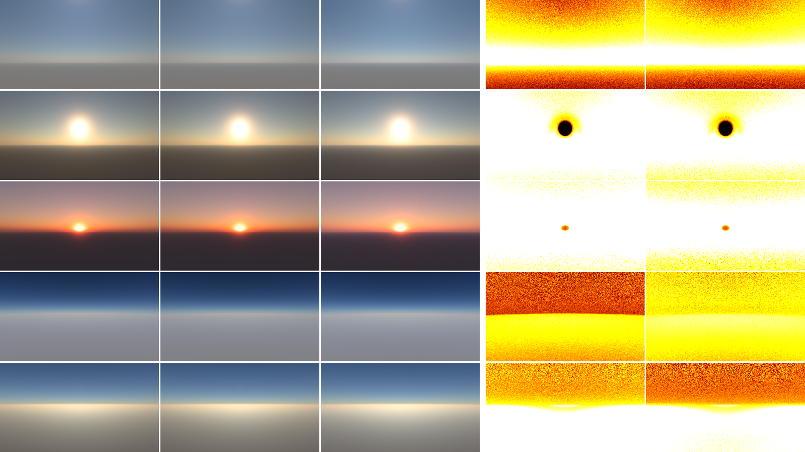
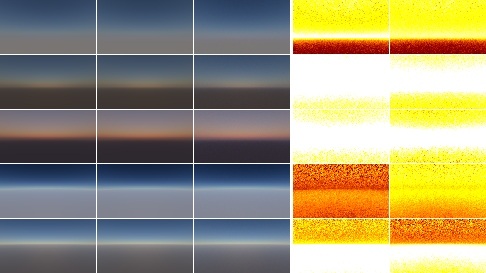

行: 昼 / 低い太陽 / 夕方 / 高度 10 km / 高度 3 km。列: 今の近似、案 1、パストレース、ΔE_ITP（今の近似）、ΔE_ITP（案 1）（黒 = 0、黄 = 3、白 = 10 以上）。

分かったこと:
- **並べると、構図と色の傾向は同じで、近似は全体にやや暗く、青が足りない。** 低い太陽・夕方では、空が 1〜2 割暗く（B は 0.78〜0.80）、ΔE_sys 12〜17 で、画面のほぼ全体が ΔE 10 を超える。昼の地上では 6〜13% 暗く（ΔE_sys 6.5〜7.8）、差は地平線の付近に集まる。高度 10 km の空は ΔE_sys 3 前後。
- **地面を照らすと、足りない色が R から B に変わる。** V4b-2（地表アルベド 0）では R の多重散乱が最も足りなかった。原因は、地表で反射した空の光（青い）が地面と大気の間を往復する分を近似が持たないためと考えている（未検証）。Hillaire 2020 の近似は、L₂ に太陽の直達光の地表反射を 1 回含むだけで、f_ms は地表の反射を含まない。
- **地面の誤差は高度 3 km で大きい**（ΔE_sys 12、B 0.80）。近似側の地面は空からの照度も近似の空から求めているので、空の誤差と、地面と大気の間の往復の不足の両方が入っている。
- **案 1 では解消しない。** 低い太陽・夕方・高度 3 km で ΔE が 1〜3 下がるが、低い太陽・夕方は 10 を超えたまま。高度 10 km は逆に悪化した（空 2.8 → 5.3）。地表アルベド 0 の V4b では、高度 10 km は案 1 で良くなった（地平線より上で 3.2 → 0.7）。今の近似が多重散乱を多めに見積もる分と、地表の往復の不足が打ち消し合っていたためと考えている（未検証）。
- 改善案 H の候補に、地表の反射を含めた f_ms（地面と大気の間の往復）を加える（research.md §11.4）。

### Phase 4.8（2026-10-18、AMD Radeon RX 7800 XT）

エアロゾルのプリセット（1 成分、§5.9）。検証のバッチは `aerosol_presets`、照合は `reference/validate_phase4_8.py`。プリセットは Hillaire2020 の `C`・`C+A`・`C+B`・`C+A+B` と、SpectralFit709 / 2020 の `C+B`・`C+A+B`（A・B を含まない `C`・`C+A` の Mie は色空間で変わらない）。下の値は、Multi-scattering LUT の既定を 40 区間・2 次配置に変えた後のもの（変更の経緯は「Multi-scattering LUT の区間数」）。

**回帰（`base`）**: 変更前のビルドで取ったダンプ（13 テスト・237 ファイル）と比べた。
- 実装を入れた直後（Multi-scattering LUT は 20 区間・等間隔のまま）: 最大相対差 4.1×10⁻⁷（基準 < 10⁻⁶、合格）。ビット一致ではないのは、シェーダーの変更で命令の並びが変わったため。
- 既定を 40 区間・2 次配置に変えた後: Multi-scattering LUT を使わないテスト（透過率・単散乱・分光・地表の影）は変わらず、使うテストは最大 6.9% 変わった（意図した変更）。Phase 3・4・4.5・4.6 の照合（V3・V3b・V3c・V3d・V3e〜V3h・V4・V9 と Multi-scattering LUT の照合）を再実行し、すべて合格。主な変化: Multi-scattering LUT の既定の設定の誤差（倍精度との比）が最大 2.7% → 1.3%・平均 0.22% → 0.10%。V4 の単位照度あたりの絶対 RMSE は昼の B で 1.064×10⁻³ → 1.046×10⁻³ など、わずかに小さくなった。V3 の LUT vs レイマーチはほぼ変わらない（同じ LUT を両方が使う）。

**V3i（媒質と単散乱、基準 < 1×10⁻³）: 不合格（既知の限界）**

| 対象 | V1・V2 と同じ設定 | 区間数を増やした GPU |
|---|---|---|
| Transmittance LUT（500 区間） | 最大 0.48〜0.63%（全 6 件不合格） | 4000 区間でも 0.48〜0.67% |
| 　うち τ < 1 / 1〜3 / 3〜10 / > 10 | 8.8×10⁻⁴ / 1.2×10⁻³ / 1.2×10⁻³ / 4.8×10⁻³（Hillaire2020 C） | 5.5×10⁻⁵ / 2.1×10⁻⁴ / 1.3×10⁻³ / 5.0×10⁻³ |
| 単散乱（視線 2048・太陽方向 256 区間） | 太陽天頂角 85° で 1.0〜4.5×10⁻³、60° の地表付近で 1.3〜1.5×10⁻³（36 件中 16 件不合格） | 太陽方向 1024 区間で全件 < 1×10⁻³（最大 8.8×10⁻⁴） |

- 単散乱の誤差は太陽方向の区間数による。区間数を 4 倍にすると基準を満たすので、実装の誤りではない。AOD 0.1 で地平線付近の太陽方向の光学的厚さが今の大気の数倍になり、台形則の誤差もそれに比例して増える。
- Transmittance LUT の誤差は、透過率が 5% 未満（τ > 3、地平線すれすれのテクセル）に集中し、区間数を増やしても減らない。float32 の積算と惑星座標の精度の限界と考えている（未検証）。τ < 3 なら 4000 区間で 2×10⁻⁴。描画への影響は小さい（透過率が 5% 未満の太陽光はほとんど寄与しない）が、量っていない。
- 既定（500 区間）は変えない。

**V3j（Multi-scattering LUT、基準 < 1%）: 合格**。検証用の設定（入れ子 256 区間）で最大 0.20〜0.22%（6 件）。既定の設定の誤差（記録）は、20 区間・等間隔で最大 24〜34%、40 区間・2 次配置で最大 7.6〜10%。

**V3k（全天 128×64、GT7 SDR、基準: GPU のレイマーチ vs Python の近似の ΔE_ITP の平均 < 0.5）: 合格（40 件）**。ΔE の平均は 0.02〜0.28（地平線より上だけでは 0.01〜0.13）。LUT 経由の描画 vs レイマーチ（記録）は相対 RMSE 0.1〜3.2%、ΔE の平均 0.07〜0.24。
- 既定が 20 区間・等間隔のときは 40 件中 33 件が不合格だった（ΔE の平均 0.4〜4.6、地平線より上は 0.01〜1.3）。Python の近似の Ψ_ms を GPU の LUT に差し替えると GPU のレイマーチと ΔE 0.03〜0.29 で一致したので、差は Multi-scattering LUT の区間数によるものと分かった（媒質・位相関数の表・単散乱の実装は正しい）。

**Multi-scattering LUT の区間数（記録）**: GPU の LUT（Transmittance LUT を引く実用の設定）と検証用の LUT（入れ子 256 区間）との比。ΔE は、Python の近似の描画の Ψ_ms だけを差し替えたときの全天の平均（括弧内は地平線より上）。Hillaire2020 の C+A+B（C もほぼ同じ）。

| 区間数・配置 | 最大誤差 | 平均誤差 | ΔE（昼） | ΔE（低い太陽） | ΔE（夕方） | ΔE（高度 3 km） |
|---|---|---|---|---|---|---|
| 20・等間隔（以前の既定） | 21% | 1.5% | 1.58（0.85） | 2.11（0.86） | 4.08（1.26） | 1.06（0.09） |
| 20・2 次 | 26% | 3.6% | 0.12（0.09） | 0.13（0.07） | 0.22（0.04） | 0.10（0.08） |
| 40・等間隔 | 7.0% | 0.35% | 0.43（0.23） | 0.75（0.28） | 1.24（0.37） | 0.35（0.02） |
| **40・2 次（新しい既定）** | 9.1% | 1.2% | 0.01（0.01） | 0.02（0.01） | 0.05（0.02） | 0.02（0.02） |
| 64・等間隔 | 2.8% | 0.11% | 0.15（0.08） | 0.33（0.12） | 0.48（0.14） | 0.16（0.01） |
| 64・2 次 | 3.3% | 0.44% | 0.02（0.02） | 0.01（0.01） | 0.01（0.01） | 0.02（0.01） |
| 128・等間隔 | 0.6% | 0.03% | 0.03（0.02） | 0.09（0.04） | 0.10（0.03） | 0.05（0.01） |

- 最大誤差・平均誤差は 2 次配置のほうが大きいのに、見た目の誤差は 2 次配置のほうがずっと小さい。誤差の大きいテクセル（高い所・明暗境界）が描画にほとんど使われず、描画に効く地表付近のテクセルを 2 次配置が正しく求めるためと考えている（未検証）。等間隔では、地表付近の点から地平線方向へ伸びる長い光線（数百 km）の最初の区間に、濃いエアロゾルの層（1〜2 km）がすべて入ってしまう。
- 今の大気（Phase 3 の倍精度との比較）では、40 区間・2 次配置は最大 1.3%・平均 0.15% で、以前の既定（20 区間・等間隔、最大 2.7%）より小さい。
- GPU 時間（V8、Release、1080p / 4K）: Multi-scattering LUT 0.047 ms（以前の 20 区間・等間隔は 0.027 ms）。媒質を変えたときだけ作るので、毎フレームの合計は変わらない。

**V3b（太陽の周り ±6°、低い太陽・夕方、記録）**: LUT 描画 / レイマーチの光輪のピークの比 0.995〜1.013、広がりの比 0.998〜1.003。角度の帯ごとの平均の比は 0.995〜1.019（夕方の 0〜1° が最大）。

**V4b（地表アルベド 0 の GPU の LUT 描画 vs Phase 4.7 のパストレース、記録のみ）**: ΔE_sys（太陽側 / 反対側、括弧内は地平線より上）。Python の近似（§14 Phase 4.7）とほぼ同じ（差は 0.2 以内）。

| 大気 | 昼 | 低い太陽 | 夕方 | 高度 10 km | 高度 3 km |
|---|---|---|---|---|---|
| C | 13.8 / 14.4（3.8 / 7.1） | 13.1 / 13.7（6.6 / 6.8） | 23.0 / 22.3（9.5 / 7.1） | 9.9 / 8.7（3.9 / 5.2） | 10.4 / 11.2（1.7 / 1.9） |
| C+A+B | 8.0 / 8.2（2.9 / 3.0） | 8.3 / 9.1（5.4 / 5.5） | 14.4 / 14.6（7.1 / 5.0） | 5.5 / 5.4（3.1 / 4.1） | 5.7 / 6.7（1.5 / 1.7） |

**V9（単散乱、地表 0.2 km、128 方向、Mie の波長依存を入れた分光リファレンス、記録）**

| 係数セット・プリセット | 太陽天頂角 30° ΔE_ITP 平均 / 最大 | 60° | 85° | 輝度の誤差（平均、30 / 60 / 85°） |
|---|---|---|---|---|
| `SpectralFit709` C+B | 3.2 / 4.6 | 2.5 / 5.1 | 8.1 / 18.1 | +2.5% / +1.7% / −1.8% |
| `SpectralFit709` C+A+B | 2.9 / 3.8 | 2.0 / 5.1 | 8.1 / 17.6 | +1.2% / +0.3% / −2.6% |
| `SpectralFit2020` C+B | 1.9 / 2.9 | 1.5 / 2.8 | 1.6 / 8.7 | −1.4% / −1.2% / +1.4% |
| `SpectralFit2020` C+A+B | 1.8 / 2.7 | 1.5 / 2.7 | 1.5 / 4.4 | −1.5% / −1.3% / +1.1% |

- 今の大気の V9（§14 Phase 3: SpectralFit2020 で 1.4〜3.2、SpectralFit709 で 3.8〜9.0）と同程度で、Mie の分光フィット（§12 Q22）で悪化はしていない。`SpectralFit2020` が分光計算に最も近いのは変わらない。

**画面での確認**: UI の「Aerosol preset」の切り替えは、ビルドと起動前の処理（位相関数の表の転送）までで、実際の画面では確かめていない。

分かったこと:
- **実装（媒質・解析式の鉛直分布・位相関数の表・単散乱・多重散乱の掛け方）は Python と一致した。** 基準を外れたのは、どれも積分の区間数か float32 の精度によるもの。
- **AOD 0.1 では、今の大気向けに決めた品質の設定が足りなくなる。** Multi-scattering LUT の等間隔 20 区間（見た目で ΔE 最大 4.6）を 40 区間・2 次配置にした。Transmittance LUT（500 区間）は地平線すれすれで 0.5%、単散乱の検証用の入れ子 256 区間は低い太陽で 0.4% の誤差になる（既知の限界）。
- **GPU の LUT 描画は、パストレースとの差でも Python の近似と同じ振る舞いをする**（V4b）。多重散乱の近似の誤差（Phase 4.7）は、GPU の実装でもそのまま残る。

---

## 参考

- GT7 Tone Mapping: K. Yasutomi, K. Suzuki, H. Uchimura, "Driving Toward Reality: Physically Based Tone Mapping and Perceptual Fidelity in Gran Turismo 7", SIGGRAPH 2025 PBS Course. https://blog.selfshadow.com/publications/s2025-shading-course/
- GraphicsTest/LUTGenGT7（Python 移植・元 C++ と照合済み）、GraphicsTest/HDR/testbed（HLSL 実装・スワップチェーン・PQ）
- 大気: research.md の参考文献
