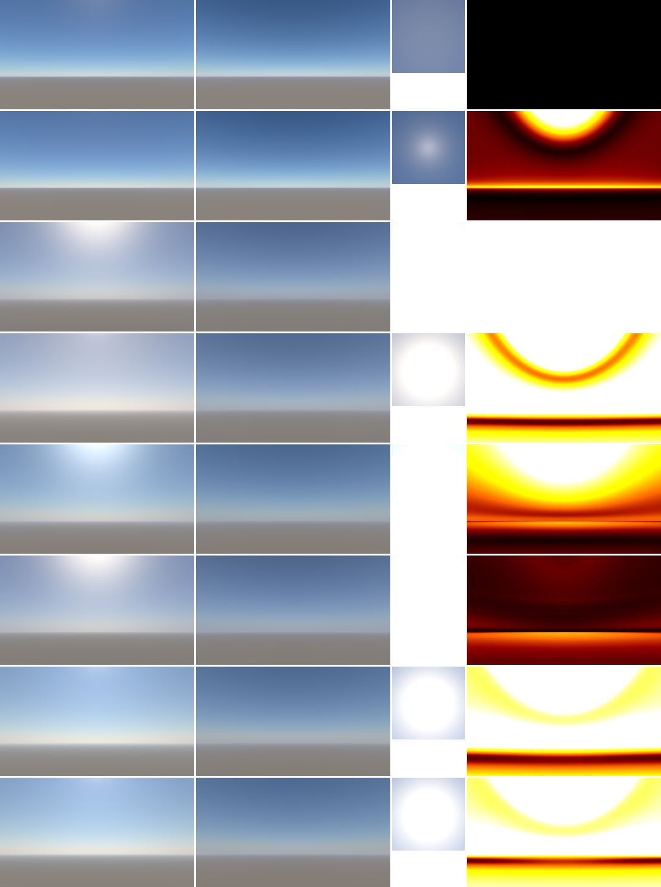
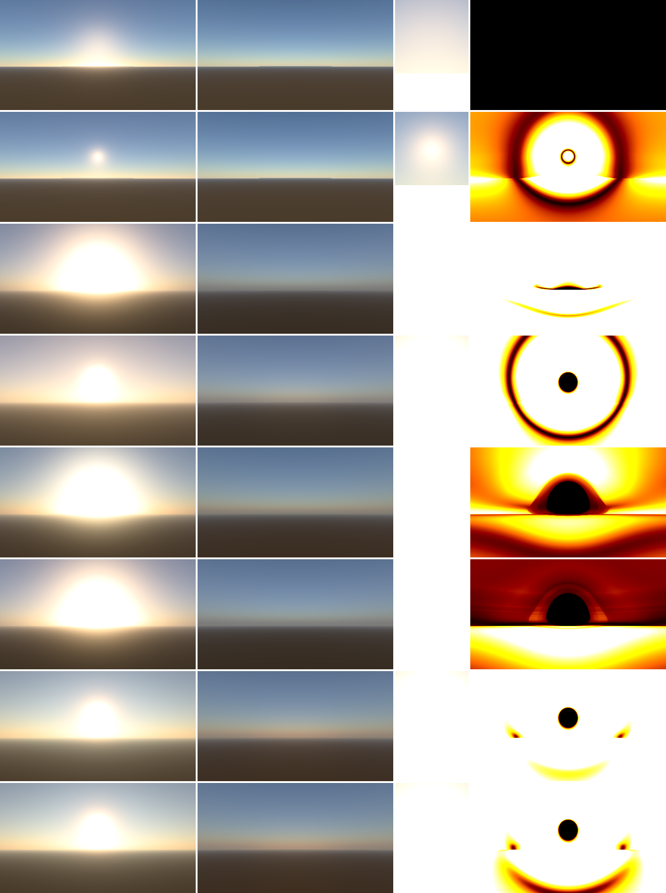
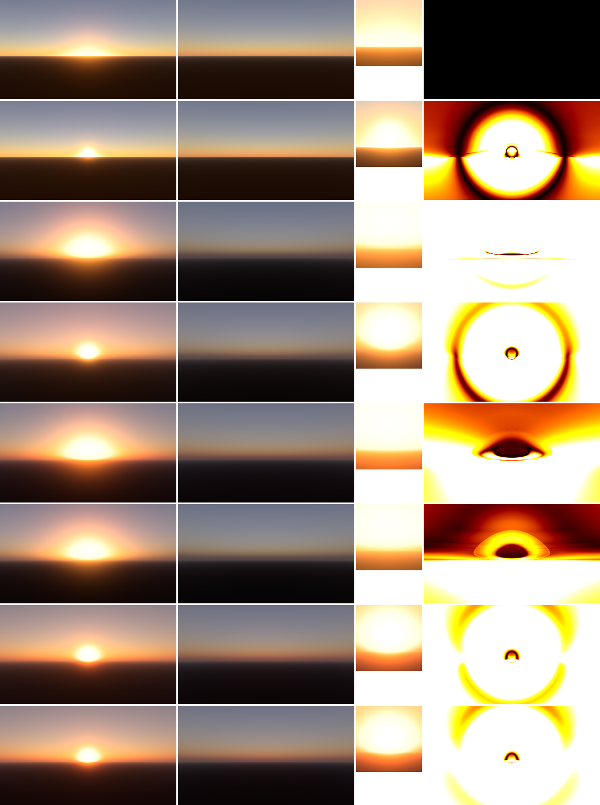
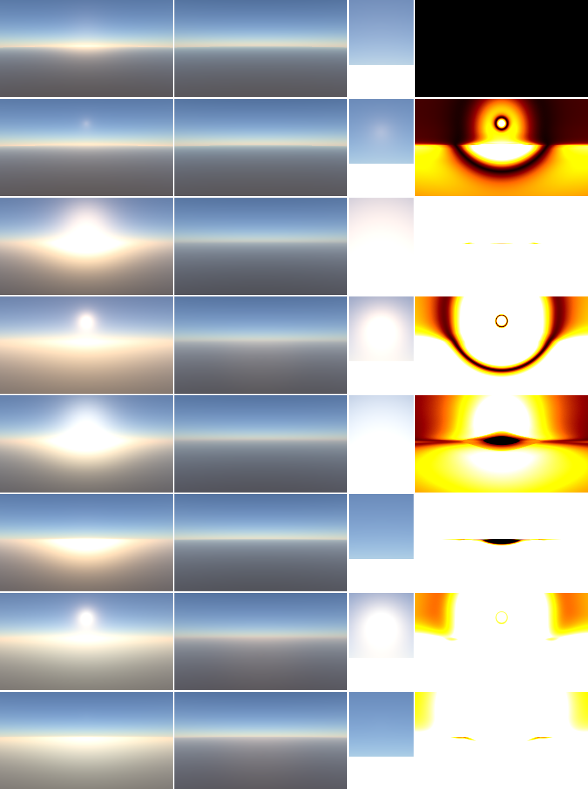
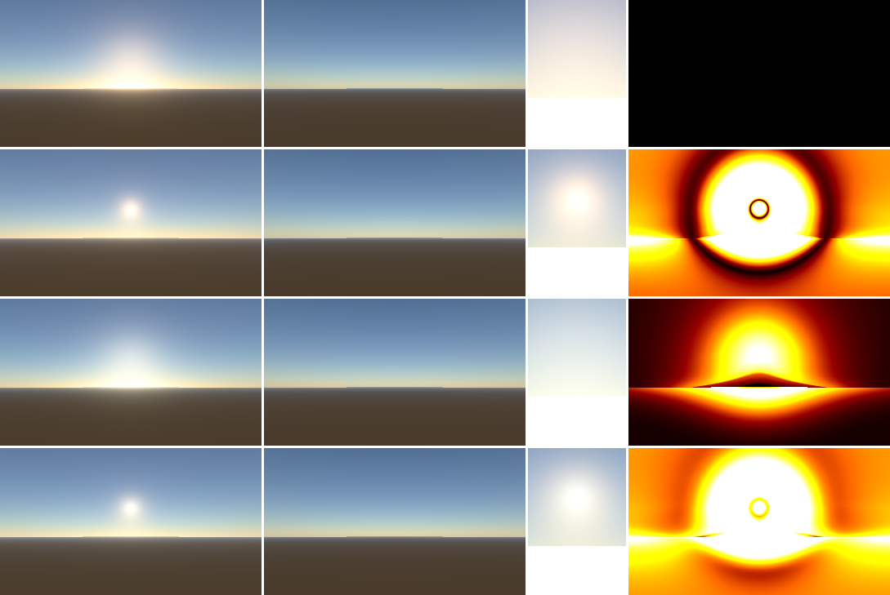
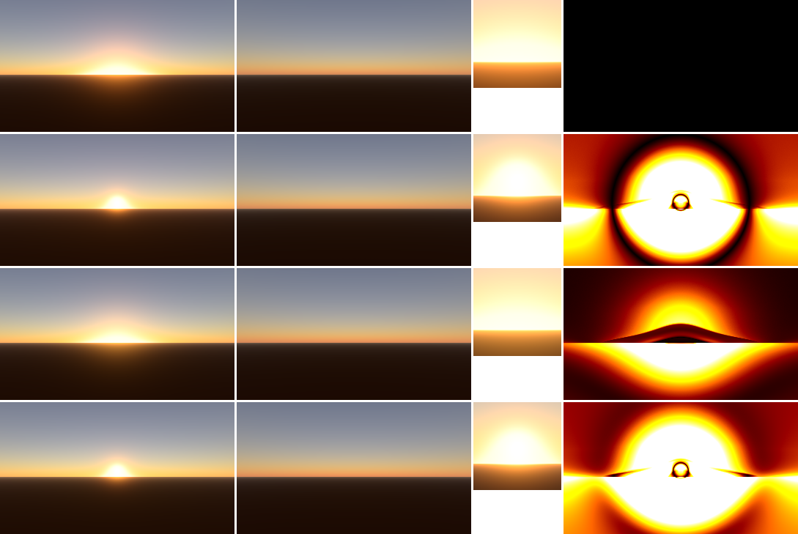

# 大気散乱 リアルタイムレンダリング 調査レポート

- 作成日: 2026-10-15
- 目的: 将来 Shoga ランタイムに組み込むことを前提とした、大気散乱（空・空気遠近法）の検証実装に向けた事前調査
- 統合先の前提（Shoga 現状の確認結果）
  - D3D12 / HLSL、Bindless 前提の RHI、RenderGraph、Forward / Deferred の両パス、ForwardTranslucent パスあり
  - `RenderFeatureRegistry` による拡張 Feature 登録が可能（`ViewPipelineDesc::extensionFeatures`）
  - 空・IBL は未実装。環境光は定数 `ambientColor`（`LightingContext.hlsli`, `DeferredLightingShared.hlsli`）
  - `ExtractedDirectionalLight` は `directionWs / intensity / color` のみで、単位は未定義（デフォルト 1.0）
  - 露出は手動スカラー（`ViewPipelineExposureDesc`）+ `ExposureCompute` スロットあり
  - `ShadowDepth` パス種別は存在するが、ディレクショナルライト用シャドウマップの実装状況は未確認

---

## 1. 手法の系譜

| 系統 | 代表 | 概要 | 動的な時刻変化 | 宇宙視点 | 空気遠近法 | 多重散乱 | ゲーム用途での評価 |
|---|---|---|---|---|---|---|---|
| 解析モデル | Preetham 1999, Hosek-Wilkie 2012, Prague (Wilkie et al. 2021) | 実測/シミュレーション結果にフィットした式で天空輝度を返す | ○ | × | ×（別途必要） | フィットに内包 | 地上視点の空ドーム専用。高度変更・大気パラメータ変更不可。IBL ベイク用途向き |
| 実時間レイマーチ | Nishita 1993, O'Neil 2005 (GPU Gems 2) | ピクセルごとに視線・光線を数値積分 | ○ | ○ | ○ | ×（単散乱のみ） | 安価だが多重散乱なしで夕景・地平線が暗く不自然 |
| 4D/3D 事前計算 LUT | Bruneton & Neyret 2008, Elek 2009, Yusov 2013, Bruneton 2017 (改良版実装) | 散乱を (r, μ, μs, ν) の 4D テーブルに次数ごとに反復事前計算 | △（再計算は重い／時分割） | ○ | ○ | ○（反復回数分） | 品質は高いが大気パラメータ変更時の再計算コストが大きい（論文中、Bruneton 2017 実装で全 LUT 更新 250ms@GTX1080）。地平線付近の LUT アーティファクト、小惑星で精度低下 |
| 低次元 LUT + 多重散乱近似 | **Hillaire 2020 (EGSR, UE4/5 SkyAtmosphere)** | 透過率 2D・多重散乱 2D・Sky-View 2D・空気遠近法 3D の小さな LUT を毎フレーム生成 | ◎（毎フレーム更新可能） | ○（画面空間レイマーチに切替） | ○（フラスタム 3D LUT） | ○（無限次数を等方近似） | 現在の事実上の標準。UE4/5、Bevy 0.16+ などが採用 |
| パストレース | Hillaire 2020 中のリファレンス, 各種オフライン | デルタトラッキング等で厳密解 | － | ○ | ○ | ○（厳密） | 実時間用ではない。**検証用の正解生成に使う** |

補足:
- Frostbite (Hillaire 2016) は Bruneton 系 4D LUT を時分割更新し、空気遠近法をフラスタムボリュームで適用。2020 手法の前身。
- Ghost of Tsushima (Patry, SIGGRAPH 2021 Advances) は Bruneton/Elek/Yusov 系の 3D LUT を使い、毎フレーム太陽・月角度で 2D にリサンプリング。霞はフロクセル (128x64x64, 10cm–100km, 指数スライス) で別途計算。Rayleigh 誤差を最小化する独自 LMS 色空間を使用。
- Hillaire 2020 のフォローアップとして LUT パラメタ化や多重散乱近似そのものを改良した 2024–2026 年の論文は今回の調査では見つからなかった。周辺の発展は以下:
  - Schneegans et al. 2024: Mie 理論で成分ごとの位相関数・係数を事前計算（Bruneton モデル拡張、火星等）。Hillaire モデルへの統合は「今後の課題」と記載。
  - Schneegans et al. 2025 (CGF): 日食の物理ベース実時間レンダリング（屈折含む）。Bruneton モデルを拡張。Hillaire モデルは宇宙視点向けに最適化されていない点を指摘。
  - Bevy 0.16 (2025) で Hillaire 2020 を実装、その後 LUT モードと Raymarched モード（画面空間で直接積分、鋭いボリュームシャドウ向け）の切替、0.18 で大気によるシーンライティング（遮蔽・PBR）に拡張。

---

## 2. 推奨: Hillaire 2020 をベースにする

理由:
1. **全 LUT を毎フレーム再生成できるコスト**（GTX 1080 で LUT 生成合計 約 0.17ms）。時刻・天候・大気パラメータを実行時に自由に変えられる。ゲームランタイムでの要件（TOD、天候、アーティスト調整）に合う。
2. **多重散乱が非反復**。濃い大気（アート調整で密度を上げた場合）でも発散せず、エネルギー保存的。Bruneton は濃い大気で反復数が爆発し、FP32 でも数値的に破綻する例が論文で示されている。
3. **地上〜宇宙まで単一モデル**。宇宙視点は画面空間レイマーチへ切替。
4. **スケーラブル**（モバイル iPhone 6s で約 1ms）。LUT 解像度とステップ数で品質を調整できる。
5. **参照実装が MIT ライセンス**（sebh/UnrealEngineSkyAtmosphere, D3D11/HLSL）。同リポジトリに GPU パストレーサーと Bruneton 実装も含まれ、比較検証の土台がそのまま使える。
6. 業界採用実績（UE4.24+/UE5, Fortnite, Bevy）と、比較対象（UE5 の SkyAtmosphere 実装・パラメータ）が豊富。

Bruneton 2017 は「比較用リファレンス」として位置付ける（BSD-3、スペクトル→輝度変換の扱いが丁寧）。

---

## 3. Hillaire 2020 の詳細

### 3.1 大気モデル（地球、RGB）

| 成分 | 散乱係数 (1/km) | 吸収係数 (1/km) | 密度分布 | 位相関数 |
|---|---|---|---|---|
| Rayleigh | (5.802, 13.558, 33.1)e-3 | 0 | exp(-h / 8km) | 3/(16π)·(1+cos²θ) |
| Mie | 3.996e-3 | 0.444e-3（消散 4.44e-3、単散乱アルベド 0.9） | exp(-h / 1.2km) | Cornette-Shanks, g = 0.8（HG でも可） |
| オゾン | 0 | (0.650, 1.881, 0.085)e-3 | 25km 中心・幅 30km のテント: max(0, 1 - \|h-25\|/15) | － |

- 地表半径 6360km、大気上端 6460km（100km 層）
- 地表は拡散反射、論文本文はアルベド 0.3（参照実装の既定値は 0）
- 太陽視半径: 参照実装 0.004675 rad
- 注意: 論文 Table 1 では Mie 吸収が 4.40 と読めるが、参照実装は消散 4.44・散乱 3.996（= 吸収 0.444）。**実装値を正とする**
- オゾンは散乱せず吸収のみだが、夕暮れ時の天頂の青さに必須（Kutz 2013）

### 3.2 LUT 構成と論文記載の性能

| LUT | 次元/パラメタ | PC 解像度 (GTX1080) | ステップ | 時間 | モバイル (iPhone 6s) |
|---|---|---|---|---|---|
| Transmittance | 2D: 高度 × 視線天頂角（Bruneton 2017 のパラメタ化） | 256×64 | 40 | 0.01ms | 256×64 / 40 / 0.53ms |
| Multi-scattering | 2D: 高度 × 太陽天頂角 | 32×32 | 20（方向数 64） | 0.07ms | 32×32 / 20 / 0.12ms |
| Sky-View | 2D: 経度（太陽相対方位）× 緯度（非線形） | 200×100（参照実装 192×108） | 30 | 0.05ms | 96×50 / 8 / 0.27ms |
| Aerial Perspective | 3D: 画面 32×32 × 深度 32 スライス（0–32km） | 32³ | 30 | 0.04ms | 32²×16 / 8 / 0.11ms |

- 画面への合成（空 + 空気遠近法）0.14ms、合計 0.31ms @1280×720
- 宇宙視点は Sky-View LUT を使わず画面空間レイマーチ（合計 0.5ms）
- Fortnite の iPhone 6s で空全体 約 1ms
- ボリュームシャドウ有効時（CSM + 32 サンプル/ピクセルのレイマーチ + ジッタ + TAA）で 1.0ms

### 3.3 各 LUT の要点

**Transmittance LUT**: 太陽方向へのセカンダリレイマーチを置き換える。Bruneton と同じパラメタ化（地平線付近にテクセルを集中）。大気パラメータが変わった時のみ更新でよい。

**Multi-scattering LUT（本手法の核心）**:
- 2 次以上の散乱は等方的と仮定（位相関数を無視）。
- 各点で 64 方向にレイマーチし、2 次散乱輝度 L₂ と、周囲から等方的に戻ってくるエネルギーの割合 f_ms を積分。
- 無限次数の和を等比級数で近似: F_ms = 1 / (1 - f_ms)、Ψ_ms = L₂ · F_ms。
- 単散乱積分に `σs(x) · Ψ_ms` を加算するだけで多重散乱を反映（式 11: Lscat = σs (T·S·p + Ψ_ms) E）。
- 限界: Mie の g が大きいほど誤差増（RMSE: g=0 で 0.0058、g=0.8 で 0.039）。非常に濃い大気では色相がずれる。

**Sky-View LUT**:
- カメラ位置の局所 up を基準にした経緯度テクスチャ。地平線が常に水平線。
- 緯度を `v = 0.5 + 0.5·sign(l)·sqrt(|l| / (π/2))` で非線形化し地平線付近を高密度化。
- 太陽ディスクは低解像度・非線形マッピングのため LUT に含めず、後段で合成。
- 参照実装は経度を「太陽との相対方位」で持つため光源 1 つ前提。月など複数光源の散乱を入れるなら絶対方位化などの変更が必要。

**Aerial Perspective (AP) ボリューム**:
- カメラフラスタムに沿った 3D テクスチャ。RGB = 内散乱、A = 透過率（RGB 透過率の平均＝グレースケール）。
- 不透明物体へはライティング後のフルスクリーンパスで適用（Sky-View 合成と同時）。
- 半透明（フォワード）は論文では頂点単位。デスクトップならピクセル単位で 3D テクスチャをサンプルしても安価。
- 透過率がモノクロである点は近似。遠景の色付き減衰が必要なら RGB 透過率を別ボリュームで持つ（コスト 2 倍）か、Dual-source blending で RGB 透過率を合成する方法がある（UE には有色透過率オプションあり）。

### 3.4 論文で明示された限界と今後の課題
- 等方多重散乱近似による誤差（強い前方散乱、高密度大気）
- 空間的に変化する大気条件（局所的な霧・雲との統合）は対象外
- RGB レンダリング（スペクトルは future work）
- ボリュームシャドウ（山・雲の光芒）は LUT では表現不可 → レイマーチ + シャドウマップが必要

---

## 4. 実装時の落とし穴・設計上の論点

### 4.1 単位・露出・浮動小数点範囲（最重要）
- 物理単位では太陽照度は地表で約 10⁵ lux、太陽ディスク輝度は 10⁹ cd/m² オーダー。**FP16 の最大値 65504 を容易に超える**。
- 対策は二択:
  1. **物理単位 + プリエクスポージャ**（Frostbite / UE 方式）: シェーダ内で露出値を事前乗算してから FP16 RT に書く。自動露出（EV100）と一体で設計する必要がある。
  2. **正規化単位**（太陽照度 = 1 などとし、輝度スケールを露出で吸収）: 参照実装のデモはこちら。検証は楽だが、人工光源や発光体との物理的な比率が崩れる。
- Shoga は現状ライト強度の単位が未定義なので、**大気を入れる前にライト単位系（lux / cd / nit）と露出系の方針を決める必要がある**。これは大気以外（IBL、発光、ブルーム）にも波及する決定事項。

### 4.2 座標と精度
- 惑星半径 6360km を float32 で扱うと ULP ≈ 0.5m。km 単位で計算しても相対精度は同じ。
- 惑星中心原点で計算するのは LUT 生成内部のみに留め、レンダリング側は「カメラ高度」「惑星中心からのカメラ相対ベクトル」で渡す。
- 地平線付近のレイ-球交差は判別式の桁落ちが起きやすい。数値的に安定な交差式を使い、地表直下に潜らないよう小さなオフセット（参照実装は `PLANET_RADIUS_OFFSET = 0.01km`）を入れる。
- ワールド座標系（Shoga は Y-up と思われる。要確認）と惑星座標系の変換、ワールド単位（m）↔ 大気計算単位（km）のスケールを一箇所に集約する。
- 大規模ワールドや惑星規模を将来想定するなら、平面ワールドの「惑星上の原点位置」を指定するパラメータを用意する（UE の Transform Mode に相当）。

### 4.3 地平線・低太陽高度
- Transmittance LUT の地平線付近は境界でアーティファクトが出やすい（three-geospatial や Bruneton 系実装でも完全除去できていないと明記）。サブテクセル UV 補正（`fromUnitToSubUvs`）が必要。
- 日没前後は Sky-View LUT の解像度不足（地球の影、太陽周り）が出る。Sky-View LUT の解像度とステップ数、または画面空間レイマーチへのフォールバックを比較検証項目にする。
- 夜間（太陽が地平線下）は月光源の追加、星空、Purkinje シフトなどが別途必要（範囲外としてよい）。

### 4.4 太陽ディスク
- Sky-View LUT とは別に、視線方向と太陽方向の角度で解析的に描画し、透過率 LUT を掛ける。
- 周縁減光（limb darkening）の有無。
- ブルーム閾値との相性（物理単位なら極端に明るい）。

### 4.5 時間的安定性
- LUT 生成は低ステップでもほぼノイズなしだが、ボリュームシャドウのレイマーチを入れる場合はブルーノイズジッタ + TAA/再投影が前提。
- Shoga は MotionVectors パスがあるので、TAA または専用の時間フィルタと組み合わせ可能。

### 4.6 スペクトル vs RGB
- 標準は 3 波長相当の RGB。夕景の色相・彩度に誤差が出る。
- Bruneton 2017 は複数波長で計算して輝度/RGB へ変換する方式を持つ。Ghost of Tsushima は Rayleigh 透過率誤差を最小化する LMS 系の色空間を採用。
- 検証実装では RGB で開始し、スペクトルリファレンス（オフライン）との差を測ってから必要性を判断するのが妥当。

### 4.7 ワイドカラーガマット
- 係数は sRGB/Rec.709 原色前提の値。Shoga/HDR 出力がより広い作業色空間を使うなら係数の再導出が必要（GraphicsTest/WideColorGamutLighting との整合を確認）。

---

## 5. エンジン統合で必要な接点（Shoga 視点）

| 接点 | 内容 | Shoga の現状 / 必要な変更 |
|---|---|---|
| 大気パラメータ | 惑星半径、各成分係数・密度プロファイル、地表アルベド、太陽視半径 | Scene 側にコンポーネント（例: `SkyAtmosphereComponent`）と Extract 構造体を追加 |
| 太陽ライト | ディレクショナルライトを大気の光源として扱い、**透過率で減衰させた色をサーフェスライティングに使う**（カメラ位置で 1 回、またはピクセル単位） | `ExtractedDirectionalLight` に「大気光源」フラグ・照度単位を追加 |
| 空の描画 | Sky-View LUT + 太陽ディスクを背景として合成 | 背景（深度 = far）領域を描くパスが必要。Deferred は Lighting 後、Forward は Opaque 後 |
| 空気遠近法（不透明） | AP ボリュームを深度から引いて合成 | ライティング後・トーンマップ前のフルスクリーンパス |
| 空気遠近法（半透明） | ForwardTranslucent のピクセルシェーダで AP ボリュームを参照 | Bindless なので AP ボリュームのインデックスを view 定数に入れるだけで済む |
| 環境光（スカイライト） | 空からの拡散照度。定数 ambient の置換 | 簡易: 多重散乱 LUT / Sky-View LUT から SH or 照度を算出。本格: 空キューブマップのリアルタイムキャプチャ＋プリフィルタ（GraphicsTest/IBL の成果と接続） |
| LUT の寿命 | Transmittance / Multi-scattering はパラメータ変更時のみ、Sky-View / AP はビューごと毎フレーム | RenderGraph の永続リソース（外部インポート）と、ビューごと一時リソースの区別。エディタ+ゲームの複数ビュー対応 |
| ボリュームシャドウ（光芒） | ディレクショナルシャドウマップ参照のレイマーチ | シャドウマップ実装状況に依存。後段フェーズ |
| ハイトフォグ / ボリュメトリックフォグ / 雲 | 大気透過率 LUT・AP と同じ照明モデルを共有 | 将来拡張。フロクセル基盤を作るなら AP ボリュームと統合可能 |
| 露出 | 物理単位ならプリエクスポージャと自動露出 | 4.1 の決定次第 |

RenderGraph 上のパス順（Deferred の場合の案）:
```
[Compute] TransmittanceLUT        (パラメータ変更時)
[Compute] MultiScatteringLUT      (パラメータ変更時)
[Compute] SkyViewLUT              (ビュー毎)
[Compute] AerialPerspectiveVolume (ビュー毎)
DepthPrepass → GBuffer → DeferredLighting
[Graphics] Sky + Sun disk + AerialPerspective 合成   (SceneColor へ)
ForwardTranslucent (AP をピクセルで適用)
Exposure → ToneMapping
```
LUT 生成 4 パスは依存関係が浅く、非同期コンピュートに載せやすい。

---

## 6. 他エンジン・実装の比較メモ

| 実装 | 方式 | 特徴 / 参考点 |
|---|---|---|
| UE4.24+/UE5 SkyAtmosphere | Hillaire 2020 | 原典。AP 開始距離・距離スケール、ハイトフォグへのライティング、半透明への AP（モバイルは頂点単位）、Fast Sky / AP の CVar で品質切替 |
| sebh/UnrealEngineSkyAtmosphere (MIT) | Hillaire 2020 + Bruneton + パストレーサー | D3D11/HLSL。検証・比較用のベース。最終更新 2022 |
| ebruneton/precomputed_atmospheric_scattering (BSD-3) | Bruneton 2017 | スペクトル→輝度変換、厳密な LUT パラメタ化、ドキュメント豊富。2025 年にも更新あり |
| Bevy (0.16+) | Hillaire 2020 | LUT / Raymarched モード切替、シーン単位↔メートル変換係数、0.18 で大気によるシーンライティング。比較的新しい実装として設計の参考になる |
| takram three-geospatial (MIT) | Bruneton 2017 | Web 向け。ECEF 対応・Stars・AerialPerspective 合成。光芒は未実装、地平線アーティファクトは完全には消せないと明記 |
| Ghost of Tsushima | Bruneton 系 3D LUT + フロクセル霞 | 3D→2D 毎フレームリサンプル、雲/霞/パーティクルの照明統合、Purkinje、照度ベース露出 |
| Frostbite (2016) | Bruneton 系 4D LUT 時分割 | 物理単位・露出系との統合、雲との合成 |

未確認事項（推測で書かない）: Unity HDRP Physically Based Sky の現行実装詳細、UE5 の現行 LUT 既定解像度。必要なら追加調査する。

---

## 7. 検証方法の提案

1. **リファレンス生成**: GPU パストレーサー（デルタトラッキング + 比率トラッキング、散乱次数 N 指定）を検証アプリ内に実装、または参照実装のものを移植。Python/NumPy による単散乱・透過率のオフライン積分も CPU ゴールデンとして用意（GraphicsTest/HDR の `pyref` / `golden` と同じ運用）。
2. **比較シナリオ**（論文と同条件 + 追加）
   - 昼（太陽高度 30–60°）、夕暮れ（0–5°）、太陽が地平線下（地球の影）、上空 10–80km、宇宙視点
   - 濃い大気（Rayleigh/Mie ×5〜×50）、Mie g = 0 / 0.8 / 0.95
   - 火星風・小惑星（パラメタ化の頑健性）
3. **指標**: RGB 別 RMSE（論文値 昼 ~1e-3 オーダーと比較）、相対誤差マップ、地平線付近の 1D プロファイル、LUT 解像度・ステップ数を振ったときの誤差-コスト曲線
4. **性能**: パス別 GPU 時間（PIX / Tracy のマーカー）、解像度別、Sky-View LUT vs 画面空間レイマーチ
5. **安定性**: 太陽高度を連続変化させた際のちらつき・バンディング、カメラ高度遷移（地上→宇宙）のポッピング

---

## 8. 段階的な検証実装計画（案）

| フェーズ | 内容 | 完了条件 |
|---|---|---|
| P0 | 単位系・露出方針、座標系、検証アプリの土台（D3D12/HLSL、Shoga RHI を使うか単独か）を決定 | 決定事項の文書化 |
| P1 | Transmittance + 単散乱の画面空間レイマーチ（リファレンス兼用）、パストレーサー | パストレーサーとの単散乱一致 |
| P2 | Multi-scattering LUT、Sky-View LUT、太陽ディスク | 論文 Fig.9 相当シナリオで RMSE が論文と同オーダー |
| P3 | Aerial Perspective ボリューム、不透明/半透明への適用、太陽光の透過率減衰をサーフェスライティングに反映 | 地形・オブジェクトありのシーンで破綻なし、性能計測 |
| P4 | スカイライト（環境光）生成、IBL 連携 | 定数 ambient を置換 |
| P5（任意） | ボリュームシャドウ（光芒）、宇宙視点、月/夜、スペクトル比較 | － |
| P6 | Shoga への RenderFeature としての統合設計 | 設計レビュー |

---

## 9. 決める必要がある事項（次ステップ前に確認したい）

1. **ライトの単位系と露出**: 物理単位（lux, EV100, プリエクスポージャ）で行くか、正規化単位で行くか。
2. **検証アプリの土台**: Shoga の RHI/RenderGraph の上に作るか、GraphicsTest の他プロジェクトと同様に単独の D3D12 アプリにするか。
3. **対象スコープ**: 地上〜高高度のみか、宇宙視点・惑星表現まで必要か。夜空・月は必要か。
4. **プラットフォーム**: Shoga はクロスプラットフォーム前提だが、モバイルクラスの GPU まで品質スケーリングを検証するか。
5. **雲・フォグとの統合**を将来計画に含めるか（AP ボリュームをフロクセル基盤として設計するかに影響）。
6. **外部コード利用**: 参照実装（MIT / BSD-3）からの移植を許容するか、論文から独自実装するか。

---

## 10. 追加調査: 空気遠近法のボリュームと影（光芒）のブロック状の見た目（2026-10-16）

背景: Phase 4.5 で空気遠近法のボリューム（32×32×32）の単散乱に太陽のシャドウマップを掛けた。カメラを地表近くに置き、太陽が低いと、球や山の影がボリュームの格子（画角 60° で 1 ボクセル ~1.9°）の大きさのブロックとして見える。他の実装がこれをどう扱っているかを調べた。

### 10.1 何が起きているか（本実装）
- Hillaire 2020 の LUT 方式は「空気遠近法は画面上でも奥行きでも滑らか」という前提に立つ。講演スライドも、高周波を作るのは地平線とボリュームの影だけだと述べている（*"Only the horizon and volumetric shadows create high frequencies"*）。影を入れると、この前提が崩れる。
- 本実装では次の 3 つが重なっている。
  1. ボリュームの画面方向の解像度（32×32）。
  2. ボリュームが引くのは全体のカスケードだけ（1 テクセル 約 10 m）。近くの半径 2 m の球の影は、このテクセルより細い。
  3. 1 回の比較で、低域通過フィルターをかけていない。

### 10.2 他の実装の対処
| 実装 | 方式 | 影の扱い | 出典 |
|---|---|---|---|
| UE Sky Atmosphere | 空気遠近法を froxel の LUT に入れる（Hillaire 2020 そのもの） | ディレクショナルライトの「Cast Shadow on Atmosphere」と `r.SkyAtmosphere.SampleLightShadowmap` で、大気のボリュームの影を作る。LUT の解像度は `r.SkyAtmosphere.AerialPerspectiveLUT.Width` / `.DepthResolution` で上げられる（3D テクスチャなのでメモリが増える）。映像向けには `r.SkyAtmosphere.FastSkyLUT=0` と `r.SkyAtmosphere.AerialPerspectiveLUT.FastApplyOnOpaque=0` で LUT の最適化を切り、画面のレイマーチにする（コスト増。高周波の模様が TAA で消えないことがある、とドキュメントに注記）。空気遠近法の開始距離 `aerial_perspective_start_depth` は既定 0.1 km（目的は性能） | UE ドキュメント（Sky Atmosphere、Python API） |
| UE Volumetric Fog | カメラの視錐台に沿った低解像度の froxel（高さフォグ・ボリュメトリックフォグ用） | ディレクショナルライト 1 灯を CSM（または静的な影）で遮る。froxel の粗さは、フレームごとに違うボクセル内のジッターと、強い時間方向の再投影で隠す。代償は動く光の残像 | UE ドキュメント（Volumetric Fog） |
| Assassin's Creed IV（Wronski 2014） | froxel 160×90×64（または 128） | シャドウマップ（4 カスケード 1k×1k）をそのまま引くと、細かさがボリュームのナイキスト周波数を超えて、エイリアシングとちらつきが出た。指数シャドウマップ（ESM）にして 256² に縮小し、ぼかしてから引く（低域通過フィルター）。光漏れは媒質の中では目立たない | AC4 GDC 2014 スライド |
| Frostbite（Hillaire 2015） | 段階的な（カスケード）消散のボリューム | 任意の光源から影を落とせる、単純なボリュームのシャドウマップ | SIGGRAPH 2015 Advances の要旨 |
| Bevy | LUT モード（3D の内散乱 LUT）と、レイマーチのモード | LUT モードは影の解像度が LUT の画面方向の解像度に制限されると、設計文書が明記。鋭いボリュームの影が要るときは、画面のレイマーチのモード（Sky-View LUT・空気遠近法の LUT を使わない）。設計文書（未実装の提案を含む）には、ジッター・TAA、時間方向の再投影の案もある | Bevy の AtmosphereMode のドキュメント、設計文書（HackMD） |
| Bruneton 2017 | LUT（4D の散乱） | ピクセルごとに、視線上で影に入る長さ `shadow_length` を求め、その区間の散乱を差し引く（GetSkyRadianceToPoint）。デモは 1 個の球の影の円錐との交差を解析的に求めるだけ | Bruneton の参照実装のドキュメント |
| Intel（Yusov 2013） | エピポーラ線上のサンプリング + 1D min/max 二分木 | 影の境界に合わせて画面のサンプルを置き、シャドウマップの行ごとの min/max 木で視線の可視区間を速く求める（Chen et al. 2011 の 1D min-max mipmap の系譜）。鋭い光芒を高い解像度で出せるが、実装は複雑 | GDC 2013、GPU Pro 5 |
| Unity HDRP | Physically Based Sky + ボリュメトリックフォグ | 光芒はボリュメトリックフォグ（froxel）側で、光源ごとの「Shadow Dimmer」で影の強さを調整 | Unity のブログ、チュートリアル |
| The Last of Us Part II（Kovalovs 2020） | ビュー空間の froxel | 要旨は「グリッドのフォグのアーティファクトを減らす」工夫を述べる。詳細は未確認 | SIGGRAPH 2020 Talks の要旨 |

### 10.3 まとめ（対処の型）
1. **影を froxel の解像度まで低域通過フィルターする**（AC4: ESM の縮小 + ぼかし）。ブロックとちらつきは消えるが、細い影は出ない（光芒がやわらかくなる）。安い。
2. **ボリュームの解像度を上げる**（UE の cvar、AC4 の 160×90×64）。コストとメモリはボクセル数に比例する。32³ → 160×90×64 は 28 倍。
3. **ジッター + 時間方向の再投影**（UE Volumetric Fog、Bevy の提案）。TAA と履歴バッファが前提で、残像との引き換え。
4. **不透明物にはピクセルごとにレイマーチする**（UE の FastApplyOnOpaque=0、Bevy のレイマーチのモード）。正確で鋭いが、コストは画素数に比例する。ステップ数を減らすとノイズが出て、TAA に頼る。
5. **ピクセルごとに影に入る区間だけを求めて差し引く**（Bruneton の shadow_length、Yusov / Chen の min/max 木はその高速化）。散乱そのものは LUT のまま、可視性だけを画面の解像度で求める。

主要な実装（UE）は、1（シャドウマップの解像度に依存）と 2 の調整、近景の 3（ボリュメトリックフォグ）、映像向けの 4 を併用していて、LUT 版で鋭い光芒を出すことはあきらめている。

### 10.4 本実装への当てはめ（案、未決定）
- **すぐできる**: 空気遠近法で引く影に、ボクセルの大きさに合わせた低域通過フィルターをかける（1。PCF の広さをスライスの奥行きと画角から決めるか、ESM / VSM のような、ぼかせる形式で持つ）。カメラの近くは近景のカスケードを使う。
- **鋭さを保つ**: 5 の型。空気遠近法のボリュームは影なしの単散乱（視線上の累積値）を持ったまま、ピクセルごとに視線上の点（例: 16〜32 点）でシャドウマップだけを引く。影に入る区間の単散乱を、累積値の差（ボリュームを奥行きで引いた差）で差し引く。大気の計算はボリュームのままで、ピクセルごとに増えるのはシャドウマップを引く回数だけ。そのためには、ボリュームで単散乱を多重散乱から分けて持つ必要がある（Mie は Phase 3 で分離済み。Rayleigh は多重散乱と混ざっている）。
- 2 / 3 / 4 は、それぞれ Shoga 側の TAA・性能の予算と関わるので、移植の設計（Phase 5）で扱う。

## 11. 追加調査: 『グランツーリスモ７』の天球レンダリング（2026-10-17）

目的: Polyphony Digital の講演から、本実装（Hillaire 2020 ベース、Phase 4.5 まで実装済み）に取り入れられる点を探す。

### 11.1 資料

| 講演 | 内容 | 出典 |
|---|---|---|
| CEDEC+KYUSHU 2022「『グランツーリスモ７』における天球レンダリング」（鈴木 健太郎、安冨 健一郎） | 日本語、173 枚。GDC 版とほぼ同じ構成。オゾン・地表アルベド・検証の記述が少し多い | Polyphony Digital の発表資料ページの PDF |
| GDC 2023「Realistic Real-time Sky Dome Rendering in Gran Turismo 7」（同） | 英語、268 枚（発表者ノート付き）。Sky-View LUT のマッピングの擬似コード、フォグ・雲の詳細 | 同上 |
| SIGGRAPH 2023「Rendering Technologies behind Gran Turismo 7: VR, Ray Tracing and Sky Simulation」（鈴木） | 空の部分は上の 2 つの要約。新しい情報はない | 同上 |

以下はスライドと発表者ノートの記述による。スライドにない内容は「推測」と書く。

### 11.2 GT7 の方式

**全体の構成**: 正確な大気モデルを分光パストレーサーでオフラインで解き、結果を時刻 × 天候の LUT に焼いてランタイムで引く。ランタイムで散乱は解かない。

**オフライン（Skysim）**

| 項目 | 内容 |
|---|---|
| レンダラー | 大気専用のボリュームパストレーサー（C++ 約 2 万行、開発 1 年程度）。**分光**（波長ごとに計算し、CIE 2006 2° の等色関数で XYZ → Rec.2020）。Ratio tracking（Novák 2014）、位相関数と波長（分光視感効率）の重点サンプリング、太陽近傍の適応的なサンプル増加、デノイザ、社内の空き PC での分散レンダリング |
| 空気 | Rayleigh の位相関数（近似で誤差なし）。鉛直分布は U.S. Standard 1976。NRLMSIS と比べ、差の最も大きい条件で 3 割ほど違ったが、見た目は地平線をよく見比べて分かる程度だった。指数で近似すると H = 7.994 km（線形のプロットでは少しずれる） |
| エアロゾル | 層の和。各層は「複素屈折率（波長依存）+ 対数正規の粒径分布（平均半径・幾何標準偏差）+ 鉛直密度の表」。散乱係数・吸収係数・位相関数は **BHMIE（Bohren & Huffman の Mie 計算）で粒子の物性から導出**する（直接与えない）。屈折率は RefractiveIndex.INFO・ARIA・OPAC、粒径分布は AERONET と Omar 2005 |
| オゾン | Chappuis 帯（可視光の吸収）がブルーアワーの深い青に効く、と強調。参考文献は Krueger & Minzner 1976（中緯度のオゾン分布）と Bremen 大学の O3 吸収断面積 |
| 太陽 | ASTM G173-03 の大気圏外スペクトルを 10 nm で平均し、太陽の立体角 6.807×10⁻⁵ sr で割って放射輝度にする。散乱計算では平行光 |
| 地表 | アルベドも分光（森・砂漠・海・雪の測定値）。照り返しは「意外と重要」 |

**調査で分かったと述べていること**:
1. エアロゾルの粒径分布は二峰性（fine-mode と coarse-mode）。Le Mans の写真で、太陽の周りの広く弱い散乱は fine-mode、太陽のすぐ近くの鋭い散乱は coarse-mode と読み取れる。
2. Henyey-Greenstein では、どちらのモードの位相関数にも合わない。coarse-mode の前方では 16 倍以上ずれる（対数のプロットで）。
3. **「Mie 散乱は波長に依存しない」は正しくない。** fine-mode の粒径パラメータは Rayleigh と Mie の中間の領域にあり、散乱はかなり青い（夕焼けを赤くする側に働く）。位相関数は Mie のまま。アーティストが「フォグに青が、夕焼けに赤が足りない」と言う理由の 1 つ、と推測している。
4. エアロゾルの鉛直分布は指数関数からかけ離れていて、粒径によっても違う（Sasano 1996、Brattich 2019）。
5. 自己評価: Rayleigh は正確。Mie（エアロゾル）は問題が多い。**どの精度の改善がどれだけ効いたかは詳しく検証していない。** 計算コストは極めて大きい。
6. 副次的な効果: coarse-mode による太陽周りの散乱で、車体に映る太陽が自然に大きく柔らかくなった（GGX の粗さやポストエフェクトでぼかすより良い）。

**ランタイム**

| 項目 | 内容 |
|---|---|
| 空の LUT | 天候 1 状態につき 3D テクスチャ 1 枚: 時刻（太陽高度）64 スライス × 方向 32×128（晴れ）/ 16×64（曇り）。R11G11B10F（BC6H は色の精度が足りない）。8 枚で 3.5 MiB。**高度は LUT のパラメータから外す**（GT のコースの高度差は 300 m 程度） |
| 時刻方向のスライス | 太陽が地平線の上に 48 枚、下に 16 枚（−10° まで、それ以下は一定値へ補間）。上側は「大気上端までの距離」を真上〜水平で線形に刻んで太陽天頂角に戻す（地平線付近に集まる）。下側は天頂角 90〜100° を 2 次で刻む |
| 方向のマッピング | 太陽を極にした極座標。太陽から地平線までの角度で緯度を正規化して、**地平線が LUT 上で直線**になるようにする（隣のスライスと補間でき、任意の太陽高度に戻せる）。さらに v を非線形に変換して、太陽の周りと地平線の上に texel を集める。太陽が数度より低いときは通常の経緯度マッピングに切り替える（極座標が破綻するため） |
| 天候 | 「基底空」8 枚の線形補間。晴れは clear / hazed の 2 枚を haziness で、曇りは「高空の巨大な雲」をエアロゾル層として大気モデルに入れた 6 枚を cloudiness で。地上から見る限り、違うエアロゾル条件でも似た空になるので、晴れは 1 軸で十分と判断（実験による） |
| ほかの LUT | フォグ 2 種、透過率、太陽光の強度、空の平均の環境光 |
| グローバルフォグ（空気遠近法） | 空と同じ大気モデル（無限遠で空と一致）。内散乱 LUT（方向 32×32 × 時刻 64）と、**減衰の LUT を別に** 64×64（u = (距離/大気上端までの距離)^(1/3)、v = 視線角^(1/2)）。深度方向は LUT に持たず、解析式 LUT(dir)·(1 − e^(−a·θ^p·x)) / (1 − e^(−a·θ^p))（a, p はリファレンスにフィット）で近似。空の LUT を使い回すと近景の誤差が大きかったので、雲より下の低高度の大気だけで計算した別の LUT にした |
| 雲の影の光芒 | 太陽の単散乱を除いたフォグ LUT（Shadowed Fog LUT）を用意し、ワールドを覆う 3D 格子で求めた雲の遮蔽で通常のフォグ LUT と補間する |
| 雲 | 積雲のみ、Schneider 2015/2017 系のノイズ + レイマーチ。原点中心の上半球の「Cloud G-buffer」（PS5 で 1024²、RGBA16F: 背景の透過率・雲までの距離・太陽の内散乱・環境光）に書き、カメラに依存しないので本画面・バックミラー・キューブマップで共用。散乱の計算は非同期コンピュートで 32〜64 フレームに分割（G-buffer 1 枚に約 6 秒）、照明は毎フレーム遅延シェーディング。多重散乱は Wrenninge 2013 の近似。遠くの雲の影は太陽方向の透過率ボリュームで。増分は PS5 で +0.18 ms |
| 検証 | 社内の全周 HDR 写真（Scapes、数千枚）と見比べ、テクニカルアーティストが基底空の大気状態と補間の重みを合わせた（「物理ベースのルックデブ」） |

### 11.3 本実装との違い

| 項目 | 本実装 | GT7 |
|---|---|---|
| 目的 | 大気パラメータ・カメラ高度を実行時に変えられる（D3） | 地上 300 m 以内で、写真に合う空（焼き込み） |
| 解き方 | RGB 3 チャンネル、毎フレームの LUT。多重散乱は等方近似 | 分光パストレース（オフライン） |
| Mie の位相関数 | Cornette-Shanks、g = 0.8 の 1 つ | 粒径分布から Mie 理論で計算、モードごと |
| Mie の波長依存 | なし（灰色、§2.6 の全セット共通） | あり（fine-mode は青い） |
| 鉛直分布 | Rayleigh・Mie は指数、オゾンはテント | 表（U.S. Standard 1976、測定値） |
| 地表 | 灰色のアルベド | 分光のアルベド |
| 空気遠近法の透過率 | RGB の平均（論文・参照実装と同じ） | 減衰を別の LUT に持つ（RGB） |
| 検証 | 同じ大気モデルを別の解法で解いた結果との比較（LUT / レイマーチ / パストレース / Python） | 実写の HDR 写真 |

**最大の違い**: 本実装の検証（V1〜V9）は、すべて「解法の誤差」を測っている。大気モデルそのものが現実の空とどれだけ違うかは測っていない。GT7 の結論は逆で、見た目を決めるのは解法より大気モデル（特にエアロゾル）の誤差だった。

### 11.4 改善案

| # | 案 | 効く所 | コスト | 本実装の準備状況 |
|---|---|---|---|---|
| G | 空気遠近法の透過率を RGB にする | V3c の最大の誤差（遠景の色） | 小 | 合成はコンピュートで RGB を掛けられる |
| A | Mie の位相関数を表にする（Mie 理論 + 粒径分布） | 太陽の周りの光輪・霞の見た目 | 小〜中 | **位相関数はすでに LUT の外で掛けている**（§12 Q9） |
| B | Mie の波長依存 | 遠景の青み、夕焼けの赤 | 小（データのみ） | 係数はすでに float3 |
| E | 分光パストレース | 上の効果を測るための正解 | 中 | GPU パストレーサーと分光データあり |
| D | 鉛直分布を表にする | エアロゾルの層構造 | 中（毎ステップのテクスチャ読み） | なし |
| C | エアロゾルのプリセットと haziness の 1 軸 | Shoga のアーティスト向けの操作 | 小（A・B・D の上に） | なし |
| F | 実測の空との比較（V10） | 大気モデルの妥当性 | 中（データの入手と整理） | なし |
| H | 多重散乱の近似の改善（実験） | 夕方の R の不足（V4） | 小〜中 | V4 の仕組みあり |
| I | 空のピクセルの光芒 | 稜線の上の空が明るすぎる問題（§5.5） | 中 | 方式 5 を広げる。Q14 で範囲外にしたので要判断 |

**G: 空気遠近法の透過率を RGB にする**
- 設計と検証の計画は design.md §5.7（2026-10-17）。結果: Transmittance LUT の比は地平線付近で誤差が大きく不採用。ボリュームに RGB の透過率を持つ方式を既定にした（design.md §14 Phase 4.6）。
- V3c で、誤差の大部分は透過率を RGB 平均にする近似だった（R/B で ±6%、5〜20 km。相対 RMSE 2.5〜4.6%）。GT7 は減衰を内散乱と別の LUT に持っている。
- 本実装ではボリュームを増やさずにできる: 2 点間の透過率は Transmittance LUT の比 T(カメラ → 点) = T(カメラ → 上端) / T(点 → 上端) で求まる（Bruneton 2017 の `GetTransmittance`。地表に向かう光線は向きを逆にして同じ比を取る）。ピクセルごとにテクスチャ 2 回。
- 合成（`SkyFromLut.hlsl` の `ApplyAerialPerspective`）はコンピュートでシーンカラーを読み書きしているので、RGB の透過率をそのまま掛けられる。
- 注意: 地平線付近では比の分母が小さくなり、Bruneton の実装でも誤差が出ると知られている。スライス 0 の手前のフェードとの整合も要る。V3c で確かめる。

**A: Mie の位相関数を表にする**
- GT7 が最も重視した点。本実装では、Phase 3 の対策（g = 0.99 の光輪の崩れ）で Mie の位相関数を LUT から外し、Sky-View・空気遠近法・空からの照度（SH の太陽中心の求積）のすべてで、描画時に正確な角度で `CornetteShanksPhase` を掛けている。この関数を 1D テクスチャ（散乱角 → p、RGB）に替えれば、3 か所すべてに入る。
- 1D テクスチャは θ = π·u² で刻む（`SkyIrradiance.hlsl` の Mie の格子と同じ考え方。前方のピークを細かく）。∫p dω = 1 を Python で確かめる。
- Multi-scattering LUT は等方なので変わらない。パストレーサーは表の累積分布から方向をサンプリングする（V4 用）。
- モードが複数あり鉛直分布が違うと、視線上の位置で位相関数の混ざり方が変わるので、位相関数を 1 つにまとめて外に出せない。モードごとに Mie の LUT を分ける（2 モードなら Sky-View Mie LUT と空気遠近法の Mie ボリュームが 2 枚ずつ）。同じ分布なら 1 枚でよい。
- coarse-mode のピークの幅: §12.5 で確かめた（2026-10-18）。半値になる角度は 2.0°（半値全幅 約 4°）で、g = 0.99（半値全幅 0.88°）より広く、太陽の視半径（0.27°）の約 7.5 倍。太陽を点光源とみなす誤差は約 1% で、ディスクとの畳み込みは要らない。見た目の変化は、太陽の周りが半径 2〜5° 白く飛ぶこと（表示の仕方は Shoga 側）。V3b は g = 0.99 まで確かめているので、新しい位相関数での測り直しは確認程度でよい。
- Mie の計算: BHMIE を numpy に移植するか、外部ライブラリ（miepython、PyMieScatt など）を使う。外部ライブラリは確認が要る（§12 Q1 の運用）。

**B: Mie の波長依存**
- `mieScatteringPerKm` / `mieExtinctionPerKm` はすでに float3 なので、シェーダーは変わらない。`derive_coefficients.py` で、Mie 理論の σs(λ)・σa(λ) を作業色空間ごとにフィットする（Rayleigh・オゾンと同じ方法、§2.6）。
- design.md §2.6 の「Mie は波長に依存しない（灰色）ので全セットで共通値」を改める。`Hillaire2020` のセットは論文との比較用にそのまま残す。
- V9 の分光リファレンスにも Mie の波長依存を入れて、夕方・地平線での差を測る。

**E: 分光パストレース**
- V9 が分光で比べているのは透過率 + 単散乱だけ。GT7 は「散乱の多い計算は RGB だと誤差が大きい」としているが、本実装の多重散乱の色の誤差は測っていない。
- GPU パストレーサーに波長のサンプリング（光線ごとに波長を選び、分光視感効率または等色関数で重点サンプリング）を加え、XYZ → 作業色空間で累積する。
- LUT 描画との差を「3 チャンネル化」「多重散乱の近似」「大気モデル（A・B・D）」に分けて測れる。GT7 自身が検証していないと述べた「どの精度がどれだけ効くか」を、本実装の検証の仕組みで測れる。

**D: 鉛直分布を表にする**
- `SampleMedium` の指数とテントを、高度 → 密度の 1D テクスチャ（例: RGBA = 空気、エアロゾル fine、coarse、オゾン）に替える。テクスチャを使わない形として、Bruneton 2017 の `DensityProfileLayer`（指数 + 線形の 2 層）もある。
- 空気は U.S. Standard 1976、オゾンは Krueger & Minzner 1976。GT7 の結論では、空気の分布の違いは見た目にほとんど効かない。効くのはエアロゾルの層構造（境界層の上端で急に薄くなる、など）と推測する（未検証）。
- コスト: 積分の各ステップでテクスチャ 1 回。毎フレームのパス（Sky-View LUT、空気遠近法のボリューム）に効くので V8 で測る。パストレーサーのデルタトラッキングの上限 σ̄ は表の最大値にする。

**C: エアロゾルのプリセットと haziness**
- Omar 2005（AERONET のクラスタ分析で、砂塵・バイオマス燃焼・汚染された海洋などのタイプに分けたもの。タイプの一覧と値は論文で要確認）の、2 モードの粒径分布と屈折率からプリセットを作る。
- Shoga のアーティスト向けに、GT7 の clear ↔ hazed に当たる haziness の 1 軸を用意する。GT7 は焼いた輝度を補間するが、本実装は大気パラメータ（係数・位相関数の表・密度）を補間して毎フレーム解き直すので、物理的に一貫したまま操作できる。
- A・B・D ができてからの話。

**F: 実測の空との比較（新しい検証項目 V10）**
- GT7 が引用している Kider et al. 2014 は、空の HDR 画像と分光放射輝度計の測定を公開している（データの範囲・ライセンスは未確認）。日時と地点が分かるので、同じ日の AERONET のデータと組み合わせられる可能性がある（未確認）。
- 合否ではなく記録。大気モデル（プリセット）が現実の空にどれだけ近いかを測る、本実装で唯一の手段になる。

**H: 多重散乱の近似の改善（実験）**
- V4 で、近似は R の多重散乱を昼 −18%、夕方 −37% 少なく見積もった。GT7 は夕焼けの輝きの大部分を長い光路の多重散乱によるとし、ここを重視している。
- 案 1: Multi-scattering LUT の 2 次散乱 L₂ で、太陽光の 1 回目の散乱に実際の位相関数を使い、2 回目（LUT の点での散乱）だけを等方にする。今は `isotropicPhase = true` で両方を等方にしている。f_ms はそのまま。64 方向では Mie のピーク（g = 0.8 で幅 19°）を粗く拾うので、方向数も増やす。効果は分からないので、V4 の「多重散乱成分の比」で判定する。
- 案 2: パストレースとの比（補正係数）を（高度, 太陽天頂角）の LUT にして、プリセットごとにオフラインで焼く（GT7 の「オフラインの正解を LUT に」の考え方）。大気パラメータを変えると使えないので、Shoga で大気をプリセットに限る場合だけの案。
  - **採らない（2026-10-17）**: 大気パラメータを実行時に変えて毎フレーム解き直せることが Hillaire 2020 の方式を選んだ理由（D3）で、オフラインの補正はその意味を薄める。
- V4b（design.md §14 Phase 4.7）で、AOD 0.1 では近似の誤差がさらに大きくなった（低い太陽・夕方で R の多重散乱を 4 割前後少なく、高度 10 km では 2 割多く見積もる）。

**H 案 1 の試験（2026-10-17、Python のみ）**

方法: V4b のパストレース（`dumps/v4b`、散乱 32 回）はそのまま使い、Python の近似（`aerosol_experiment.py` の `MultiScatteringTable`）の Ψ_ms だけを作り直して比べた。指標・露出・判定は `validate_v4b.py` と同じ。GPU は変えていない。試験用のスクリプトは一時的なもので、repo には入れていない。
- 方向の置き方: 今の 64 方向（8×8 の層化一様）と、太陽中心の格子（太陽からの角度 θ = π·u²、32 × 方位 32 = 1,024 方向、重みは立体角。`SkyIrradiance.hlsl` の Mie の格子と同じ考え方）。
- 案 1 は L₂ だけに実際の位相関数を使う（`integrate(..., isotropic=False)`）。f_ms と、描画時の最後の散乱は等方のまま。
- ベースライン（等方・64 方向）は V4b の記録と一致した。

結果（目標の大気 C+A+B+D。ΔE_sys は太陽側 / 反対側。判定は全方向、括弧内は地平線より上だけ）:

| Ψ_ms | 昼 | 低い太陽 | 夕方 | 高度 10 km | 高度 3 km |
|---|---|---|---|---|---|
| 今（等方・64 方向） | 7.2 / 7.2（3.1 / 3.2） | 7.9 / 8.3（5.6 / 5.8） | 13.6 / 13.7（7.0 / 5.1） | 5.6 / 5.6（3.2 / 4.2） | 5.7 / 7.1（1.3 / 1.4） |
| 等方・太陽中心 1,024 方向 | 7.3 / 7.6（3.0 / 3.7） | 7.7 / 8.0（5.4 / 5.6） | 13.0 / 13.0（6.8 / 4.8） | 6.2 / 6.0（2.9 / 3.9） | 5.9 / 7.4（1.5 / 1.6） |
| 案 1・64 方向 | 8.1 / 8.0（3.9 / 2.9） | 8.2 / 9.2（5.0 / 4.9） | 14.0 / 14.6（6.3 / 4.2） | 3.6 / 3.4（0.7 / 0.9） | 6.5 / 8.2（1.5 / 1.6） |
| 案 1・太陽中心 1,024 方向 | 8.6 / 9.0（3.3 / 2.6） | 9.1 / 11.7（4.3 / 4.7） | 14.2 / 15.8（5.8 / 4.0） | 4.6 / 4.4（0.7 / 0.9） | 8.2 / 11.1（1.8 / 1.9） |

多重散乱成分の比（近似 / パストレース、R / G / B）:

| Ψ_ms | 昼 | 低い太陽 | 夕方 | 高度 10 km | 高度 3 km |
|---|---|---|---|---|---|
| 今（等方・64 方向） | 0.85 / 0.88 / 0.89 | 0.56 / 0.65 / 0.74 | 0.60 / 0.78 / 0.86 | 1.22 / 1.22 / 1.18 | 0.73 / 0.82 / 0.93 |
| 案 1・64 方向 | 0.74 / 0.79 / 0.83 | 0.58 / 0.68 / 0.77 | 0.64 / 0.83 / 0.89 | 0.98 / 1.01 / 1.03 | 0.74 / 0.85 / 0.97 |
| 案 1・太陽中心 1,024 方向 | 0.84 / 0.85 / 0.86 | 0.73 / 0.77 / 0.80 | 0.76 / 0.87 / 0.90 | 1.10 / 1.08 / 1.07 | 0.91 / 0.94 / 1.00 |

方向ごとの多重散乱成分の比（G。地平線より上の太陽側 / 上の反対側 / 下の太陽側 / 下の反対側）と、パストレースでの多重散乱の太陽側 / 反対側の比（地平線より上、G）:

| シナリオ | 今 | 案 1・太陽中心 1,024 方向 | パストレースの太陽側 / 反対側 |
|---|---|---|---|
| 昼 | 0.75 / 1.03 / 0.83 / 1.28 | 0.71 / 0.98 / 0.94 / 1.45 | 1.38 |
| 低い太陽 | 0.54 / 0.79 / 0.55 / 1.02 | 0.63 / 0.92 / 0.70 / 1.30 | 1.46 |
| 夕方 | 0.70 / 0.81 / 1.00 / 1.23 | 0.80 / 0.92 / 1.04 / 1.28 | 1.20 |
| 高度 3 km | 0.91 / 0.89 / 0.65 / 0.96 | 0.97 / 0.96 / 0.78 / 1.15 | 1.00 |
| 高度 10 km | 1.26 / 1.27 / 1.14 / 1.28 | 0.95 / 0.96 / 1.05 / 1.19 | 1.01 |

分かったこと:
- **64 方向では案 1 を正しく測れない。** 位相関数の前方のピークを 64 方向が粗く拾い、太陽中心の 1,024 方向と結果が大きく違う（低い太陽の R の比 0.58 と 0.73）。等方なら、方向の置き方による差は小さい（ΔE の差 0.7 以内）。案 1 を入れるなら、太陽中心の格子が要る。GPU のコストは今の Multi-scattering LUT（0.027 ms）のおよそ 16 倍と見込む（未測定）。媒質を変えたときだけ作るので、毎フレームの負荷にはならない。
- **案 1 で、各点の多重散乱の量は合う方向に動く。** 地平線より上の空では、低い太陽が ΔE_sys 5.6 / 5.8 → 4.3 / 4.7、夕方が 7.0 / 5.1 → 5.8 / 4.0、高度 10 km が 3.2 / 4.2 → 0.7 / 0.9 になった。昼はほぼ変わらず、高度 3 km はわずかに悪化した（1.3 → 1.8）。太陽が低いとき、地表から太陽の方へ向かう長い水平の光路で、前方散乱が効くため。高度 10 km では逆に、等方の近似が下の霞の層からの光を数えすぎていた。
- **判定の指標（全方向）では、案 1 はかえって悪化する**（低い太陽 7.9 / 8.3 → 9.1 / 11.7）。V4b の基準（ΔE_sys < 3）を満たすシナリオはない。
- **残る誤差の原因は、最後の散乱を等方とみなす近似。** パストレースの多重散乱は、地表付近では太陽側が反対側の 1.2〜1.5 倍ある（前方散乱の強い粒子が、周りの空からの光をもう一度前に散乱する）。Ψ_ms は（高度, 太陽天頂角）だけの関数なので、この向きの差を表せない。案 1 は量を両側一様に増やすので、反対側（特に地平線より下）は行き過ぎ、太陽側はまだ足りない。地平線より下の誤差は、地表アルベド 0 の条件で内散乱だけが写る所なので、実際の描画では地面の明るさに埋もれる可能性がある（量っていない）。
- 地球の影（記録のみ）では、案 1 で地平線より上の反対側が悪化した（ΔE_sys 7.0 → 19.1）。
- C・C+A+B でも傾向は同じ（全方向の ΔE は高度 10 km 以外で悪化、多重散乱の量は改善）。

追加の試験（案 1 の延長、記録）: 最後の散乱の異方性を、太陽軸の帯球調和 L1 で持たせた。Multi-scattering LUT に Ψ₁ = (1/4π)∫L₂(ω)(ω·s) dω を加え（2 次散乱だけが異方で、高次は等方とみなす）、描画時に Mie の成分 k の光源へ 3·g_k·Ψ₁·(視線·太陽) を足す（g_k は位相関数の平均の余弦）。結果（C+A+B+D、全方向、括弧内は地平線より上）: 昼 5.2 / 5.3（2.4 / 5.3）、低い太陽 9.3 / 10.0（3.9 / 7.2）、夕方 15.7 / 13.7（4.9 / 5.7）、高度 10 km 2.6 / 1.4（0.7 / 0.9）、高度 3 km 8.1 / 7.9（1.8 / 1.9）。太陽側は良くなるが、反対側が引かれすぎる。合格は高度 10 km だけ。高次の散乱も同じ比で異方とみなす（Ψ₁ / (1 − f_ms)）と、反対側がさらに悪化した。

結論（2026-10-17）: 案 1 だけでは V4b の基準に届かない。採るなら太陽中心の方向の格子と組にする必要があり、最後の散乱の異方性を別に扱う方法と合わせて初めて意味がある。次の候補（未検証）は、δ-M 型の補正（前方散乱のピークの割合を、散乱しなかった光として扱う）と、L1 の Ψ₁ の見積もりの改善。

**見た目の比較（2026-10-18、地面を照らす条件）**: 詳細は design.md §14 Phase 4.7。C+A+B+D の 5 シナリオで、太陽の方と反対の画面（画角 50°、地表アルベド 0.3）を、今の近似・案 1・パストレースで並べた。
- 近似は全体にやや暗く、青が足りない。低い太陽・夕方では空が 1〜2 割暗く、ΔE_sys 12〜17 で、はっきり見える。昼の地上は 6.5〜7.8（差は地平線の付近）、高度 10 km の空は 3 前後。
- 地表アルベド 0 の V4b-2 では R が最も足りなかったが、地面を照らすと B が最も足りなくなる。地表で反射した空の光が地面と大気の間を往復する分を、近似が持たないためと考えている（未検証。Hillaire 2020 の f_ms は地表の反射を含まない）。
- 案 1 は低い太陽・夕方・高度 3 km で ΔE を 1〜3 下げるが、低い太陽・夕方は 10 を超えたまま。高度 10 km では悪化した（空 2.8 → 5.3）。
- H の候補に、地表の反射を含めた f_ms（地面と大気の間の往復）を加える（未検証）。

**I: 空のピクセルの光芒**
- GT7 は「太陽の単散乱を除いたフォグ」と遮蔽の補間で雲の光芒を出している。本実装の方式 5（影に入る区間の単散乱を、ボリュームの累積値の差で差し引く、§5.6）と同じ考え方。
- 方式 5 は、視線の終点をボリュームの最遠（128 km）に置けば、空のピクセルにもそのまま使える（影の判定はシャドウマップの範囲内）。稜線の上の空が明るすぎる問題（§5.5、量っていない）を、ボリュームを増やさずに扱える。
- §12 Q14 で空のピクセルの光芒は範囲外と決めているので、入れるかどうかは要判断。

**小さな点**
- 太陽の立体角: GT7 は 6.807×10⁻⁵ sr（平均視半径 0.2666° = 0.004652 rad に当たる）。本実装は参照実装の 0.004675 rad（6.87×10⁻⁵ sr）なので、太陽ディスクの輝度（照度 / Ω）が 0.9% 低い。照度は D14 で決めているので、影響は Ω の分だけ。参照実装との比較を崩さないなら、比較用と実用で値を分ける。
- 等色関数: GT7 は CIE 2006 2°。Rec.709 / Rec.2020 の原色と白色点は CIE 1931 で定義されているので、本実装は 1931 のままにする（2006 にするなら XYZ → RGB の行列も作り直す必要があり、規格の RGB と一致しなくなる）。
- 既定の作業色空間: GT7 は Rec.2020 で出力し、トーンマップの入力も Rec.2020。本実装の V9 でも `SpectralFit2020` が最も分光計算に近かった（ΔE_ITP 平均 1.4〜3.2）。D9 の既定（Rec.709）を見直す材料になる（要決定）。

### 11.5 採らないもの

- **時刻 × 天候の 3D LUT への焼き込み**: カメラ高度も大気パラメータも実行時に変えられなくなり、D3（Shoga で汎用に使う）と合わない。太陽中心・地平線を直線にするマッピングの主な利点（太陽の周りの解像度）は、本実装では Mie の位相関数を LUT の外に出したことですでに得ている（§14 の V3b）。Sky-View LUT の更新をフレームごとに間引きたい場合（モバイル）に、スライス間の補間の考え方を参考にできる。
- **R11G11B10F の LUT**: 仮数が 5〜6 bit で、本実装の検証の精度（10⁻³）に足りない。Shoga のランタイムでは帯域を減らす候補になる。
- **フォグの深度方向の解析式によるフィット（3D → 2D）**: カメラ高度の固定が前提。本実装の 32³ ボリュームは 0.043 ms で十分安い。
- **雲（Cloud G-buffer など）**: 範囲外（design.md §11）。Shoga に雲を入れるときの参考として記録だけしておく（カメラに依存しない上半球のバッファを本画面・ミラー・キューブマップで共用、散乱と照明を分けて遅延シェーディング、非同期コンピュートで多フレームに分割）。

### 11.6 進める順の案

1. G（小さく、既知の最大の誤差を直す）
2. A + B（GT7 の要点。構造はもう整っている）
3. E（A・B の効果と、3 チャンネル化の誤差を測る正解）
4. D → C → F
5. H は V4 の仕組みで試せる実験。I は Q14 の見直しが要る

決める必要がある事項: Mie 計算に外部ライブラリを使うか（numpy に BHMIE を移植するか）、I をやるか、既定の作業色空間。

## 12. 実験: エアロゾルのモデルの違いは見た目にどれだけ効くか（2026-10-17）

目的: §11 の改善案 A（Mie の位相関数の表）・B（Mie の波長依存）・C（量・プリセット）・D（鉛直分布）を GPU に入れる前に、どれが見た目に効くかを数字で決める。Python だけで行った（`reference/mie.py`、`reference/aerosol_experiment.py`）。リファレンス（正解）ではなく、モデルの違いによる見た目の差を比べるための実験。

### 12.1 方法

- **Mie の計算**: Bohren & Huffman の BHMIE を式から numpy で書き直した（`reference/mie.py`）。教科書の例（m = 1.55、x = 5.213）で Q_sca = 3.10543・Q_back = 2.92534（教科書の値と 5 桁一致）、Rayleigh の極限（x = 0.01）で Q_sca・位相関数とも理論値と 10⁻⁴ 以内、大きな球（x = 2000）で Q_ext = 2.009、粒径分布で平均した位相関数の ∫p dΩ = 1.000。
- **粒子（仮定）**: AERONET の逆解析でよく見る範囲の代表値として置いた（特定の地点・論文の値ではない）。fine-mode: 体積の中央半径 0.15 µm、σ = 0.45、屈折率 1.45 + 0.005i。coarse-mode: 2.5 µm、σ = 0.65、1.53 + 0.003i。AOD（550 nm）0.1、そのうち fine-mode 70%。
  - AOD 0.1 の位置づけ（2026-10-18 に出典を確認して追記）: 実験のときは出典を確かめずに「晴れた日の目安」として置いた値。確認した観測値と比べると、清浄な大気と全球平均の間にあり、全球平均よりやや澄んだ側になる。

    | 出典 | 条件 | AOD |
    |---|---|---|
    | Kinne et al. 2006（AeroCom、要旨） | 全球・年平均。AERONET / 衛星の合成 / モデル | 約 0.135 / 約 0.15 / 0.11〜0.14 |
    | OPAC（Hess et al. 1998 の表 3・4。原典ではなく写しで確認、湿度 80%） | 清浄な大陸 / 平均的な大陸 / 都市 | 0.064 / 0.151 / 0.643 |
    | Smirnov et al. 2002（500 nm） | 熱帯太平洋（清浄な海洋）/ 熱帯・亜熱帯大西洋（砂塵・煙が混じる） | 0.07 / 0.14 |

  - Hillaire 2020 の既定（AOD ≈ 0.005）は、この表の最も清浄な値よりさらに一桁小さい。
  - **曇天への注意**: AERONET も衛星も、雲のある時間・画素を除いて AOD を測る。上の値はすべて晴れたときの統計で、曇天の AOD には同じ種類の観測がない。雲の下にもエアロゾルはあり（遠景の霞）、雲の近くは湿度が高いので粒子が水を吸って大きくなり、AOD は増え、色は白っぽくなると考えられる（一般的な知識で、出典は未確認）。照明も太陽の直達光ではなく雲からの拡散光になる。曇天のエアロゾルの値は晴れの統計を流用せず、雲のモデル（雲底の高さ、雲からの照明）とセットで別の根拠から決める。
- **描画**: RGB（係数セット `Hillaire2020` と同じく 680 / 550 / 440 nm を Rec.709 の RGB とみなす。太陽は白）。単散乱は視線上 96 点、太陽方向の透過率は表の補間、多重散乱は GPU と同じ Hillaire 2020 の近似（64 方向・等方・地表アルベド 0.3）をこの大気で作り直したもの。地表は太陽の直達光の反射だけ（アルベド 0.18）。太陽ディスクは描かない。
  - 確認: `Hillaire2020` の大気で、単散乱は `atmosphere_ref.py`（倍精度）と最大 0.05%、Ψ_ms は `multiple_scattering_psi` と最大 0.15% で一致。視線上の点を倍（192）にしても、見た目の差（下の ΔE_ITP）は最大 0.45 しか変わらない。
- **比べた変種**（同じ鉛直分布の粒子は、σs で重みを付けた位相関数の混合で 1 成分にまとめた）:

  | 変種 | 内容 |
  |---|---|
  | base | 今の既定（Hillaire 2020: AOD550 ≈ 0.005、灰色、Cornette-Shanks g = 0.8、指数 H = 1.2 km） |
  | base+A | base の量のまま、位相関数を Mie（二峰性）に |
  | C | 量だけを AOD550 = 0.1 に（ほかは base と同じ） |
  | C+A | C + Mie の位相関数（550 nm の値を全チャンネルに） |
  | C+B | C + Mie の係数の波長依存（位相関数は Cornette-Shanks のまま） |
  | C+D | C + 鉛直分布を境界層の形に（仮定: fine は高さ 1.5 km まで一様、coarse は 1.0 km まで。その上は 0.3 km で減る） |
  | C+A+B+D | すべて |

- **シナリオ**: 地表 200 m で太陽天頂角 45°（昼）/ 80°（低い太陽）/ 88°（夕方）、高度 3 km で 80°。それぞれ太陽の方を向いた画面（画角 50°、320×180）、反対を向いた画面、太陽の周り ±6°（120×120）。
- **差の指標**: GT7 のトーンマップ（SDR、1.0 = 250 nit）を通した表示の ΔE_ITP（BT.2124、1 がおおよそ弁別閾）。露出は変種ごとに、正面の画面の中央値の輝度を同じにした（自動露出に相当。全体の明るさの差を除き、分布と色の差を見る）。露出をシナリオで固定した値も `dumps/aerosol_experiment/report.json` に残した。

### 12.2 粒子の光学特性（550 nm、G）

| | g | 単散乱アルベド | Ångström 指数（440 / 680 nm） | p(0°) | p(3°) | p(10°) | p(30°) | p(90°) | p(180°) [sr⁻¹] |
|---|---|---|---|---|---|---|---|---|---|
| fine-mode | 0.62 | 0.97 | 2.07 | 0.59 | 0.59 | 0.55 | 0.31 | 0.026 | 0.017 |
| coarse-mode | 0.76 | 0.89 | −0.12 | 37.6 | 11.9 | 1.04 | 0.15 | 0.013 | 0.074 |
| Cornette-Shanks g = 0.8（今） | — | 0.90 | 0（灰色） | 4.07 | 3.75 | 1.97 | 0.22 | 0.008 | 0.006 |

- 混ぜると（σs の割合は fine 約 72%、550 nm）、p(0°) ≈ 11（Cornette-Shanks の 2.7 倍）、p(3°) ≈ 3.8（ほぼ同じ）、p(10°) ≈ 0.69（約 1/3）、p(90°) ≈ 0.022（2.8 倍）、p(180°) ≈ 0.033（5.5 倍）。太陽のすぐ近くに鋭い芯、その外は弱く、横と後ろは強い。
- 消散の波長依存: fine-mode 単独で B が R の約 2.5 倍（Ångström 指数 2.07）、混ぜた AOD で B / G / R = 0.137 / 0.100 / 0.074（B が R の 1.8 倍）。GT7 の講演の「fine-mode の Mie は青い」と同じ傾向。

### 12.3 結果（ΔE_ITP の平均、SDR、自動露出。正面 / 反対）

| 比較 | 昼 | 低い太陽 | 夕方 | 高度 3 km |
|---|---|---|---|---|
| base → base+A（今の量で A だけ。σs・σa は base のまま。§12.7 の定義とは少し違う） | 1.9 / 0.6 | 6.2 / 2.5 | 8.0 / 1.0 | 3.6 / 1.0 |
| 　同じ、太陽の周り ±6° | 16 | 12 | 19 | 4.6 |
| base → C（量だけ） | 38 / 43 | 38 / 69 | 29 / 42 | 29 / 46 |
| C → C+A | 12 / 8.3 | 18 / 5.0 | 18 / 4.3 | 17 / 5.8 |
| C → C+B | 5.1 / 2.5 | 4.8 / 4.4 | 10 / 6.3 | 6.2 / 1.4 |
| C → C+D | 1.3 / 1.0 | 4.0 / 1.5 | 6.9 / 4.3 | 24 / 20 |
| C → C+A+B+D | 13 / 8.3 | 20 / 10 | 22 / 10 | 31 / 17 |






行: base / base+A / C / C+A / C+B / C+D / C+A+B / C+A+B+D。列: 太陽の方、反対、太陽の周り ±6°（GT7 SDR、露出はシナリオで固定）、太陽の方の画面での ΔE_ITP（base+A と C は base との差、ほかは C との差。黒 = 0、黄 = 3、白 = 10 以上）。

### 12.4 分かったこと

1. **量（C）が圧倒的に効く**（ΔE 29〜69）。今の既定は AOD ≈ 0.005 で、ほとんどエアロゾルのない空。量を現実的にすると、地平線が白く霞み、太陽の周りが大きく明るくなる。
2. **量が現実的なら、A（位相関数）が単独で最も効く**（正面で ΔE 12〜18）。Cornette-Shanks の広い光輪（半値幅 約 19°）が、太陽のすぐ周りの鋭い芯と、その外の弱い輝きに変わる。反対側の空も、後方散乱が強くなって変わる（ΔE 4〜8）。
3. **今の量のまま A だけを入れると、太陽が高いときは太陽の周りにしか効かない**（昼の画面全体で ΔE 1.9、±6° で 16）。ただし太陽が低いと、正面の画面全体でも ΔE 6〜8 になった（光路が長く、エアロゾルの寄与が増えるため）。前の回答の「今の既定のままでは A・B の差はほとんど見えない」は、太陽が高いときにしか当たっていなかった。
4. **B（波長依存）は中程度**（ΔE 5〜10）で、夕方に最も効く（赤みが増す）。データの変更だけで入るので、コストに対して効果は大きい。
5. **D（鉛直分布）は、地表近くの昼にはほとんど効かない**（ΔE 1.3）が、夕方（6.9）と、**カメラが境界層より上にあるとき**（高度 3 km で ΔE 24 / 20）は大きい。境界層の上からは、太陽の周りの光輪がほぼ消え、霞は地平線の下の帯になる。
6. 案どうしの効果は足し算にならない（A と D は一部重なる）。

これらの差は、改善案 G（遠景の地形の色の数 % のずれ）よりはるかに大きく、はっきり見える。

### 12.5 注意（この実験で言えないこと）

- **見た目が変わることと、正しくなることは別。** 粒子と鉛直分布は仮定の代表値で、実測の空と比べていない（§11 の改善案 F）。
- **多重散乱の近似の誤差は測っていない。** どの変種も Hillaire 2020 の等方近似を使っている。AOD 0.1 ではこの近似の誤差が大きくなる可能性が高い（今の薄い大気でも、V4 で R の多重散乱が夕方 −37%）。GPU に入れる前に、パストレーサー（V4）を新しい大気で測り直す必要がある。パストレーサーには、位相関数の表からのサンプリングが要る。
- RGB の 3 波長（680 / 550 / 440 nm）の近似。分光で計算した場合の B の大きさは確かめていない。
- 太陽ディスクは描いていない。ディスクとの関係を、§12.2 の粒子（550 nm、G）で確かめた（2026-10-18）:
  - **位相関数のピークは、太陽の視半径（0.27°）より十分に広い。** 半値になる角度は coarse-mode で 2.0°、混合で 2.1°（視半径の約 7.5 倍）。fine-mode は 20° より広く、Cornette-Shanks g = 0.8 は 9.7°。太陽から 0.27° 以内に散乱される光は、coarse-mode の散乱光の 0.3% だけ（1° 以内で 3.2%、3° 以内で 17%）。
  - **太陽を点光源とみなす誤差は約 1%。** 位相関数を一様な明るさのディスクで畳み込んだ値は、点光源の値の 0.989 倍（太陽の中心の方向）〜0.997 倍（中心から視半径の 4 倍）。ディスクとの畳み込みは不要で、今の描画（正確な角度で位相関数を掛ける）のままでよい。ディスクの輝度は全消散の透過率で求めているので、前方に散乱された光は光輪の側だけに出て、二重には数えない。
  - **見た目の変化は明るさの方に出る。太陽の周りが半径 2〜5° にわたって白く飛ぶ。** 地表 0.2 km の太陽の方の画面（§12 と同じ条件）で、太陽からの角度ごとの輝度を画面の中央値と比べた。C+A+B+D では、昼（太陽高度 45°）で 0.3° が 12 倍、2° が 6.5 倍、5° が 2.4 倍。低い太陽（10°）では 0.3° が 36 倍、2° が 20 倍、5° が 7.3 倍、10° が 3.1 倍になる。base（今の既定）は昼で約 1 倍、低い太陽で約 4 倍で、太陽の周りはほとんど明るくならない。GT7 SDR は fb ≈ 4（中央値を fb 0.6 に置く自動露出で、中央値の約 6.7 倍）で白に達する。このため C+A+B+D では、太陽の周りが昼で半径約 2°、低い太陽で約 5° の白い円になり、ディスク（中央値の 10⁵ 倍以上で、もともと白く飛んでいる）と区別できなくなる。
  - 霞んだ日の写真で太陽の周りが大きく白く飛ぶのと同じ現象で、描画の誤りではない。表示の仕方（ブルーム・グレア、自動露出。どちらも design.md §11 で範囲外）は Shoga 側で決める。
  - 粒子は仮定の代表値。coarse-mode がもっと大きい粒子（大きい砂塵など）なら、ピークは狭くなる。

### 12.6 GPU に入れるときの順番（案）

多重散乱の近似の検証の計画は design.md §5.8（V4b）。結果（2026-10-17）: AOD 0.1 では近似が基準を外れた（ΔE_ITP 5.6〜14、低い太陽・夕方で R の多重散乱を 4 割前後少なく見積もる。design.md §14 Phase 4.7）。上の順番の 1 は「C の前に改善案 H」に変わる。

1. **C（量のパラメータとプリセット）+ 多重散乱の近似の検証（V4 の測り直し）**: 最も効く。近似が崩れるなら、改善案 H を先にやる必要がある。
2. **A + B**: 量の次に効き、構造はすでに整っている（Mie の位相関数は LUT の外で掛けている）。位相関数は 1D の表、係数は `derive_coefficients.py` の分光フィットに Mie を加える。
3. **D**: カメラの高度が変わる用途（飛行、高い山）で必要。Mie の成分が 2 つになり、LUT・ボリュームが 1 枚ずつ増える。地表近くだけなら後回しでよい。

### 12.7 追加: 今の量（base）での A・B（2026-10-18）

目的: 量を変えずに、位相関数（A）と Mie の波長依存（B）がそれぞれどれだけ見た目に効くかを見る。プリセット `base+A`・`base+B`・`base+A+B` を足し（design.md §5.9）、§12.1 と同じ方法で比べた（`aerosol_experiment.py --variants base base+A base+B base+A+B --tag _base`、`dumps/aerosol_experiment/report_base.json`）。

- 作り方は C 系と同じ。AOD550 を base（σt × 柱 = 0.0053）にそろえ、単散乱アルベドは Mie 理論の値（550 nm で 0.94、base は 0.90）。§12.3 の base+A は base の σs・σa のまま位相関数だけを替えていたが、今の量では単散乱アルベドの差は見えない（下の base+A は §12.3 と ΔE で 0.3 以内、太陽の周りで 1.4 以内）。
- base+B の AOD は R / G / B = 0.0040 / 0.0053 / 0.0073（係数セット `Hillaire2020`）。

**結果（ΔE_ITP の平均、SDR、自動露出。正面 / 反対）**

| 比較 | 昼 | 低い太陽 | 夕方 | 高度 3 km |
|---|---|---|---|---|
| base → base+A | 2.0 / 0.7 | 6.0 / 2.2 | 7.9 / 0.9 | 3.6 / 0.9 |
| 　同じ、太陽の周り ±6° | 16 | 12 | 18 | 4.6 |
| base → base+B | 0.8 / 0.2 | 2.6 / 0.5 | 2.9 / 1.2 | 1.6 / 0.2 |
| 　同じ、太陽の周り ±6° | 8.1 | 8.5 | 5.4 | 2.5 |
| base → base+A+B | 2.0 / 0.7 | 7.3 / 3.1 | 9.3 / 2.3 | 4.3 / 1.5 |
| 　同じ、太陽の周り ±6° | 17 | 14 | 18 | 4.6 |




行: base / base+A / base+B / base+A+B。列は §12.3 の図と同じ（ΔE は base との差）。

**分かったこと**
1. **今の量でも A は効く**（正面で ΔE 2〜8、太陽の周りで 5〜18）。光輪が、太陽のすぐ周りの小さく明るい芯に変わる。§12.4 の 3 と同じ。
2. **今の量では、B は画面全体ではほとんど見えない**（正面 0.8〜2.9、反対 1.2 以下）。**ただし太陽の周りの色は変わる**（±6° で ΔE 5〜8.5）。灰色の Mie では光輪が黄色みを帯びるが、B を入れると Mie の散乱が青の側で強くなり（B が R の 1.9 倍）、光輪は青白くなる。空の大部分は Rayleigh で決まるので、Mie の色が見えるのは Mie の位相関数が大きい太陽の近くだけ。
3. **A と B は、太陽が低いときには足し算に近い**（低い太陽で A 6.0、B 2.6、A+B 7.3）。昼は A+B と A がほぼ同じ。
4. AOD 0.1（§12.3）と比べると、画面全体での効き方は A・B とも約 1/2〜1/6。今の既定の空で A・B を確かめるなら、太陽の周りを見るのがよい。

**注意**: §12.5 と同じ。加えて、今の量では多重散乱の近似は Cornette-Shanks で V4 の基準を満たしている（design.md §14 Phase 3、ΔE 0.9〜2.6）。位相関数の表（A）の場合はパストレースと比べていないが、多重散乱の割合が小さいので、AOD 0.1 ほどは外れないと考えている（未検証）。

## 参考文献・リソース

- S. Hillaire, "A Scalable and Production Ready Sky and Atmosphere Rendering Technique", EGSR 2020 / CGF 39(4). https://sebh.github.io/publications/egsr2020.pdf
- 参照実装 (MIT): https://github.com/sebh/UnrealEngineSkyAtmosphere
- E. Bruneton, F. Neyret, "Precomputed Atmospheric Scattering", EGSR 2008. https://diglib.eg.org/handle/10.2312/387
- E. Bruneton, 改良版実装 (BSD-3): https://github.com/ebruneton/precomputed_atmospheric_scattering
- E. Bruneton, "A Qualitative and Quantitative Evaluation of 8 Clear Sky Models", TVCG 2017
- S. Hillaire, "Physically Based Sky, Atmosphere and Cloud Rendering in Frostbite", SIGGRAPH 2016 PBS Course. https://www.ea.com/news/physically-based-sky-atmosphere-and-cloud-rendering
- S. Hillaire, SIGGRAPH 2020 PBS Course slides. https://blog.selfshadow.com/publications/s2020-shading-course/hillaire/s2020_pbs_hillaire_slides.pdf
- J. Patry, "Real-Time Samurai Cinema: Lighting, Atmosphere, and Tonemapping in Ghost of Tsushima", SIGGRAPH 2021 Advances. https://www.advances.realtimerendering.com/s2021/jpatry_advances2021/index.html
- Wilkie et al., "A Fitted Radiance and Attenuation Model for Realistic Atmospheres" (Prague sky model), SIGGRAPH 2021. https://cgg.mff.cuni.cz/publications/skymodel-2021/
- Hosek, Wilkie, "An Analytic Model for Full Spectral Sky-Dome Radiance", SIGGRAPH 2012. https://cgg.mff.cuni.cz/projects/SkylightModelling/HosekWilkie_SkylightModel_SIGGRAPH2012_Preprint.pdf
- Schneegans et al., "Physically Based Real-Time Rendering of Atmospheres using Mie Theory", 2024. https://www.researchgate.net/publication/380239530
- Schneegans et al., "Physically Based Real-Time Rendering of Eclipses", CGF 2025. https://onlinelibrary.wiley.com/doi/10.1111/cgf.70017
- Bevy atmosphere example: https://bevy.org/examples/3d-rendering/atmosphere/ / Bevy 0.18 release notes: https://bevy.org/news/bevy-0-18/
- takram three-geospatial (MIT): https://github.com/takram-design-engineering/three-geospatial
- UE SkyAtmosphere reference: https://dev.epicgames.com/documentation/unreal-engine/sky-atmosphere-component-properties-in-unreal-engine
- M. Sakmary, "Real-time Rendering of Atmosphere and Clouds in Vulkan", CESCG 2023. https://cescg.org/wp-content/uploads/2023/04/Sakmary-Real-time-Rendering-of-Atmosphere-and-Clouds-in-Vulkan.pdf
- UE Volumetric Fog: https://dev.epicgames.com/documentation/en-us/unreal-engine/volumetric-fog-in-unreal-engine
- UE SkyAtmosphereComponent (Python API): https://dev.epicgames.com/documentation/en-us/unreal-engine/python-api/class/SkyAtmosphereComponent
- UE Sky Atmosphere component: https://dev.epicgames.com/documentation/en-us/unreal-engine/sky-atmosphere-component-in-unreal-engine
- B. Wronski, "Assassin's Creed IV: Black Flag - Road to Next-Gen Graphics", GDC 2014. https://bartwronski.com/wp-content/uploads/2014/03/ac4_gdc.pdf
- S. Hillaire, "Physically Based and Unified Volumetric Rendering in Frostbite", SIGGRAPH 2015 Advances. https://advances.realtimerendering.com/s2015/index.html
- E. Bruneton, Precomputed Atmospheric Scattering (2017 implementation): https://ebruneton.github.io/precomputed_atmospheric_scattering/atmosphere/functions.glsl.html
- E. Yusov, "Practical Implementation of Light Scattering Effects Using Epipolar Sampling and 1D Min/Max Binary Trees", GDC 2013. https://gdcvault.com/play/1018794/Practical-Implementation-of-Light-Scattering
- J. Chen et al., "Real-Time Volumetric Shadows using 1D Min-Max Mipmaps", I3D 2011. https://cs.dartmouth.edu/wjarosz/publications/chen11realtime.pdf
- Bevy unified volumetrics design doc: https://hackmd.io/@bevy/SyaDBESi1l / AtmosphereMode: https://doc.qu1x.dev/bevy_trackball/bevy/pbr/enum.AtmosphereMode.html
- A. Kovalovs, "Volumetric Effects of The Last of Us: Part Two", SIGGRAPH 2020 Talks. https://history.siggraph.org/learning/volumetric-effects-of-the-last-of-us-part-two-by-kovalovs
- K. Suzuki, K. Yasutomi, 『グランツーリスモ７』における天球レンダリング, CEDEC+KYUSHU 2022. https://s3.amazonaws.com/gran-turismo.com/pdi_publications/CEDEC_KYUSHU_2022_gt7_sky_PUBLICVERSION.pdf
- K. Suzuki, K. Yasutomi, "Realistic Real-time Sky Dome Rendering in Gran Turismo 7", GDC 2023. https://s3.amazonaws.com/gran-turismo.com/pdi_publications/GDC2023_GT7_SKY_RENDERING.pdf
- K. Suzuki, "Rendering Technologies behind Gran Turismo 7: VR, Ray Tracing and Sky Simulation", SIGGRAPH 2023. https://s3.amazonaws.com/gran-turismo.com/pdi_publications/SIGGRAPH2023_RenderingTechBehindGT7.pdf
- Polyphony Digital 発表資料一覧: https://www.polyphony.co.jp/publications/
- A. H. Omar et al., "Development of global aerosol models using cluster analysis of AERONET measurements", JGR 110 (2005). https://doi.org/10.1029/2004JD004874
- J. T. Kider et al., "A Framework for the Experimental Comparison of Solar and Skydome Illumination", ACM TOG 33(6) (2014). https://doi.org/10.1145/2661229.2661259
- AERONET: https://aeronet.gsfc.nasa.gov/
- S. Kinne et al., "An AeroCom initial assessment – optical properties in aerosol component modules of global models", ACP 6 (2006)（Discussions 2005）. https://authors.library.caltech.edu/7361/
- M. Hess, P. Koepke, I. Schult, "Optical Properties of Aerosols and Clouds: The Software Package OPAC", BAMS 79 (1998). https://doi.org/10.1175/1520-0477(1998)079<0831:OPOAAC>2.0.CO;2
- A. Smirnov et al., "Optical Properties of Atmospheric Aerosol in Maritime Environments", JAS 59 (2002). https://mdsoar.org/items/1c142726-9ccb-4f52-aa98-54553d0e85ea
- B. N. Holben et al., "An emerging ground-based aerosol climatology: Aerosol optical depth from AERONET", JGR 106 (2001). https://mdsoar.org/items/012c0eed-53cf-4dd3-90a8-98f2d501bb64
- C. Bohren, D. Huffman, "Absorption and Scattering of Light by Small Particles" (BHMIE), Wiley 1983
